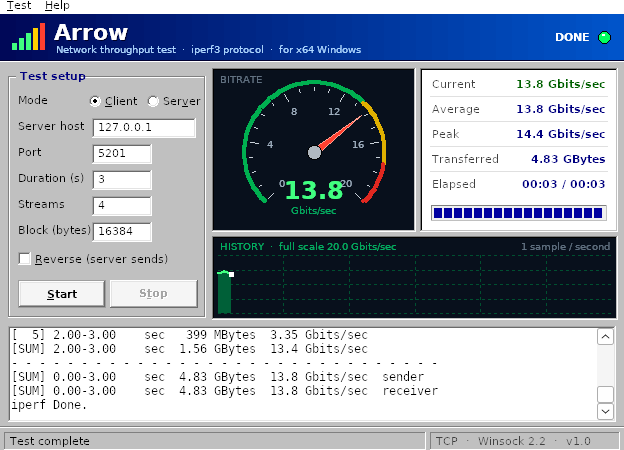

# Arrow

Arrow is an independent TCP throughput tester that speaks the iperf 3.x
control protocol. It supports client and server operation, parallel TCP
streams, and reverse mode; it does not implement UDP or bidirectional tests.
The project is not affiliated with or endorsed by the iperf3 project.

## Targets

| Executable | Platform | Network stack |
|---|---|---|
| `ARROWD.EXE` | MS-DOS / FreeDOS, 8088+ | mTCP and a packet driver |
| `ARROWM.EXE` | MS-DOS with MSCLIENT 3.0 TCP/IP | Resident Microsoft DOS sockets |
| `ARROWO.EXE` | OS/2 2.0 and later | OS/2 TCP/IP sockets |
| `ARROW16.EXE` | Windows 3.1 / WfW 3.11 | Winsock 1.1 |
| `ARROW32.EXE` | Windows 95 / 98 / ME | Winsock 1.1 |
| `ARROWN.EXE` | Windows NT 4.0 / 2000 | Winsock 2.2 |
| `ARROW64.EXE` | x64 Windows, including Windows 11 | Winsock 2.2 |

Build all targets with `docker compose run --rm build`, or choose `dos`,
`os2`, `win16`, `win9x`, `winnt` or `win64` as the make target. Binaries are
written under `build/<platform>/bin/`.
`ARROWM.EXE` is an additional, opt-in DOS build; it is not part of `all`
because it requires a user-supplied Microsoft TCP/IP Sockets SDK.

## Screenshots

| Platform | Screenshot |
|---|---|
| DOS |  |
| Windows 3.x |  |
| Windows 9x |  |
| Windows NT |  |
| x64 Windows |  |

## Usage

On DOS, load a packet driver and configure mTCP through `MTCPCFG`, then run
`ARROWD` for the interactive UI. It also accepts:

```text
ARROWD -c 192.168.1.10
ARROWD -c 192.168.1.10 -t 30 -P 2 -R
ARROWD -s
ARROWD -c 192.168.1.10 -b > LOG.TXT
```

### MSCLIENT 3.0 TCP/IP

Use `ARROWM.EXE` when Microsoft Network Client 3.0's TCP/IP stack is already
running. It uses the resident sockets API, not a packet driver or `MTCPCFG`.
The command-line options and interactive UI are the same as `ARROWD`:

```text
ARROWM -c 192.168.1.10 -t 30 -P 2 -R
ARROWM -s
ARROWM -c 192.168.1.10 -b > LOG.TXT
```

Keep your normal MSCLIENT network initialization, NDIS bindings and
`TCPTSR.EXE` startup. Enable `SOCKETS.EXE`; load `DNR.EXE` before it if you
want hostname resolution. Microsoft documents the configuration and startup
order in [KB Q128751](https://jeffpar.github.io/kbarchive/kb/128/Q128751/).
In `C:\NET\TCPUTILS.INI`, the `[sockets]` section needs `bindings=TCPIP`
(not `TCPIP_XIF`) and enough `numsockets`: at least 5 free sockets for a
four-stream client, or 6 for a four-stream server (listener, control and data).
Other applications and the redirector also consume stack resources.
Allow extra sockets and TCP connection contexts for repeated tests while
earlier connections are closing. A tested four-stream configuration uses
`numsockets=12` in `TCPUTILS.INI` and `TCPConnections=20` in the `[TCPIP]`
section of `PROTOCOL.INI`. Small resource pools can reset new connections
between tests; increasing these settings also consumes more DOS memory.
Keep the combined sockets and NetBIOS session allocation within MSCLIENT's
22-entry limit.
For DNS, the `[dnr]` section also needs `bindings=TCPIP` and the appropriate
nameserver configuration.

Arrow does not start, reconfigure or unload the Microsoft resident stack,
and closes only its own sockets. Numeric IPv4 addresses work without DNR;
SDK hostname lookups may block. The UI shows the local IP after a connection
has established it. Socket send sizes adapt to `maxsendsize` when the
resident stack rejects an oversized write; resource/buffer settings still
limit throughput and the number of parallel streams.

Both executables can be installed together. Choose the executable matching
the active DOS networking setup. Do not load competing hardware packet and
NDIS drivers for the same NIC. An NDIS-to-packet-driver shim shares adapter
access, **not** Microsoft's TCP/IP stack or DHCP configuration with mTCP.

#### Building the Microsoft backend

Supply the Microsoft TCP/IP Sockets Development Kit's `include/` tree and
`lib/dos_sock.lib`, with lower-case paths on Linux. No SDK files or Microsoft
runtime binaries are bundled or downloaded by this project. With Open Watcom
configured locally:

```sh
make msclient MSSDK=/path/to/mstcpsdk
```

Or mount your SDK read-only into the existing build container:

```sh
docker compose run --rm -v /path/to/mstcpsdk:/opt/mstcpsdk:ro build make msclient
```

The result is `build/dos/bin/ARROWM.EXE`. `MSSDK_LIB` can override the library
path. This target uses the SDK's far C calling convention and does not link
mTCP. The SDK/library and MSCLIENT retain their own licensing terms; check
those terms before redistributing a linked executable.

The backend has been cross-built/linked with Open Watcom and the Microsoft
TCP/IP Sockets SDK 1.0. Live interoperability was checked using MSCLIENT 3.0's
resident TCP/IP and sockets components on FreeDOS 1.3 under DOSBox-X:
client and server modes, forward/reverse transfers, four parallel streams,
and consecutive server tests. Throughput on real hardware depends on the
adapter, available memory and resident stack configuration.

### Windows and OS/2

The Windows builds provide a GUI for client and server modes. Use the same
TCP port (5201 by default) on both peers. Windows 9x uses the ANSI Winsock 1.1
backend; NT/2000 and x64 use Winsock 2.2.

The OS/2 build is a command-line console application for OS/2 2.0 or later
with an installed TCP/IP stack. It uses Open Watcom's OS/2 2.0 target and
TCP/IP socket import library; the OS/2 system and TCP/IP stack must be present
at runtime. For example:

```text
ARROWO -c 192.168.1.10 -t 30 -P 2 -R
ARROWO -s
```

Press Ctrl+C to stop the server. OS/2's text console is used instead of the
DOS screen UI and Windows GUI; client/server, parallel-stream and reverse
tests are supported from the command line.

## Development and licensing

`common/` contains the protocol engine, `dos/` the DOS UI and mTCP/MSCLIENT backends,
`os2/` the OS/2 console front end and TCP/IP socket backend, `win/` the
Windows UI and Winsock backend, and `tests/` protocol regression helpers.
`sh src/arrow/tests/run-host.sh` tests the protocol engine against
an installed iperf3 peer. The shared test container includes the required
compiler and peer binary.
`MSSDK=/path/to/mstcpsdk sh src/arrow/tests/run-msclient.sh` runs focused
Microsoft-backend tests on the host using your SDK headers and scripted
SDK responses; it does not require the resident DOS stack.

The Arrow source is covered by the repository MIT license. `ARROWD.EXE`
links mTCP, which retains its GPLv3 license; the build image fetches its license
alongside the sources.
