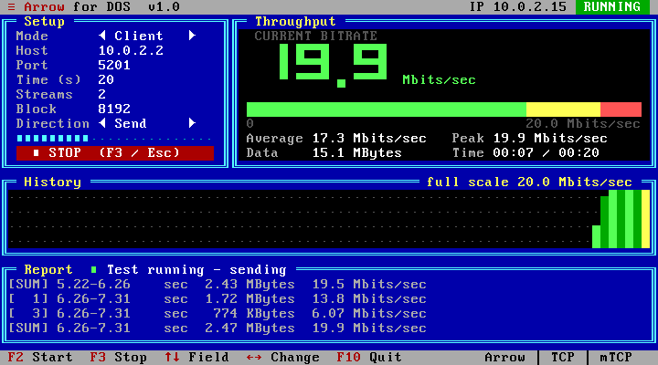
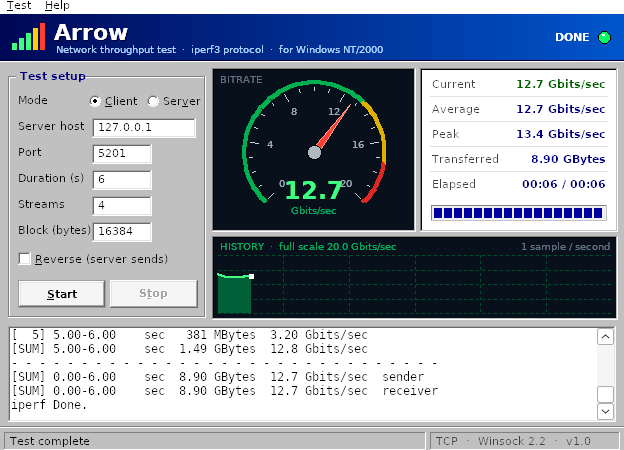

# Arrow

Arrow is an independent TCP throughput tester that speaks the iperf 3.x
control protocol. It supports client and server operation, parallel TCP
streams, and reverse mode; it does not implement UDP or bidirectional tests.
The project is not affiliated with or endorsed by the iperf3 project.

## Targets

| Executable | Platform | Network stack |
|---|---|---|
| `ARROWD.EXE` | MS-DOS / FreeDOS, 8088+ | mTCP and a packet driver |
| `ARROWO.EXE` | OS/2 2.0 and later | OS/2 TCP/IP sockets |
| `ARROW16.EXE` | Windows 3.1 / WfW 3.11 | Winsock 1.1 |
| `ARROW32.EXE` | Windows 95 / 98 / ME | Winsock 1.1 |
| `ARROWN.EXE` | Windows NT 4.0 / 2000 | Winsock 2.2 |
| `ARROW64.EXE` | x64 Windows, including Windows 11 | Winsock 2.2 |

Build all targets with `docker compose run --rm build`, or choose `dos`,
`os2`, `win16`, `win9x`, `winnt` or `win64` as the make target. Binaries are
written under `build/<platform>/bin/`.

## Screenshots

| Platform | Screenshot |
|---|---|
| DOS |  |
| Windows 3.x |  |
| Windows 9x |  |
| Windows NT |  |
| x64 Windows |  |

## Usage

On DOS, load a packet driver and configure mTCP through `MTCPCFG`, then run
`ARROWD` for the interactive UI. It also accepts:

```text
ARROWD -c 192.168.1.10
ARROWD -c 192.168.1.10 -t 30 -P 2 -R
ARROWD -s
ARROWD -c 192.168.1.10 -b > LOG.TXT
```

The Windows builds provide a GUI for client and server modes. Use the same
TCP port (5201 by default) on both peers. Windows 9x uses the ANSI Winsock 1.1
backend; NT/2000 and x64 use Winsock 2.2.

The OS/2 build is a command-line console application for OS/2 2.0 or later
with an installed TCP/IP stack. It uses Open Watcom's OS/2 2.0 target and
TCP/IP socket import library; the OS/2 system and TCP/IP stack must be present
at runtime. For example:

```text
ARROWO -c 192.168.1.10 -t 30 -P 2 -R
ARROWO -s
```

Press Ctrl+C to stop the server. OS/2's text console is used instead of the
DOS screen UI and Windows GUI; client/server, parallel-stream and reverse
tests are supported from the command line.

## Development and licensing

`common/` contains the protocol engine, `dos/` the DOS UI and mTCP backend,
`os2/` the OS/2 console front end and TCP/IP socket backend, `win/` the
Windows UI and Winsock backend, and `tests/` protocol regression helpers.
`sh src/arrow/tests/run-host.sh` tests the protocol engine against
an installed iperf3 peer. The shared test container includes the required
compiler and peer binary.

The Arrow source is covered by the repository MIT license. The DOS executable
links mTCP, which retains its GPLv3 license; the build image fetches its license
alongside the sources.
