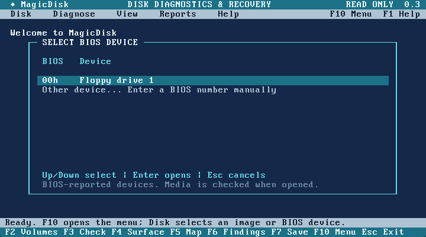
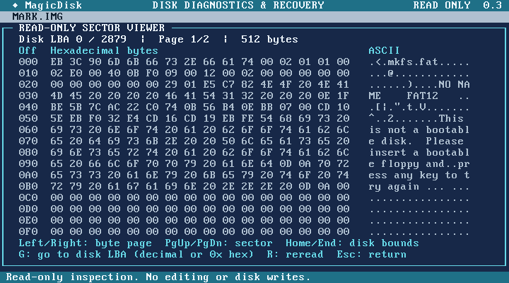
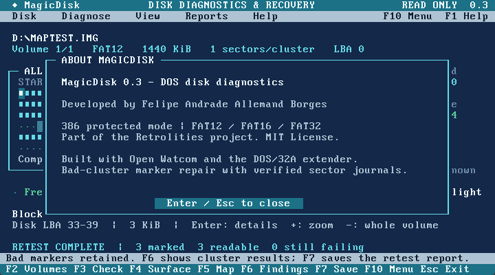
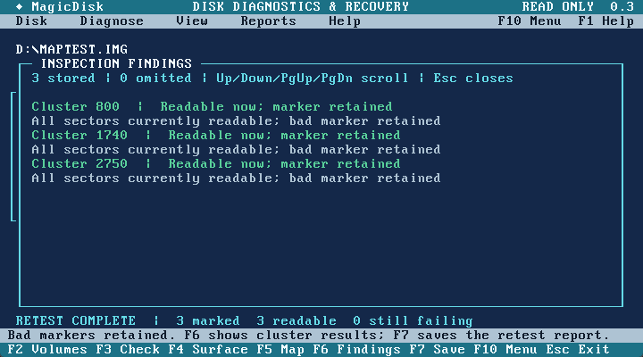
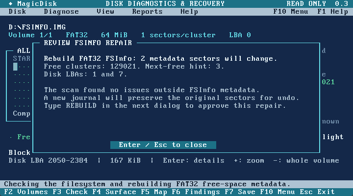

# MagicDisk

MagicDisk is a DOS disk diagnosis and repair utility in development. It has a
keyboard-driven 80-column TUI with a partition selector, cancellable
diagnostics, allocation and surface maps, menus, a status bar, and a findings
browser and a read-only hex/ASCII sector viewer. Developer: **Felipe Andrade Allemand Borges**. Bad-cluster marker and
FAT-copy, FAT32 FSInfo and backup boot sector repairs are available for disk images and
mounted MS-DOS 6.22/7.1 and FreeDOS volumes, with
sector journals and verified rollback. FAT32 primary boot recovery can restore
an unmountable image from its validated backup. Lost-chain export preserves the source and
records recovered cluster contents in separate files. Live-file export preserves
healthy file lengths and salvages damaged prefixes before repair, with UTF-8 path
mapping and sector provenance. Journaled reclaim frees lost
allocations after recovery. File repairs correct lengths and damaged chain endings
while preserving names. Directory repairs remove loops and invalid endings from
validated prefixes. Broader repair tools remain in development; this is not yet a complete
ScanDisk or Norton Disk Doctor replacement.


The screenshot shows a generated test floppy with six files and three marked bad
clusters. Map cells display actual FAT entries, not decorative or simulated data.

## Build and run

```
make PROJECTS=magicdisk dos
MAGICDSK
MAGICDSK --tui FLOPPY.IMG
MAGICDSK FLOPPY.IMG
MAGICDSK --devices
MAGICDSK --bios 00
MAGICDSK --bios 80 --partition 1
MAGICDSK FLOPPY.IMG --surface
MAGICDSK HDD.IMG --list
MAGICDSK HDD.IMG --partition 1
```

Output: `build/dos/bin/MAGICDSK.EXE`. This is a 386 protected-mode program with
the DOS/32A extender embedded. The dedicated Makefile defaults to `/opt/watcom`;
override `WATCOM` for another Open Watcom installation. No separate extender
executable is required. The executable name fits DOS 8.3 conventions.

Without a partition argument, the image must contain a filesystem beginning at
sector zero (for example, a floppy image). Partition numbers are one-based and
follow primary entries, then logical entries. `--list` lists MBR partitions;
`--partition` mounts the selected volume independently of DOS drive letters.

Exit status: **0** inspection completed without detected issues; **1** inspection
completed with issues; **2** invalid input, unsupported geometry, or incomplete
inspection. An incomplete inspection must never be interpreted as a clean disk.
Inspection opens images read-only. Marker writes require explicit approval and
a new journal file. BIOS access currently implements reads only.
Physical drives are identified by BIOS hexadecimal numbers: `00` for A, `01` for
B, and `80` for the first hard disk. Direct access requires BIOS-visible media;
Host-directory shares are not BIOS disks.

**Disk > BIOS device** lists the floppy and hard drives reported by the BIOS.
Choose a device with arrows and Enter; disks with multiple partitions then open
the volume picker. Home/End jump to the first/last entry. Enumeration does not
read media, so a listed drive can be empty or unreadable. **Other device** permits
manual hexadecimal entry when a controller does not report its drives. The CLI
equivalent is `--devices`. Enumeration uses the drive count from INT 13h AH=08h,
as documented in the [AMIBIOS technical reference](https://bitsavers.trailing-edge.com/pdf/americanMegatrends/Hi-Flex_ISA_and_EISA_Hi-Flex_AMIBIOS_Technical_Reference_1993.pdf).



## Workspace

- **F10** opens the Disk, Diagnose, View, Reports and Help menus.
- **F2** selects a primary or logical volume; **F3** checks the filesystem.
- **F4** reads every sector in the volume, including filesystem metadata.
- **F5** loads the allocation map; **F6** browses findings; **F7** saves a report.
- **F8** opens the read-only sector viewer at the selected block. It is also in
  **View > Sector viewer** and works on an opened image without a valid FAT volume.
- **Arrows** select map blocks; **Enter** shows counts and ranges. Enter again
  opens that block's first sector; **+** zooms
  into an allocation region; **-** returns to the full allocation map.
- **Esc** cancels scans and pre-write validation, closes dialogs, or exits the
  workspace. Transaction writes show **Wait** and disable cancellation.
- **Help > About** contains the developer credit and build information.
- In Findings, **Left/Right** scroll long paths horizontally; reports retain the
  complete names even when they do not fit on the screen.

The sector viewer shows 16-byte rows in hexadecimal and printable ASCII, with
nonprintable bytes shown as dots. Left/Right selects the lower or upper 256 bytes
of the sector. PgUp/PgDn changes sectors, Home/End reaches the source's first or
last sector, and G accepts a decimal LBA or a `0x` hexadecimal LBA. These are
absolute sector numbers within the opened source: a BIOS disk includes its MBR
and all partitions, whereas a DOS drive starts at that volume's sector zero.
R rereads the sector; a failed read clears the byte display and offers retry.
Esc returns to the map. The viewer has no editing or write operation.



The allocation map aggregates FAT entries into 384 blocks. Cyan squares are
allocated, green dots are free, shading indicates mixed allocation, amber Xs are
marked bad, and red exclamation marks identify unreadable or invalid entries.
Surface mode uses a separate legend and preserves pending regions after
cancellation. Each block exposes its exact range and absolute disk LBAs.
Surface failures are recorded individually as `SURFACE_READ` findings with an
absolute disk LBA, volume-relative sector, and metadata region or data cluster
and sector offset. F6 opens these findings; F7 exports tested/unreadable counts
and completion status, including cancelled scans. Up/Down selects a finding;
Page Up/Down, Home and End move through the list. F8 opens a selected surface
failure or bad-cluster retest result in the read-only sector viewer. Closing
the viewer returns to the same selected finding. Other findings are not treated
as sector addresses. The CLI `--surface` prints
these locations before its summary. Surface findings do not identify file
ownership or change bad-cluster markers.
Allocation colors do not certify the health of the owning file. Surface reads
cannot detect latent write failures. Reports preserve existing filenames and
record incomplete checks and omitted findings (the UI stores up to 512 findings).



## Bad sectors: retest, mark and unmark

The **Diagnose** menu includes **Retest marked bad**, **Mark bad sector**,
**Unmark bad sector**, and **Restore journal**. Sector inputs are absolute disk
LBAs, matching the map's block details. FAT tracks bad *clusters*, so a marker
change affects every sector in the containing cluster. The review dialog shows
that entire range before asking for confirmation.

- **Retest** reads every sector in each marked bad cluster, reports individual
  unreadable disk LBAs, and keeps all markers. It works with BIOS disks and images.
- **Mark** accepts a sector in a free data cluster. It refuses allocated clusters
  and metadata sectors; relocating files away from damaged clusters is not yet
  implemented.
- **Unmark** accepts an already marked cluster only after every sector passes a
  fresh read test. It returns the cluster to free space. Passing a read test does
  not establish long-term media health or test whether writes will succeed.
- Both marker changes require a complete filesystem check without allocation or
  ownership issues; timestamp findings are preserved. FAT
  mismatches, referenced bad/free clusters, lost allocations and other detected
  errors must be resolved first.

Marker changes update all mirrored FATs, or only the selected active FAT
when FAT32 mirroring is disabled. FAT12 neighboring nibbles and FAT32 reserved
bits are preserved. FAT32 free counts are updated in the primary and backup
FSInfo sectors. Unknown next-free hints remain valid.

Command-line examples (replace the sample cluster/LBA with your map's value):

```
MAGICDSK FLOPPY.IMG --retest-bad
MAGICDSK FLOPPY.IMG --mark-sector 372
MAGICDSK FLOPPY.IMG --mark-sector 372 --apply --journal MARK.MDJ
MAGICDSK FLOPPY.IMG --unmark-sector 372 --apply --journal UNMARK.MDJ
MAGICDSK FLOPPY.IMG --restore-journal MARK.MDJ --apply
```

`--mark-bad CLUSTER` and `--unmark-bad CLUSTER` accept cluster numbers instead of
sector LBAs. Without `--apply`, marker commands only preview the proposed change.
`--partition N` selects the target volume inside an MBR disk image. Keep writable
images unmounted and unused by other programs. The BIOS backend supports
retesting and previews. To repair physical media mounted by DOS, select
**Disk > DOS volume** or use `--drive LETTER`.

Before writing, MagicDisk rechecks the filesystem and saves complete before/after
metadata sectors in a newly created journal. It commits and rereads the journal,
then commits and verifies each disk write. A write/verification failure triggers
reverse-order rollback. Cancellation is available during preparation; once writes
begin, the transaction finishes or rolls back without cancellation.

The TUI shows separate progress phases for saving/verifying the journal, committing
repairs, rolling back failed writes, and restoring metadata. During these phases
the footer explicitly disables cancellation and queued keys are consumed, so an
Esc press cannot interrupt a commit or unexpectedly exit afterward. Restore's
journal reading, ownership revalidation, and sector checks remain cancellable;
cancelling any of them restores no sectors. Already-restored sectors still count
toward progress during repeated undo.

Keep the journal on separate storage. Restore validates its checksums, volume
identity and all affected sectors before writing. It can recover an interrupted
transaction whose sectors match either their original or planned contents, and
can be run repeatedly. Normal restore refuses unrelated later changes or a torn
sector that matches neither complete image. Journals
are retained after success or failure and existing files are never overwritten.
Repair plans grow with the number of changed metadata sectors; there is no
16-sector limit. Memory and journal-file capacity are checked before writes.
Marker journals retain version 1 compatibility. FSInfo and backup boot journals use version 2,
which records the repair type. FAT-copy repairs use version 3; older MagicDisk
builds reject these journals. Lost-allocation reclaim uses version 4 and includes
original-ownership revalidation during undo. File repairs use version 5, allowing
journaled directory sectors and validating their contents against the original
file tree before undo. Directory-chain repairs use version 6 and revalidate the
original directory ownership during undo. Primary boot recovery uses version 7,
restricting writes to sector zero and requiring an unchanged backup source.
Combined file/directory repair uses version 8 and revalidates the original tree
before undo. Selected-source FAT/tree repairs use version 9 and record the
chosen authority alongside the original metadata. Directory-entry repairs use
version 10. This build restores all ten versions.

### Recover an interrupted sector write

**Reports > Recover interrupted write** is an explicit recovery action. Its CLI
equivalent adds `--accept-torn` to an applied journal restore:

```
MAGICDSK --drive D --restore-journal C:\REPAIR.MDJ --apply --accept-torn
```

This accepts a mixed sector only when every byte matches the byte at the same
position in the journal's original or planned image. It restores the original
metadata, retaining the journal. Journal integrity, volume identity and applicable
ownership checks still run before writes; unrelated bytes are refused. Sector
checksums are recorded during validation and rechecked immediately before each
write. Cancellation remains available until restoration begins.

A matching mixture is not proof of interruption: later legitimate edits can
coincide with saved byte values. Use this action only after checking that the
journal belongs to the interrupted operation and that later changes should not
be retained. It does not force arbitrary damaged bytes, unreadable sectors or
boot identity mismatches through validation. Primary boot damage still requires
a valid recovery mount and the existing boot-source identity checks.

Tests cover mixed directory, marker, FAT-copy and FSInfo sectors on FAT12/16/32,
repeated undo, unrelated-byte and ownership refusal, cancellation, changes after
validation, and retry after write/flush failure. QEMU verifies strict refusal
followed by the explicit TUI recovery action on MS-DOS 6.22, FreeDOS and Windows
98 DOS, comparing the restored image and retained journal byte for byte.



## Rebuild damaged FAT copies

**Diagnose > Rebuild FAT copies** asks which FAT copy to keep (numbered from 1).
MagicDisk checks that source's reserved entries and follows every file and
directory through it. It refuses incomplete scans, broken chains, lost clusters,
and unrelated directory damage. A differing backup boot sector does not block
repair; the mounted primary boot sector remains authoritative. FAT32 free-space metadata is rebuilt
from the chosen source, including damaged FSInfo signatures and stale counts.

```
MAGICDSK VOLUME.IMG --repair-fat 1
MAGICDSK VOLUME.IMG --repair-fat 1 --apply --journal FATS.MDJ
MAGICDSK --drive D --repair-fat 2 --apply --journal A:\FATS.MDJ
```

The review identifies the source and changed-sector count; type `COPY` to approve
it in the TUI. The source FAT remains unchanged, and differing sectors in every
other copy are replaced byte-for-byte. File contents and directory entries are
preserved. Mirroring must be enabled; a FAT32 volume deliberately using one
active FAT is not treated as having broken mirrors.

A consistent source is not proof that it is the newest or contains the intended
file chains. The user chooses the authority explicitly; MagicDisk does not guess
between plausible copies. It revalidates that choice before writing. An already
consistent set of copies and free-space hints creates no journal.

The journal covers every changed sector, even an entire FAT. Interrupted repairs
can be undone when affected sectors still match their recorded before/after
contents. Restoration also verifies that the source FAT sectors used by the
journal have not changed. Arbitrary torn sectors still require further recovery.

## Export live files before repair

**Report > Export live files** copies files still listed in the directory tree
without modifying their source. The CLI equivalent is:

```
MAGICDSK --drive D --export-files C:\RECOVER
MAGICDSK FLOPPY.IMG --export-files C:\RECOVER
```

Choose an existing destination directory. Mounted sources require a different
DOS volume. Each export creates a new `RECxxxxx` directory with numbered `.CHK`
files and `RECOVERY.TXT`; it never overwrites an earlier export. Healthy files
retain their exact logical lengths, including empty files. Damaged files retain
their known allocated prefixes, including cluster slack, so copying does not
discard potentially useful bytes before a repair. Output parts split at 1 GiB.

The manifest's `LIVE_BEGIN` records identify source directory entries, recorded
sizes, chain endings and export mode. `path_hex` is the hexadecimal encoding of
the original UTF-8 path; it preserves long names without requiring an LFN driver
or making control characters part of the manifest syntax. `FILE_BEGIN` records
associate numbered output parts with that entry, and `DATA` records map bytes
to source sectors. Duplicate source names remain separate numbered exports.
`ISSUE` records retain each scan diagnostic, its location and a hexadecimal
UTF-8 `message_hex`. This includes damaged long-name metadata even when the file
contents can be exported intact under a short-name fallback.

Unreadable data is zero-filled and listed explicitly. Shared tails are exported
through their first scanned owner; later aliases may have empty or truncated
exports. The operation cannot infer inaccessible directory contents, recover
deleted entries, or restore missing clusters. It requires a complete directory
scan and consistent FAT copies. Inspect the manifest's scan findings count and
damage records before treating the output as a backup; empty directories and
filesystem attributes/timestamps are not recreated.

Cancellation and output failures retain partial files. A completed export has a
committed `FINAL` record; `COMPLETE_WITH_GAPS` indicates damaged prefixes or missing
data, and `COMPLETE_WITH_FINDINGS` indicates other source scan findings. CLI status
is 0 for complete without findings, 1 for complete with findings, damaged prefixes
or unreadable sectors, and 2 for incomplete/refused export. Keep the source idle.

## Recover lost chains

**Diagnose > Recover lost chains** exports allocated clusters that are not owned
by any live directory entry. The CLI equivalent is:

```
MAGICDSK --drive D --recover-lost C:\RECOVER
MAGICDSK FLOPPY.IMG --recover-lost C:\RECOVER
```

The destination directory must already exist. MagicDisk creates a new
`REC00001` directory (or the next unused number), containing `.CHK` files and
`RECOVERY.TXT`. It does not change source allocation or attach files to the
source directory. Mounted DOS sources require a destination on another volume;
open BIOS devices by DOS drive letter so this check can be performed.

Recovery first scans directory ownership and requires consistent FAT copies.
Damaged FSInfo signatures, hints or a differing backup boot sector do not block
export because they do not determine ownership; they remain unchanged on the source.
It exports each unowned cluster once, follows chain roots before cycles, and
records cycles, shared tails and links leaving the lost allocation set. Original
names and file lengths cannot be inferred from orphan allocation chains: output
contains full clusters, including any slack bytes, and shared tails are not
repeated. Files split at 1 GiB boundaries.

The manifest maps every cluster to its output file, byte offset and source
sector. Unreadable data sectors become zero-filled gaps with individual entries.
Cancellation or output failure retains partial files and an incomplete manifest;
only a successfully committed export gets a complete final record. CLI status is
0 for complete, 1 for complete with unreadable sectors, and 2 for incomplete or
refused recovery. Keep the source idle while exporting.

## Repair directory chains

**Diagnose > Repair directory chains** repairs loops and invalid chain endings
when the allocated directory prefix can be scanned completely and its entries
remain structurally valid. It supports nested FAT12/16/32 directories and the
FAT32 root directory; fixed FAT12/16 root directories have no FAT chain.

```
MAGICDSK --drive D --repair-directories
MAGICDSK --drive D --repair-directories --apply --journal C:\DIRS.MDJ
MAGICDSK --drive D --restore-journal C:\DIRS.MDJ --apply
```

Review lists the affected paths, retained cluster counts and final cluster to
terminate. In the TUI, cancel the review to inspect **F6 Findings** or export
**F7 Save report**, then rerun and type `REPAIR` to apply. Only the final FAT link
of each affected directory changes. The directory entries, long names, file
contents and bad markers are preserved; inactive FAT copies remain unchanged
when FAT32 mirroring is disabled.

The scan distinguishes a loop within one chain from a cross-link to another
owner. A later directory with a unique allocated prefix can detach its shared
tail; the first scanned owner retains the shared clusters. This changes only the
later directory's final unique FAT link. Its unique files, subdirectories and
names remain intact. The preview explicitly reports this first-owner policy.
Directories with no unique allocated prefix and damaged directory entries or
live file chains are refused. A missing or
unreadable part of a directory is not reconstructed. Other orphan allocation or
FSInfo problems can remain for their corresponding recovery/repair actions.
Tests preserve the contents of both owners, including nested subdirectories and
long names, and verify exact/partial undo, selected FAT authorities and refusal
of fully shared directories. Fault injection covers partial FAT12 writes and
rollback. Mounted-volume QEMU tests combine shared-tail detachment with directory
growth and verify the DOS cache and all journaled sectors independently.
Version 6 journals preserve original FAT sectors and validate the original
directory tree before undo, including partially committed transactions.

## Repair directory-entry metadata

**Diagnose > Repair directory entries** corrects metadata whose values follow
from the scanned directory tree. It fixes the existing `.` self-reference and
`..` parent reference (zero for a root parent), their directory attributes and
zero sizes, and nonzero sizes in subdirectory entries. A reversed leading
`..`/`.` pair is put back in order by moving the complete entries; each entry
keeps its own timestamps and reserved fields. If only one named dot entry
survives in the leading pair, it is moved to its proper position and the missing
counterpart is rebuilt with unset timestamps. If both entries have the same dot
name, the correctly placed one is retained and the duplicate is replaced by the
missing counterpart; the discarded bytes remain in the undo journal.

```text
MAGICDSK VOLUME.IMG --repair-directory-entries
MAGICDSK VOLUME.IMG --repair-directory-entries --apply --journal ENTRIES.MDJ
MAGICDSK VOLUME.IMG --restore-journal ENTRIES.MDJ --apply
```

The `ENTRY_REPAIR` preview identifies each affected directory, its entry and
prefix locations, directory size and expected self/parent clusters. Cancel the
TUI review to inspect F6 Findings or export with F7, then rerun and type `REPAIR`
to apply. Existing names, LFN slots, timestamps, file contents and FAT allocation
stay unchanged. Existing FAT12/16 reserved high-cluster words are preserved.
Rebuilt dot slots receive canonical names/attributes, the tree-derived cluster,
zero size and unset timestamps/reserved fields; deleted metadata is not reused.

Missing dot entries can be rebuilt in their required leading slots when those slots are
deleted, empty, or occupied by a duplicate dot entry. A usable dot entry in the other
leading slot can be moved while rebuilding its counterpart. When advancing an end
marker, a preexisting end marker must remain immediately after the rebuilt prefix, and
no hidden entry may be exposed. The dedicated directory-entry action can also move
ordinary file or subdirectory entries out of the leading slots into deleted or empty
slots in the directory. It tries the first sector before searching the retained chain. A
leading long-name group moves together with its short entry into contiguous free slots.
When separate space is insufficient, the group can shift into overlapping slots without
overwriting another live entry. Groups can cross sector and fragmented-cluster
boundaries; names through 255 characters are supported. The complete file and LFN
records are preserved, including their names, attributes, lengths, timestamps and
cluster references. An advanced end marker stays within the retained directory chain;
hidden entries are never exposed. The preview reports how many entries will move, and
the journal restores their original positions on undo. Child directory-size corrections
follow the relocated entry rather than its old slot. Child contents and dot pointers are
checked through the original directory tree; shared ownership still prevents applying
the plan.

Tests cover one or two displaced files, deleted slots including the sector's last
entries, advancement of an end marker, merged child-size corrections, independent
filesystem checks and exact undo on FAT12/16/32. Long-name tests also verify Unicode
paths through 255 characters, fragmented directory chains, intact record bytes and file
contents, and refusal of invalid checksums, hidden entries and groups that cannot fit.
Subdirectory tests combine short or long names with child-size and dot-pointer
corrections and reject shared children without writes. Injected failures cover
cancellation during relocation, unreadable later sectors, partial writes and rollback.
QEMU verifies review, apply, clean scan and byte-for-byte restoration under MS-DOS 6.22,
FreeDOS and Windows 98 DOS.

Invalid LFN groups, unavailable free space, dots outside the leading pair, shared
directories, inconsistent FAT copies, chain damage and other live-tree errors are
refused. Full directories may gain one or two free clusters to hold displaced
entries and an end marker. A separate ownership scan excludes clusters still
referenced by damaged files, even if their FAT entries say they are free.
Every sector in added clusters is journaled, including unchanged zero sectors,
so later edits prevent undo and original free-space bytes can be restored.
Valid FAT32 free-count hints are updated; the next-free hint is reset to unknown.
The preview reports each extension as `DIR_GROW`. No live file contents are
moved into newly allocated clusters, only directory records.

This action does not infer a missing directory attribute on an ordinary entry. Relocation beyond the first sector requires
memory for the retained directory and its relocation map; insufficient memory or an
unreadable sector stops preparation without writing. The combined tree action uses the
same relocation rules when entry problems coexist with supported file or directory-chain
damage. Later file-length, start cluster and directory-size corrections follow the
relocated records. Independent orphan allocation, timestamp findings and auxiliary FAT32
metadata do not prevent these corrections and remain for separate handling.

Version 10 journals hold the original and repaired directory sectors, any
allocation changes, and the original contents of added clusters. Apply
recomputes the plan before writing; undo reconstructs and checks the original
tree, including partially committed transactions, before restoring any sector.
Older journal versions remain supported.

## Repair the filesystem tree

**Diagnose > Repair filesystem tree** handles file-length/chain damage, unique
directory-chain loops or invalid endings, dot-entry metadata, missing dots in
leading slots (relocating intact entries within the directory when needed), and
nonzero directory sizes in one reviewed transaction. Use this when the separate
actions each refuse damage handled by another.

```text
MAGICDSK VOLUME.IMG --repair-tree
MAGICDSK VOLUME.IMG --repair-tree --apply --journal TREE.MDJ
MAGICDSK VOLUME.IMG --restore-journal TREE.MDJ --apply
```

A directory whose entire chain is already owned by an earlier scanned entry
can be replaced with an independent **empty directory**. The original shared
clusters remain with their first owner; the later path no longer exposes those
contents. MagicDisk preserves the later entry's name and timestamps, allocates
an unowned free cluster, and creates canonical dot entries with unset dates.
The preview reports `DIR_REPLACE` and explicitly says **EMPTY directory** before
confirmation. This is available through filesystem-tree repair, including a
selected FAT authority; chain-only repair still refuses directories without a
unique prefix. Missing, invalid or unreadable allocation is not treated as a
valid shared chain.

Replacement journals include every sector of the new cluster, including zero
sectors, plus the entry, FAT and valid FAT32 free-count hints. Undo restores the
original reference and free-space contents. Changes to the new directory after
repair prevent undo. Existing orphan allocation is left for separate recovery.
Tests cover multiple aliases, nested parents, parent relocation/growth, both FAT
authorities, no free space, cancellation, partial writes and exact/partial undo.

The preview lists `FILE_REPAIR`, `DIR_REPAIR`, `ENTRY_REPAIR` and `DIR_REPLACE` findings. A
directory with both chain and entry damage is counted once in the summary.
Cancel the review
to inspect them with F6 or export them with F7, then rerun and type `REPAIR` to
apply. One journal contains all affected FAT and directory sectors. Undo validates
the original ownership tree and accepts partially committed before/after sectors.

The same policies as the individual actions apply: directories retain their
unique allocated prefixes and detach shared tails from later owners. Fully
shared entries receive empty independent directories. Missing or unreadable
unshared directory prefixes,
unavailable free allocation, hidden entries and dots outside the leading
pair are refused. Reversed pairs, duplicate dots and a surviving dot in the
wrong leading slot are repaired using the same entry-preservation policy. Dot references follow the retained
tree, including zero for root parents, and directory sizes become zero. Shared regular files retain the first scanned owner; later files
may become empty. File lengths may shrink or expand to cluster boundaries.
Existing names, timestamps and file data are preserved. Newly rebuilt dot slots
have unset timestamps. Independent orphan or auxiliary
metadata findings may remain and require their corresponding actions.

## Repair a damaged tree from a selected FAT copy

**Diagnose > Repair from FAT copy** accepts an explicit source FAT number, repairs
its file/directory chains and directory-entry metadata, and copies the corrected
FAT to every enabled mirror.
Use it when FAT disagreement and tree damage prevent the separate actions from
proceeding. FAT32 FSInfo counts and next-free hints are rebuilt from that source.

```text
MAGICDSK VOLUME.IMG --repair-tree --fat-source 2
MAGICDSK VOLUME.IMG --repair-tree --fat-source 2 --apply --journal SOURCE.MDJ
MAGICDSK VOLUME.IMG --restore-journal SOURCE.MDJ --apply
```

The review and exported preview identify `FAT_SOURCE`, followed by the proposed
file and directory corrections. The selected source must have valid reserved
entries and yield a complete, repairable directory tree. Shared directories,
unreadable metadata and ambiguous directory entries are refused. Selecting a
copy does not prove it is the newest or best copy; inspect the preview and keep
needed data backed up. Orphans remain allocated for later export/reclaim, and
independent backup-boot damage remains for its own action.

The journal includes corrected directory/FAT sectors and changed FSInfo sectors.
Undo reconstructs the original selected-source tree and refuses unrelated later
ownership changes. Native image tests verify exact original-image restoration.
On mounted Windows 98 media, DOS may set the advisory FSInfo free count to
unknown while flushing a damaged primary FAT **before** the raw lock and journal
are established. The journal preserves that flushed state, not an earlier boot
image state. QEMU tests capture BIOS snapshots around the operation and verify
this transition plus exact restoration of every byte in the flushed baseline.

## Repair file chains and lengths

**Diagnose > Repair file chains** prepares corrections for regular files. The
preview reports each affected path, directory-entry location, old/new lengths,
retained cluster count and starting cluster. In the TUI, cancel the review and
use **F6 Findings** to inspect or **F7 Save report** to export these proposed
changes; mounted DOS volumes require a report destination on another volume.
Rerun the action and type `REPAIR` to apply them with a new journal. CLI examples:

```
MAGICDSK FLOPPY.IMG --repair-files
MAGICDSK --drive D --repair-files
MAGICDSK --drive D --repair-files --apply --journal C:\FILES.MDJ
```

The repair keeps the allocated prefix before a loop, shared tail, invalid link,
free cluster or bad marker. It terminates the retained prefix and clears the
starting cluster if none remains. Bad markers remain in the FAT. For a cross-link,
the first file encountered by the directory scan keeps the shared clusters;
later files keep only their unique prefixes, possibly becoming empty. This is a
stated repair policy, not proof of which file originally owned the data.

A length that does not fit the retained chain becomes its full cluster capacity
(capped at FAT's file-size limit). This can shorten a damaged file or expose
slack bytes when extending an undersized length; original lengths are not
recoverable from allocation alone. Valid lengths within the retained last
cluster stay unchanged. Back up needed data and inspect the preview first.

Only FAT links and the starting-cluster/size fields of short directory entries
change. VFAT names, aliases, attributes, timestamps and file-data sectors stay
intact. Unreferenced allocation remains available to the lost-chain exporter;
use reclaim separately after recovery. Existing FSInfo or orphan-allocation
issues may still require their own repair. Damaged directory chains, directory
metadata or inconsistent enabled FAT copies block file repair.

Version 5 journals support both fixed-root and cluster-based directory sectors.
Repair revalidates the preview before writing and rolls back failed writes.
Undo checks recorded before/after bytes and reconstructs the original file tree
in memory to validate the intended repair before restoring any sector.

## Reclaim lost allocation

After exporting needed data, **Diagnose > Reclaim lost allocation** frees clusters
not owned by live files or directories. Review the cluster/sector counts, type
`RECLAIM`, and choose a new journal on a separate volume. CLI preview and apply:

```
MAGICDSK --drive D --reclaim-lost
MAGICDSK --drive D --reclaim-lost --apply --journal C:\LOST.MDJ
MAGICDSK --drive D --restore-journal C:\LOST.MDJ --apply
```

The repair handles orphan chains, cycles, shared tails and invalid orphan links.
It requires a complete ownership scan and consistent enabled FAT copies, keeps
bad-cluster markers, and refuses damage affecting live directory ownership.
When FAT32 mirroring is disabled, only the active FAT changes. Free-space
metadata is rebuilt from the resulting allocation. No file data sectors change.

Reclaim makes the clusters available for future writes, which can overwrite
recoverable data. Export and inspect needed data first. The journal preserves
metadata only; undo cannot recover data overwritten since reclaim. Undo checks
current directory ownership against the original allocation, and refuses a
journal whose original lost clusters have acquired live owners or whose repair
no longer matches the allocation. Interrupted transactions with a mixture of before/after
sectors can be undone; arbitrary torn sectors still require further recovery.

## Rebuild FAT32 free-space metadata

**Diagnose > Rebuild FAT32 FSInfo** reconstructs the FSInfo signatures, free-cluster
count, next-free hint, and zeroed reserved bytes from a fresh filesystem scan.
It updates the primary sector and the backup when the BPB declares one. Review
shows the disk LBAs and the rebuilt counts; type `REBUILD` and supply a new
journal filename to commit. Writes support images and mounted DOS volumes.

```
MAGICDSK VOLUME.IMG --repair-fsinfo
MAGICDSK VOLUME.IMG --repair-fsinfo --apply --journal FSINFO.MDJ
MAGICDSK VOLUME.IMG --restore-journal FSINFO.MDJ --apply
```

Preview does not write. Apply rescans and refuses a changed plan, unreadable
metadata, an invalid FSInfo location, or scan findings outside FSInfo and backup-boot metadata. If both
sectors already match, no journal is created. The operation leaves FAT entries,
file contents and boot sectors unchanged. Journals restore the exact original
bytes, including damaged FSInfo signatures.

FSInfo counts are advisory. A stale backup count is tolerated by diagnostics;
invalid backup signatures and nonzero reserved bytes are reported. Rebuilding
refreshes both copies, using the selected active FAT when mirroring is disabled.



## Recover the FAT32 primary boot sector

**Diagnose > Recover primary boot** reads a selected backup sector (usually 6),
checks its geometry against the FATs and complete file/directory tree, and previews
copying its 512 bytes over the primary. Type `RECOVER` and supply a new journal
on separate storage to apply. The workspace can inspect a failed primary through
backup sector 6 and labels its map **BACKUP GEOMETRY**. Other repairs are disabled
until the primary is recovered and the volume is mounted normally.

```text
MAGICDSK VOLUME.IMG --boot-source 6
MAGICDSK VOLUME.IMG --repair-boot-primary
MAGICDSK VOLUME.IMG --repair-boot-primary --apply --journal PRIMARY.MDJ
MAGICDSK VOLUME.IMG --restore-journal PRIMARY.MDJ --apply
MAGICDSK VOLUME.IMG --boot-source 6 --restore-journal PRIMARY.MDJ --apply
```

The final command repeats undo after the primary has become unmountable again.
Use `--boot-source N` with recovery for a nondefault backup. Partition images
also accept `--partition N`; backup sector numbers are relative to the volume.
The backup must declare its own location, remain within the reserved area, and
not overlap FSInfo. Inconsistent FATs or live-tree damage block recovery.
FSInfo damage can be repaired separately after restoring the primary.

Recovery changes only the primary BPB/boot sector. It does not reconstruct
additional bootstrap sectors, prove that boot code executes, or recover when
both copies are invalid. Undo requires the backup to remain unchanged and the
primary to match either journal image. An image is required when DOS cannot
mount the damaged physical volume: BIOS-only writes remain unavailable.

## Rebuild the FAT32 backup boot sector

**Diagnose > Rebuild backup boot** copies the mounted primary 512-byte boot
sector to the backup location declared in its BPB. The review identifies source
and destination disk LBAs. Type `REBUILD` and supply a new journal to apply it.

```
MAGICDSK VOLUME.IMG --repair-boot-backup
MAGICDSK VOLUME.IMG --repair-boot-backup --apply --journal BOOT.MDJ
MAGICDSK VOLUME.IMG --restore-journal BOOT.MDJ --apply
```

The primary sector must mount successfully and remain unchanged. A complete
filesystem scan must find no issues outside backup-boot and FSInfo metadata.
Missing, overlapping and out-of-range backup locations are refused. Preview
never writes; an identical backup creates no journal. Apply rechecks the plan
and verifies the write; undo restores the exact damaged backup bytes.

This operation repairs the one sector containing the backup BPB. It does not
reconstruct the additional bootstrap sectors or recover an unmountable primary
boot sector. It does not verify that the primary bootstrap code is executable.
Physical BIOS targets support CLI preview; apply through the mounted DOS volume
or a disk image.

## Repairing simultaneous damage

FSInfo and the backup boot sector can be repaired in either order when both are
damaged. Neither determines file ownership; repairs still require a valid,
unchanged primary boot sector and valid, nonoverlapping metadata locations.

File and directory-chain repairs, lost-chain export/reclaim, and FAT-copy repair
also tolerate independent FSInfo or backup-boot damage. Correct the applicable
file/directory chains first, or export needed orphan data before reclaiming it,
then repair the remaining auxiliary metadata. FAT-copy repair still requires an
explicit source copy whose live tree is structurally consistent. Use **Repair
from FAT copy** when that selected copy also needs supported tree corrections.

Each action has its own preview and journal. Inspect remaining findings after
each stage; a successful individual action does not mean every problem is fixed.
For exact rollback of a sequence, restore its journals in reverse order. Some
combinations involving unreadable directory prefixes or unresolvable ownership still require
further repair capabilities. Use **Repair filesystem tree** for simultaneous
file-chain, directory-chain and dot-entry metadata damage when the unique
directory prefixes remain readable and any displaced entries fit within the
retained directory chain.

## Long filenames

MagicDisk reads VFAT long names directly from FAT12, FAT16 and FAT32 directory
entries, including names that cross sectors or clusters. It validates ordinal
sequences, checksums, metadata fields, terminators, padding and the 255 UTF-16
code-unit limit. File-chain findings include the reconstructed directory path.
Invalid LFN sets are reported and the associated short alias is used instead.

Diagnostic paths and saved or redirected reports use UTF-8. The DOS screen maps
available characters to VGA CP437 glyphs and shows `?` for unavailable glyphs;
the original Unicode remains intact in exported reports. Short-name bytes
outside ASCII are escaped when no valid LFN exists, because FAT does not record
the OEM code page that created an alias. Directory `.` and `..` links, their
positions and attributes, directory sizes, and volume-label placement are also
checked. Per-directory name indexing detects duplicate DOS aliases, exact Unicode
LFNs, ASCII case-insensitive long names, and collisions between an alias and
another entry's long name. An entry's own alias/LFN pair is accepted, as are the
same names in different directories. Conflicts report the first entry's disk
sector and byte offset, and block ownership-sensitive repairs; inspection never
renames or deletes either entry. Non-ASCII case equivalence depends on the
original locale/code page and is not guessed. Timestamp validation remains
unfinished.

LFN handling does not require DOS interrupt 21h long-filename services, which may
be absent in real DOS mode. Existing marker and FSInfo repairs preserve directory
entries and names. For image/report/journal *host paths* in real DOS, use names
accessible to that DOS environment (normally their 8.3 aliases).

## Repair mounted DOS volumes

**Disk > DOS volume** opens a drive letter, including a floppy or a FAT16/FAT32
partition mounted by DOS. All existing repair commands then use DOS absolute
sector I/O with exclusive volume and raw-access locks. The equivalent CLI is:

```
MAGICDSK --drive D
MAGICDSK --drive D --mark-bad 1000
MAGICDSK --drive D --mark-bad 1000 --apply --journal A:\MARK.MDJ
MAGICDSK --drive D --unmark-bad 1000 --apply --journal A:\FREE.MDJ
MAGICDSK --drive D --restore-journal A:\MARK.MDJ --apply
```

Replace the sample cluster with the value found on your own map. In this mode,
sector numbers are relative to the selected volume; sector zero is its boot
sector. `--partition` and `--list` do not apply to a drive letter. BIOS device
selection still exposes MBR partitions directly, but remains read-only.

Mounted-volume inspection supports MS-DOS 6.22, FreeDOS and MS-DOS 7.1 in real
DOS mode. QEMU checks cover MS-DOS 6.22 and FreeDOS 1.4 FAT12/FAT16 reads,
long-name diagnostics, BIOS inspection, the TUI and image marker repairs with undo.
MS-DOS 6.22 uses INT 25h with an explicit media check to establish floppy geometry.
FreeDOS uses its extended absolute-sector service. Mounted-volume writes support
MS-DOS 6.22, FreeDOS and DOS 7.1, as supplied by Windows 95 OSR2/98. MS-DOS 6.22
supports FAT12/FAT16; FAT32 requires FreeDOS or DOS 7.1. Desktop DOS windows are
refused by this backend.

The journal path must resolve to a different local DOS volume; use separate
physical storage when possible. DOS canonicalizes paths before this check, so a
relative filename on the target volume is also refused. The check establishes
separate volumes, not separate physical devices. Keep reports off the target too.

Windows 98 writes acquire lock levels 0 and 4, use `INT 21h/7305h`, and invalidate the DOS
volume state before flushing, preventing stale FAT32 free-space hints from
replacing the journaled values. Both locks are released after commit or rollback.
Critical DOS I/O errors fail the operation instead of waiting at an
Abort/Retry/Fail prompt. A flush/unlock failure is reported as a failure.

MS-DOS 6.22 uses INT 26h writes and Reset Disk to refresh kernel buffers. QEMU
tests cover mounted FAT12 floppies and FAT16 partitions, marker changes and
retests, exact undo, free-space counts and subsequent DOS file allocation.
Mounted directory-growth tests also cover FAT12 and FAT16.
It has no Windows-style volume locks. FreeDOS simulates those calls, so MagicDisk
does not treat them as exclusive locks. In real DOS mode it flushes pending buffers before raw writes,
uses FreeDOS's absolute-write cache invalidation, and rebuilds the DPB before
flushing afterward. QEMU tests cover mounted FAT16/FAT32 marker changes, readable
bad-cluster retests, exact journal undo and updated DOS free-space counts.
Mounted directory-growth tests cover FAT12, FAT16 and FAT32. An
additional cache test copies and reads back an 8 MiB file while a bad cluster is
marked, checks that the marker remains intact, then deletes the test file.
Directory-growth tests first read the original directory through DOS to populate
its caches, repair through the mounted-volume interface, then copy a file using
its relocated directory entry. Independent BIOS reads verify every journaled
sector, including unchanged sectors in newly allocated clusters. DOS free-space
queries must decrease by the exact allocation and return to the original value
after undo; the entire source volume must also match its original bytes.
The `--shared-prefix` variant also makes the full directory point into an earlier
owner's directory chain. It verifies shared-tail detachment and growth together.
The `--empty-alias` variant repairs fully shared directory references, enters the
new empty path through DOS, verifies the original owner's contents, and checks
free-space counts and exact undo. The `--alias-ui` variant exercises the FAT16
interactive flow: cancel a review, export its preview, check the EMPTY-directory
warning, confirm the repair, and rescan. It passed under MS-DOS 6.22, FreeDOS,
and Windows 98 DOS. The `test-compat` and `test-win98` targets include these
matrices and the interactive check. Both QEMU boot helpers accept a raw boot image or a `.7z` archive containing one `.img` file.

Run repairs without disk-writing TSRs or other background disk users. Source
drive substitutions and remote journal volumes are refused.

The absolute-sector interface is described in
[Microsoft KB 174569](https://www.betaarchive.com/wiki/index.php/Microsoft_KB_Archive/174569).
The test-only `LOCKTEST.EXE` records the actual guest's lock/reset capabilities in
`build/magicdisk-test/win98-locks.txt`; unsupported physical-lock and Windows LFN
reset calls are not silently treated as successful.

## Windows 9x DOS mode

The DOS executable has been tested by booting a Windows 98 Second Edition DOS
disk (version **4.10.2222**) in QEMU with HIMEM enabled. Tests cover the embedded
DOS/32A extender, BIOS floppy and FAT16/FAT32 partition access, Unicode LFN report
export from the TUI, FAT32 logical partitions, all menu/device/repair UI tours,
image-based marker/FSInfo/backup boot repairs, and mounted FAT12/16/32 marker
changes with BIOS retests and journal undo. Mounted FAT32 FAT-copy, FSInfo and backup boot repairs also pass independent
BIOS scans and exact whole-volume undo. Mounted directory growth also passes on
FAT12, FAT16 and FAT32.
The BIOS backend remains read-only. Windows 95 and Windows desktop DOS windows
have not yet been separately verified.

To repeat this test with your own licensed boot image:

```
make -C src/magicdisk test-win98 WIN98_BOOT="/path/to/Windows 98 Boot.img"
```

`WIN98_BOOT` also accepts a `.7z` archive containing exactly one `.img` file;
reading an archive additionally requires `7z` or `7zz`.

This optional test requires QEMU and mtools. It works on a temporary copy of the
boot image and generated hard disks, and verifies that the original image or
archive's checksum is unchanged. No Windows system files are included in this repository.

To run the MS-DOS 6.22 or FreeDOS compatibility checks with bootable floppy images:

```
make -C src/magicdisk test-compat DOS_BOOT="/path/to/Disk1.img" DOS_KERNEL=msdos622
make -C src/magicdisk test-compat DOS_BOOT="/path/to/x86BOOT.img" DOS_KERNEL=freedos
```

The FreeDOS test uses the boot disk from the FreeDOS 1.4 Floppy Edition. These
tests use QEMU and temporary media copies, and verify that marker repair followed
by journal undo restores an image byte for byte. Both targets run mounted
FAT12/FAT16 repair and undo, cache and file-allocation checks, and write-protected
floppy failures. Combined tree tests inject file-chain, directory-chain and dot-entry
damage together. They compare repaired sectors through independent BIOS reads,
verify journal before/after bytes and exact whole-volume undo, and check that DOS
can copy a repaired file at its corrected length after caching its directory before
repair. FreeDOS additionally tests mounted FAT32 repairs and allocation.

## Implemented

- FAT12, FAT16 and FAT32 BPB validation, including extent and FAT capacity checks.
- MBR primary and EBR logical partitions; bounds, overlap and cycle checks.
- Recursive directory traversal using a queue, including FAT32 root chains.
- VFAT long-name validation and UTF-8 diagnostic paths; dot-entry and parent-link checks.
- File chain length, cross-link/loop and invalid allocation checks.
- Lost allocated cluster, free cluster and bad cluster counts.
- FAT mirror comparison, respecting FAT32 active-FAT selection.
- FAT32 primary/backup FSInfo signatures and reserved bytes; primary count and
  hint bounds; backup boot comparison and journaled FSInfo repair.
- FAT12 entries spanning two sectors.

The implementation follows the on-media structures in the
[Microsoft FAT specification](https://www.scs.stanford.edu/~zyedidia/docs/_other/fat.pdf).

## Timestamp diagnostics

Directory checks report `DIR_TIMESTAMP` for invalid encoded creation/write times,
creation fractions outside 0–199, and nonzero creation/access/write dates with an
invalid month or day. Calendar checks include leap years: 2000 permits February
29; 2100 does not. Findings identify the entry name, field, raw value, disk sector
and byte offset. Files, directories, and dot entries are checked; LFN slots,
deleted entries and volume labels are excluded.

Zero dates are treated as unavailable legacy metadata, including a zero write
date. Midnight is valid. MagicDisk does not infer chronological relationships
between the fields or invent replacement timestamps. These findings do not block
allocation repairs or lost-chain export because they do not change ownership;
repair operations preserve the timestamp bytes. This follows the encoded field
ranges in section 6.3 of the Microsoft FAT specification linked above, with the
explicit zero-date compatibility allowance described here.

## Remaining work

- Writes to BIOS-only/unmounted volumes; broader DOS and hardware compatibility.
- Recovery of torn sectors containing bytes absent from both journal images or with unresolvable boot identity.
- Reconstruction of missing/unreadable directory contents, unresolved ownership, and broader directory recovery.
- Non-ASCII case-equivalence checks, timestamp correction, and richer findings.
- Deleted-file recovery and extended hardware/emulator compatibility coverage.

Current limits: 512-byte sectors; MBR rather than GPT. BIOS access supports CHS
and extended LBA reads. The DOS C runtime image backend currently supports
offsets through 2 GiB minus one;
larger reads fail explicitly. The native test backend supports large-file offsets.
A successful scan describes implemented checks only; it does not certify every
filesystem invariant or guarantee the absence of future media failures. FAT
mirror comparisons include padding bytes, and backup comparisons include the
complete boot sector. DOS journal commits use DOS 3.3+
[INT 21h/AH=68h](https://fd.lod.bz/rbil/interrup/dos_kernel/2168.html).

## Tests

```
make -C src/magicdisk test
make -C src/magicdisk test-dos WIN98_BOOT="/path/to/Windows 98 Boot.img"
```

Requires a host C compiler, Python 3, dosfstools and mtools. Tests generate independent
FAT12/16/32 filesystems, add file entries and inject lost chains, loops, mirror
mismatches, invalid BPBs, overlapping partitions and cyclic EBR links. The C
fault-injection tests cover map range coverage, zoom, failed reads and cancellation.
All MagicDisk emulator testing uses QEMU. `test-dos` and `test-win98` run the same
suite with a temporary copy of the supplied boot disk and generated hard disks.
The suite exercises mounted-volume repairs with BIOS verification and BIOS
floppy access, FAT16 primary/FAT32 logical partitions, surface reads and TUI
keyboard navigation, marker commits, retests, FSInfo/backup boot repair and
journal restoration. The compatibility suite also retests eight marked clusters,
checks selected-row and page navigation, opens the selected cluster in the sector
viewer, returns to the same row, exports the retest report, and verifies that the
entire inspected image remains unchanged. Lost-chain export runs through both the CLI and TUI, with
independent payload checks and a full source-volume comparison. Lost-allocation
reclaim has CLI/TUI repair and undo tests, plus FAT12 sector-boundary write-fault
checks and ownership-change refusal tests. File repairs cover chain loops,
cross-links, invalid endings and length mismatches, with exact expected images,
large directory journals, Unicode name preservation and partial-write rollback.
Directory repairs test self/interior loops, invalid endings, FAT32 root chains,
active-FAT selection and refusal of cross-linked owners; QEMU exercises preview,
report export, repair and exact undo through the CLI and menus. It compares
disk hashes to ensure inspection is read-only and restoration reproduces the
original image. Fault injection covers failed reads, partial writes, failed syncs,
rollback failure, stale plans, damaged journals and interrupted transactions.
Timestamp tests cover date/time boundaries, leap-century rules, unset legacy
stamps, Unicode findings and preservation through each repair family. The QEMU
LFN tour verifies timestamp findings in its exported DOS report.
FSInfo tests also cover full volumes, absent backups, active FAT selection,
unrelated structural damage, no-op repairs, and independent `fsck.fat -n` validation.
Backup boot tests verify exact sector changes, non-default backup locations,
partition offsets, journal extent/content guards and primary-sector changes.
Primary recovery tests include missing signatures/BPBs, explicit backup mounting,
nondefault sources, exact repeated undo, partial-write/flush rollback, and
Windows 98 DOS CLI/TUI recovery in QEMU.
FAT-copy tests destroy entire FAT12/16/32 copies, repair from either source,
exercise journals larger than 16 sectors, and verify partial-write rollback,
interrupted undo, invalid sources, and independent filesystem checks.
LFN tests use mtools-created trees, including nested Unicode paths, 255-character
names and cross-cluster sequences, then inject isolated directory corruptions.

The sources use the repository's four-space C style, expanded conditionals, and
separated function definitions. A local `.clang-format` records these conventions.

The DOS tests build a separate 16-bit resident helper, `KEYPLAY.EXE`. It waits for
specific text and selection colors on the real VGA screen before injecting each
BIOS key. Its timer handler performs no DOS calls or disk writes. This exercises
the production MagicDisk executable without fixed typing delays or test hooks.
Every emulator process must exit successfully; UI return markers, exported
reports, repair results and image hashes are checked. A write-protected floppy
checks critical-error handling without interactive prompts. The helper is a test tool,
not part of the MagicDisk executable.

Combined-chain tests cover FAT12/16/32 exact writes, partition offsets, changed
ownership, forged journals, partial undo and injected FAT/directory write failures.
The QEMU suite exercises preview/export, CLI/TUI commit and exact volume undo.

Selected-source tests cover either FAT authority, large journals, FAT32 hint
rebuilds, interrupted writes and undo. A test-only SECTGET helper reads BIOS
sectors to distinguish DOS pre-lock hint normalization from repair writes.

Transaction tests verify notification order/counts, incomplete commit progress on
write failure, rollback completion, cancellation before restore mutations, and
repeated undo. The QEMU keyboard tour presses Esc during commit and restore,
cancels restore validation, and verifies the resulting complete/cancelled states.

Directory-entry tests inject dot pointers/attributes/sizes and parent-entry sizes
on independent FAT12/16/32 trees. They verify exact expected bytes, Unicode names,
reserved-word/timestamp preservation, independent fsck checks, partial/repeated
undo, forged journals and changed ownership. Fault injection covers cancelled
scans, unreadable metadata, torn writes and sync-failure rollback. The QEMU tour
covers CLI and TUI review/export/apply, BIOS verification and exact whole-volume
undo under Windows 98 DOS.

Combined tree tests include simultaneous file-chain, directory-chain and dot-entry
metadata damage on FAT12/16/32, both explicit FAT authorities, entry-only tree
repair, FAT32 active-FAT selection and partition offsets. They check exact sectors,
partial/repeated undo and relocation of leading files or subdirectories, including
intact LFN groups and subsequent file-size/start-cluster corrections. Fault injection
exercises merged changes in a shared directory sector, torn writes at every patch,
rollback and cancellation. QEMU verifies combined CLI/TUI preview, report export,
repair and exact undo, including a damaged primary FAT with a selected backup.

Missing-dot tests cover deleted slots and end markers in empty directories on
FAT12/16/32, nested parent references, combined chain damage and explicit selection of
FAT copy 2. Exact expected bytes verify unset new timestamps and preservation
of all existing directory contents. Undo covers partially committed transactions;
unavailable free allocation and hidden entries are refused without writing. The QEMU
`--missing-dots` tour verifies CLI/TUI preview/export, rebuilding deleted dot
slots, BIOS scans and exact whole-volume restoration under Windows 98 DOS.

Dot-order tests verify reversed leading pairs on FAT12/16/32 with distinct dates
and reserved words, simultaneous metadata/chain damage, explicit FAT authority,
independent fsck validation and exact partial/repeated undo. The scanner separates
leading-pair order errors (`DIR_DOT_ORDER`) from misplaced dots elsewhere
(`DIR_DOT_POSITION`); extra dots outside the leading pair remain refused. Fault injection
covers torn writes and rollback, and the QEMU `--dot-order` tour verifies
CLI/TUI preview/export, repair, BIOS checks and exact undo under Windows 98 DOS.

The leading-pair matrix tests both duplicate names, a single surviving dot in
either slot, reversed pairs and deleted slots on FAT12/16/32. Expected bytes
specify which entry survives, with distinct timestamps/reserved words to detect
accidental reassignment. Tests exercise both repair actions, simultaneous chain
damage, selected FAT authority and partial undo. Fault injection covers duplicate
replacement and rollback. The QEMU `--dot-pairs` tour covers duplicate replacement
and movement of a survivor through CLI/TUI preview, export, repair and exact undo.

Sector-viewer QEMU tests check actual boot bytes and signatures, both byte pages,
ASCII rendering, first/last-sector boundaries, decimal/hex jumps, invalid LBAs,
reread, and access through F8, the View menu and block details. They cover an
image, a BIOS disk selected through a FAT32 logical partition, and a one-sector
unformatted image, then compare source hashes and the FAT32 volume byte for byte.
Run the focused tour with `tests/test_win98.py MAGICDSK.EXE BOOT.IMG --viewer`;
the full QEMU target includes it.

Live-file export tests compare FAT12/FAT16/FAT32 contents, empty files, original
UTF-8 paths and damaged-prefix lengths while checking unchanged source bytes.
Fault tests cover unreadable data, cancellation, FAT read failure, destination
refusal and output-size limits; sanitizer runs cover the export path. QEMU checks
the CLI and Report-menu action under MS-DOS 6.22 and FreeDOS, and the Report-menu
action under Windows 98 DOS, including retained manifests and source hashes.
