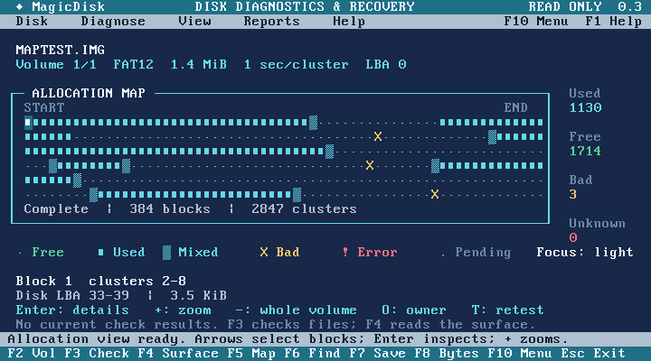
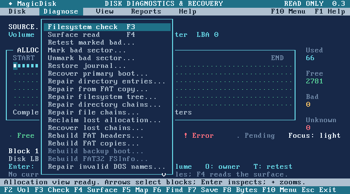
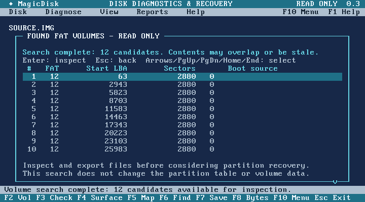

# MagicDisk

MagicDisk is a DOS disk diagnosis and repair utility for FAT12, FAT16 and
FAT32. It has a keyboard-driven 80-column TUI with a partition selector,
cancellable diagnostics, allocation and surface maps, menus, a status bar, a
findings browser and a read-only hex/ASCII sector viewer. Developer: **Felipe
Andrade Allemand Borges**.

It covers the core of what ScanDisk and Norton Disk Doctor do — one-step
automatic repair, cross-linked file copies, lost chains saved as `FILEnnnn.CHK`,
surface and write tests with bad-cluster retirement, partition and boot-record
recovery — and adds what neither offered: every write is planned, previewed,
journaled to separate storage, verified, rolled back on failure and undoable
later, even after an interrupted write. Repairs work on disk images, mounted
MS-DOS 6.22/7.1 and FreeDOS volumes, and unmounted IDE partitions via the BIOS.
Limits compared with the originals: directories stored compressed inside
DoubleSpace/DriveSpace volumes are not expanded (MagicDisk never decompresses),
and Stacker volumes are not recognized. GPT and sector sizes other than 512 bytes are unsupported; neither
DOS-era tool handled them either.

| Capability | ScanDisk | Norton Disk Doctor | MagicDisk |
|---|---|---|---|
| FAT, directory, file-size, chain and cross-link checks | Yes | Yes | Yes, plus FAT headers, mirrors, dot entries, timestamps, attributes, labels and VFAT names |
| One-step automatic repair | `/AUTOFIX` | `/QUICK`, auto-fix | `--autofix` / **F9**; re-planned and verified after every step |
| Cross-linked files | Copy or delete | Copy | Private copies for every later owner; unreadable shared data refused, not guessed |
| Lost chains | `FILEnnnn.CHK` or free | `FILEnnnn.CHK` or free | `FILEnnnn.CHK` (keeps deleted entries for undelete; grows a full FAT32 root), free, keep, or export elsewhere |
| Surface test | Read (Windows 95 thorough mode adds write testing) | Read tests (pattern tests live in Calibrate) | Read of every sector; non-destructive free-space write test; per-sector findings with owners |
| Bad clusters | Mark, move readable data | Mark, move data | Mark, relocate (3 read attempts), optional zero-filled salvage, retest, unmark |
| Undo | Undo disk for the last run | Undo file for the last run | Per-step verified journals, exact undo, interrupted-write recovery |
| Partition table and boot record | Boot sector only | Yes | MBR/EBR/extended-container reconstruction, lost-volume search, FAT32 boot and backup recovery |
| Data rescue before repair | No | No | Live-file, lost-chain, orphan-directory and deleted-file export to another disk |
| DoubleSpace/DriveSpace volumes | Check and repair | Check and repair | `--cvf FILE [--repair]` / **Fix > Check compressed volume**: MDBPB, stamps, MDFAT vs FAT, heap cross-links (data copied), tags, BitFAT, inner chains, sizes, cross-linked files and lost chains; journaled with exact undo |
| CMOS setup check | No | Yes | `--cmos` / **Fix > CMOS check**: battery, POST status, checksum, clock/calendar, floppy and memory agreement; read-only |
| Long filenames and code pages | Windows 95 version | Later versions | VFAT with UTF-8 reports; CP437/850/852/860/866 aliases |



The screenshot shows a generated test floppy with six files and three marked bad
clusters. Map cells display actual FAT entries, not decorative or simulated data.



Menus size to their labels and scroll above the status bars. The highlighted
heading identifies the open menu; arrow indicators show additional items.

## Build and run

A self-contained development bundle can be built with
`make -C src/magicdisk package`. The result is
`build/dos/dist/MAGICDSK.ZIP`, containing the executable, an ASCII quick-start
`README.TXT`, MIT/DOS32A/Open Watcom/Unicode notices and `SHA256.TXT` checksums.
All archive members have DOS 8.3 names; text uses CRLF line endings. The ZIP uses
standard deflate without Zip64, encryption or long filenames. It contains no
operating system, boot image or proprietary driver. Identical inputs with the
same packaging tools produce identical archive bytes.

`make -C src/magicdisk test-package DOS_BOOT="..." DOS_KERNEL=msdos622`
(also `freedos` or `win98`) validates the archive and runs its packaged executable
in QEMU, checks CLI help and the About/developer credit, reads the guide through
DOS, and verifies payload files remain byte-identical. This is a development
bundle, not a claim that all remaining replacement features are complete.

```
make PROJECTS=magicdisk dos
MAGICDSK
MAGICDSK --tui FLOPPY.IMG
MAGICDSK FLOPPY.IMG
MAGICDSK --devices
MAGICDSK --bios 00
MAGICDSK --bios 80 --partition 1
MAGICDSK FLOPPY.IMG --surface
MAGICDSK HDD.IMG --list
MAGICDSK HDD.IMG --partition 1
```

Output: `build/dos/bin/MAGICDSK.EXE`. This is a 386 protected-mode program with
the DOS/32A extender embedded. The dedicated Makefile defaults to `/opt/watcom`;
override `WATCOM` for another Open Watcom installation. No separate extender
executable is required. The executable name fits DOS 8.3 conventions.

Without a partition argument, the image must contain a filesystem beginning at
sector zero (for example, a floppy image). Partition numbers are one-based and
follow primary entries, then logical entries. `--list` lists MBR partitions;
`--partition` mounts the selected volume independently of DOS drive letters.

Filesystem checks validate reserved FAT entries 0 and 1 as well as allocation
links. Identical corruption in every FAT header is reported as `FAT_HEADER`,
even when the FAT copies match. Findings identify the copy and absolute disk
LBA. FAT16/FAT32 clean-shutdown and I/O-error flag bits are preserved and are
not treated as malformed reserved bits. FAT32 high reserved nibble bits are
ignored; when mirroring is disabled, only the selected active FAT is checked.
A header problem blocks unrelated repairs. A valid authoritative FAT copy can
repair another copy's header through the existing journaled FAT-copy repair.

When every copy has header damage, `--repair-fat-headers` or **Diagnose >
Rebuild FAT headers** reconstructs reserved entries from the BPB media byte.
The proposed result must pass allocation and directory ownership checks;
remaining mirror disagreements are refused. FAT16/FAT32 status flags and
FAT32 high reserved bits are retained. With mirroring disabled, only the active
FAT is changed. A recognized media descriptor (F0 or F8 through FF) is required.
This operation uses journal version 15, supports exact undo and interrupted-write
recovery, and does not change allocated file data. Preview first, then use
`--apply --journal HEADERS.MDJ` to apply it with a new journal on a separate disk.

`make -C src/magicdisk test-fat-headers DOS_BOOT="..." DOS_KERNEL=msdos622`
(also `freedos` or `win98`) tests identical header damage, refused marker writes,
authoritative-copy repair, header reconstruction through CLI and TUI, injected
write-failure rollback, and exact journal undo in QEMU. Native
tests also cover media-byte mismatches, status-bit combinations, active FATs,
and reserved allocation values at the FAT12 size limit.

Exit status: **0** inspection completed without detected issues; **1** inspection
completed with issues; **2** invalid input, unsupported geometry, or incomplete
inspection. An incomplete inspection must never be interpreted as a clean disk.
Inspection opens images read-only. Marker writes require explicit approval and
a new journal file. BIOS repairs are available through the CLI and menus for unmounted
IDE partitions; see [BIOS writes](#bios-writes-and-tests).
Physical drives are identified by BIOS hexadecimal numbers: `00` for A, `01` for
B, and `80` for the first hard disk. Direct access requires BIOS-visible media;
Host-directory shares are not BIOS disks.

**Disk > BIOS device** lists the floppy and hard drives reported by the BIOS.
Choose a device with arrows and Enter; disks with multiple partitions then open
the volume picker. Home/End jump to the first/last entry. Enumeration does not
read media, so a listed drive can be empty or unreadable. **Other device** permits
manual hexadecimal entry when a controller does not report its drives. The CLI
equivalent is `--devices`. Enumeration uses the drive count from INT 13h AH=08h,
as documented in the [AMIBIOS technical reference](https://bitsavers.trailing-edge.com/pdf/americanMegatrends/Hi-Flex_ISA_and_EISA_Hi-Flex_AMIBIOS_Technical_Reference_1993.pdf).


## Workspace

Allocation-map errors include unreadable FAT entries and invalid/reserved FAT
values. Reserved values remain errors even near the largest FAT12/FAT16 volume
sizes, where their numeric values overlap the cluster-number range. An invalid
map range clears the previous map instead of leaving stale cells visible.
`make -C src/magicdisk test-map-dos DOS_BOOT="..." DOS_KERNEL=msdos622`
(also `freedos` or `win98`) runs the production map implementation against
synthetic FAT12/16/32 boundary values, read faults, cancellation and range checks
inside QEMU; no physical source is written by this test.

- **F10** opens the Disk, Diagnose, View, Reports, Help and Fix menus.
  Arrows choose menus/items; Home/End select the first/last item, Page Up/Down
  move through long menus, Enter opens the action, and Esc closes the menu.
  Menus fit their longest label and scroll above the two bottom status bars.
- **F2** selects a primary or logical volume; **F3** checks the filesystem.
- **F4** reads every sector in the volume, including filesystem metadata.
- **T**, or **View > Retest map block**, reads only the selected block. On an
  allocation map this tests every sector in its cluster range; on a surface map
  it tests the displayed sector range, including metadata if selected. The new
  map and findings replace the previous results. `RANGE COMPLETE` means only
  that range finished; F7 reports its volume sectors and absolute disk LBAs.
  Switching back with F5 preserves this range summary. No markers are changed.
- **F5** loads the allocation map; **F6** browses findings; **F7** saves a report.
- **F9**, or **Fix > Automatic repair**, plans and commits every applicable
  repair with one journal per step. The **Fix** menu also offers automatic
  repair with a surface scan, cross-link copies and lost-chain conversion.
- **O** opens the cluster-owner viewer; **View > Cluster owner** offers the same action.
- **F8** opens the read-only sector viewer at the selected block. It is also in
  **View > Sector viewer** and works on an opened image without a valid FAT volume.
- **Arrows** select map blocks; **Enter** shows counts and ranges. Enter again
  opens that block's first sector; **+** zooms
  into an allocation region; **-** returns to the full allocation map.
- **Esc** cancels scans and pre-write validation, closes dialogs, or exits the
  workspace. Transaction writes show **Wait** and disable cancellation.
- **Help > About** contains the developer credit and build information.
- In Findings, **Left/Right** scroll long paths horizontally; reports retain the
  complete names even when they do not fit on the screen.
- **P** in Findings opens the existing repair workflow for supported filesystem
  issues: file lengths, chain damage, cross-links (copied, not truncated), lost
  clusters (adopted as `.CHK` files), dot metadata/directory sizes, timestamps,
  reserved FAT headers, FAT-copy disagreements, FSInfo, and backup/primary boot
  metadata. The footer advertises this action only when available. The preview
  covers the volume's applicable issues, not just the selected entry. It still
  requires the normal review, typed confirmation and separate journal before
  any write. FAT-copy conflicts require an explicit authority selection.
  Unsupported findings and proposed-change lists do not offer this shortcut.

The sector viewer shows 16-byte rows in hexadecimal and printable ASCII, with
nonprintable bytes shown as dots. Left/Right selects the lower or upper 256 bytes
of the sector. PgUp/PgDn changes sectors, Home/End reaches the source's first or
last sector, and G accepts a decimal LBA or a `0x` hexadecimal LBA. These are
absolute sector numbers within the opened source: a BIOS disk includes its MBR
and all partitions, whereas a DOS drive starts at that volume's sector zero.
R rereads the sector; a failed read clears the byte display and offers retry.
Esc returns to the map. The viewer has no editing or write operation.


The allocation map aggregates FAT entries into 384 blocks. Cyan squares are
allocated, green dots are free, shading indicates mixed allocation, amber Xs are
marked bad, and red exclamation marks identify unreadable or invalid entries.
Surface mode uses a separate legend and preserves pending regions after
cancellation. Each block exposes its exact range and absolute disk LBAs.
Surface failures are recorded individually as `SURFACE_READ` findings with an
absolute disk LBA, volume-relative sector, and metadata region or data cluster
and sector offset. F6 opens these findings; F7 exports tested/unreadable counts
and completion status, including cancelled scans. Up/Down selects a finding;
Page Up/Down, Home and End move through the list. F8 opens a selected surface
failure or bad-cluster retest result in the read-only sector viewer. Closing
the viewer returns to the same selected finding. Other findings are not treated
as sector addresses. The CLI `--surface` prints
these locations before its summary. Surface findings do not identify file
ownership or change bad-cluster markers.
Allocation colors do not certify the health of the owning file. Surface reads
cannot detect latent write failures. Reports preserve existing filenames and
record incomplete checks and omitted findings. The findings list grows as needed
until memory is exhausted; it has no fixed 512-entry limit. If allocation fails,
the workspace retains earlier findings and counts subsequent omitted entries.
Saving a report commits the file before reporting success and refuses to
overwrite an existing file.

The summary row retains the last surface scan's tested/total and failed-sector
counts when switching back to the allocation map. Incomplete checks and surface
scans use amber rather than a success color. Repair previews explicitly say
that no repair has been applied; salvage previews also identify zero-filling.
After a repair or source change clears the results, the row prompts for a fresh
check instead of displaying an earlier scan as current.

`make -C src/magicdisk test-findings-capacity DOS_BOOT="..." DOS_KERNEL=msdos622`
checks 700 findings, browsing to the last entry, repeated scans, complete report
contents and overwrite refusal in QEMU. The same test supports `freedos` and
`win98` and verifies that the inspected disk and original boot media are unchanged.


## Automatic repair

**Fix > Automatic repair** (or **F9**) and `--autofix` replace ScanDisk's
`/AUTOFIX` and Norton Disk Doctor's automatic mode with journaled steps. A
preview lists every repair that applies now; nothing is written:

```
MAGICDSK --drive D --autofix
MAGICDSK --drive D --autofix --apply --journal A:\
MAGICDSK HDD.IMG --partition 1 --autofix --surface --write-test --apply --journal C:\JNL
```

With `--apply` (or typing **FIX** in the TUI), each step is planned from the
current metadata, saved to a new journal `MDFXnnnn.MDJ` in the given existing
directory on another disk, written, verified, and followed by a fresh scan
before the next plan. A failed write rolls back that step and stops; steps
already committed keep their journals. Restore the journals newest first to
undo the whole sequence exactly.

Order: FAT headers; FAT copies (only when exactly one copy is self-consistent,
or all candidates agree — otherwise use `--repair-fat N`); tree repair from a
FAT copy under the same rule; cross-link copies; filesystem tree, directory
chains, file chains and directory entries; extra dots, reserved attributes,
labels, label text, name conflicts, invalid DOS names, invalid long names and
timestamps; lost chains; FAT32 FSInfo; the backup boot sector; and finally
bad-cluster retirement. Steps refused because other damage remains are retried
after each commit; the final report lists those still refused.

| Option | Effect |
|---|---|
| `--surface` | Read every volume sector first. Unreadable free clusters are marked bad; readable live clusters are relocated (directories and the FAT32 root included). Metadata failures are reported only. |
| `--write-test` | Also write-test free space (implies `--surface`, needs `--apply`): every sector of every unowned free cluster is inverted, verified, restored and verified. Owned data, including cross-linked or invalid chains, is never written. Failing clusters are marked bad. |
| `--salvage` | Allow lossy salvage of live-file clusters that stay unreadable after three attempts; missing sectors become zeros. Without it such clusters are reported as `BAD_UNRESOLVED`. |
| `--lost-chains files\|free\|keep` | Adopt lost chains as `FILEnnnn.CHK` (default), free them like `--reclaim-lost`, or leave them for `--recover-lost` export. |

Exit status: **0** clean after the run (or nothing to do), **1** issues remain
or a preview has pending steps, **2** refused, cancelled, failed or incomplete.
The `.CHK` timestamp is the current local DOS date and time and is stored in
the journal so revalidation is deterministic. **Automatic + surface** in the
Fix menu adds `--surface`; the TUI never salvages automatically.

If a write test is interrupted (power loss), at most one free sector can be
left inverted; it belongs to no file. Free-space contents are otherwise
restored byte-for-byte, so deleted-file recovery remains possible.

## Compressed volumes (DoubleSpace/DriveSpace)

`MAGICDSK --cvf H:\DBLSPACE.000` (TUI **Fix > Check compressed volume**)
checks an MS-DOS 6.x compressed volume file through the host drive, reading it
as an ordinary file; checking never writes. It recognizes `MSDBL6.0` (DoubleSpace)
and `MSDSP6.0` (DriveSpace) MDBPBs and reports:

- `CVF_STAMP` / `CVF_LAYOUT`: a missing `F8 44 52 00` MdStamp1 after the inner
  boot sector or `MDR0` MdStamp2 in the last complete sector; MDFAT, root or
  sector-heap positions that disagree with the MDBPB. The checker accepts
  either sector-numbering convention between the documentation's "logical"
  and file sectors, using the stamps to decide.
- `CVF_MDFAT`, `CVF_MDFAT_STALE`: clusters allocated in the FAT but unused in
  the MDFAT, free clusters still holding heap sectors, and the reserved bit.
  All-zero entries ("infinitely compressible" clusters) are valid.
- `CVF_HEAP_RANGE`, `CVF_HEAP_CROSSLINK`, `CVF_UNREADABLE`, `CVF_TAG`: data
  outside the sector heap, heap sectors shared by two clusters, unreadable
  heap sectors, and compressed clusters without their `MD 00 0x` tag.
- `CVF_BITFAT`: BitFAT bits that disagree with the MDFAT. This is a note,
  not an error, because DoubleSpace rebuilds the BitFAT at every mount.
- `CVF_FAT_HEADER`, `CVF_CHAIN`, `CVF_CROSSLINK`, `CVF_FILE_SIZE`, `CVF_LOST`:
  the inner FAT filesystem, traversed from the root through raw or sparse
  subdirectories with 8 KB clusters. Directory loops are reported, not
  followed.

Directories stored compressed are not decompressed, so the result is then
`PARTIAL` (`CVF_PARTIAL`, exit 2) and lost-cluster analysis is skipped. Exit
status is 0 for a clean complete check, 1 with findings, 2 when the file is
not a CVF or the check is partial.

### Repair a compressed volume

```
MAGICDSK --cvf H:\DBLSPACE.000 --repair
MAGICDSK --cvf H:\DBLSPACE.000 --repair --apply --journal A:\CVF.MDJ
MAGICDSK --cvf H:\DBLSPACE.000 --restore-journal A:\CVF.MDJ --apply
```

In the TUI, findings from **Fix > Check compressed volume** lead to a repair
review; type **REPAIR** and give a new journal file on another disk. Unmount
the CVF first (`DBLSPACE /UNMOUNT`) and clear its read-only, system and hidden
attributes; an open or protected file is refused. Repairs rewrite only
bookkeeping, and compressed data is copied byte-for-byte, never recompressed:

- rebuild the inner FAT's reserved entries and clear MDFAT reserved bits;
- release heap sectors still held by free clusters;
- restore a cleared in-use flag when the cluster's data range and `MD` tag are
  intact (otherwise the cluster is reported `CVF_UNRESOLVED`, never invented);
- give a later cluster its own copy of heap sectors it shares with another;
- end chains that run into free, reserved or out-of-range clusters, set file
  lengths to their chains, and give later cross-linked files private copies of
  the shared clusters (cross-linked directories are detached and reported);
- save lost chains as root `FILEnnnn.CHK` files, or free them if the 512-entry
  root is full;
- rebuild the BitFAT from the final MDFAT.

The journal (`MDCVFJ01`, CRC-checked records bound to the CVF's size and
MDBPB) is written and reread before any CVF write; each sector is written and
verified, and a failure rolls back the sectors already written. Restore
refuses sectors changed for other reasons. `tests/test_cvf_repair.py` repairs
each kind of damage and all of them together, confirms the independent checker
then reports no issues and copied data is byte-identical, and undoes every
journal exactly. A fault-injection build (`-DMAGICDISK_CVF_FAULTS`) tears the
write at every position in turn; each run must restore the CVF byte-for-byte,
including the half-written sector. `tests/test_cvf.py` builds volumes from the
[Tech Help! CVF layout](http://fuz.ooo/techhelp/805-doublespace_compressed_volume_file_layout.html)
and checks each finding; real DBLSPACE output has not been available for
testing.

## CMOS check

`MAGICDSK --cmos` (TUI **Fix > CMOS check**) reads the IBM AT CMOS registers
and reports, without writing anything: a lost RTC battery (status D bit 7),
POST diagnostic flags in register 0Eh (power loss, checksum, configuration,
memory size, fixed disk, time), a setup checksum that does not match bytes
10h–2Dh, impossible clock values in BCD or binary, 12- or 24-hour mode
(including 29 February in non-leap years), unknown floppy types or an equipment
byte that disagrees with them or with INT 13h, base memory that differs from
INT 12h, and setup extended memory that differs from the POST count. Correct
reported problems in the BIOS setup program.

`MAGICDSK --cmos DUMP.BIN` checks a saved 128-byte register dump on any
platform. `tests/test_cmos.c` covers each finding with synthetic dumps.

## Copy cross-linked files

`--repair-crosslinks` (TUI **Fix > Copy cross-linked files**, confirm with
**COPY**) handles `CHAIN_SHARED` the way ScanDisk's "make copies" does, but
without guessing. The first owner in traversal order keeps the shared
clusters. Each later regular file keeps its private prefix and receives fresh
copies of the shared clusters it referenced, up to its recorded length, taken
from the lowest readable free clusters. Its start cluster is redirected when
the very first cluster was shared. If the shared chain ends early, the length
is reduced to the copied clusters. Names, LFNs, dates and attributes stay
intact; FAT32 free counts are updated.

Each source sector gets three read attempts; a persistently unreadable shared
cluster refuses the plan (salvage or export it first). Cross-linked
directories are left for **Repair filesystem tree**. The plan tolerates
name-level findings, lengths, lost clusters and auxiliary metadata, but refuses
FAT-copy disagreements, header damage and incomplete scans. Journal version 24
records copied data sectors and links; undo revalidates the original ownership.

```
MAGICDSK FLOPPY.IMG --repair-crosslinks
MAGICDSK FLOPPY.IMG --repair-crosslinks --apply --journal A:\XLINK.MDJ
```

## Convert lost chains to files

`--convert-lost` (TUI **Fix > Convert lost chains**, confirm with **ADOPT**)
creates a root-directory `FILEnnnn.CHK` entry for each lost chain, like
CHKDSK `/F` and ScanDisk. Chain heads come first, then clusters reachable only
through cycles or merges. A chain is terminated where it leaves the lost set,
re-enters a cluster already adopted, or would exceed the 4 GiB FAT limit; the
remainder becomes its own file. Lengths are whole clusters. Names skip every
existing alias and long name in the root.

Never-used root slots are used before deleted (`E5`) entries so undelete
candidates survive; the directory end marker is preserved. A full FAT12/16 root
is refused (export with `--recover-lost`, then `--reclaim-lost`); a full FAT32
root gains one zeroed cluster. This requires a complete scan with no damage
other than lost clusters and auxiliary metadata. Journal version 25 stores the
DOS timestamp used for the entries.

```
MAGICDSK FLOPPY.IMG --convert-lost
MAGICDSK FLOPPY.IMG --convert-lost --apply --journal A:\LOST.MDJ
```

`make -C src/magicdisk test` also builds `magicdisk-ui`, the real workspace
(`ui.c`) with a scripted keyboard and an in-memory screen
(`-DMAGICDISK_SCRIPTED_UI`). `tests/test_fix_ui.py` drives it through the Fix
menu, F9, typed confirmations, cancellation, the **P** shortcut on
`CHAIN_SHARED` and the CMOS item, and checks the resulting images and journals.
QEMU tests remain the reference for real DOS video and keyboard behavior.

`make -C src/magicdisk test` runs `tests/test_crosslinks.py` on FAT12/16/32:
byte-exact contents of copied and adopted files, `fsck.fat` acceptance,
autofix with each lost-chain policy, FAT32 root growth, full-root refusal and
reverse-order undo. `tests/test_xlink_faults.c` fails every write position,
the first flush, cancels preparation, changes metadata after preview, refuses
unreadable shared data, and runs autofix with injected unreadable free and
file clusters, salvage and a weak sector found by the write test, then undoes
every journal back to the original image.

## Identify a cluster's file or directory

Press **O** on the map to look up the data cluster at the start of the selected
block. For an exact sector, open **F8**, navigate with **G**, then press **O**.
The viewer shows the first owner found in scanned allocation prefixes, its
UTF-8 path rendered with DOS glyphs, file/directory type, starting cluster,
recorded size and directory-entry disk LBA/byte offset. FAT32 root clusters
are identified separately. Left/Right scroll long paths; Home returns to the
start, and Esc returns to the same map selection or sector.

For a regular file, **R** opens the selected-file export review using that exact
cluster. Choose a separate destination to copy the file before repair; there is
no cluster number to retype. Export rescans the source and retains the existing
gap, shared-prefix and incomplete-catalog policies. Cancelling or finishing
returns to the original map or sector. The action is unavailable for directory
owners and clusters with no identified file owner.

The lookup reads metadata without writing or replacing existing findings.
Esc can cancel its scan. Incomplete scans explicitly warn that more references
may be unknown, and any scan findings warn that ownership may be affected.
Cross-linked files do not become proof of unique ownership merely because a
first owner is shown. An empty result means no owner was found in the scanned
allocated prefixes. Metadata sectors and fixed FAT12/16 root sectors are
identified as outside data-cluster ownership.

`make -C src/magicdisk test-owner DOS_BOOT="..." DOS_KERNEL=msdos622`
tests map/menu/sector lookup on FAT12/16/32 in QEMU, including Unicode filenames,
head/middle/tail file clusters, directories, the FAT32 root, free clusters,
metadata rejection, unreadable directories and cross-link warnings. It also
supports `freedos` and `win98`; each case checks the complete source image
remains unchanged. The tour exports the file from a middle-cluster lookup,
verifies its Unicode path and exact payload, checks cancellation and confirms
that partial catalogs and shared-allocation findings remain visible in the
export manifest.

## Bad sectors: retest, mark and unmark

Retest summaries distinguish sectors attempted from failed reads. A cancelled
retest remains explicitly incomplete, records where it stopped, and retains
failures already observed in a partially tested cluster. A cluster is counted
as readable only after every sector passes. In incomplete reports, marked-cluster
totals include only those found before stopping. Saved reports include the
attempted and failed-sector totals; no bad markers are changed by retesting.

`make -C src/magicdisk test-retest DOS_BOOT="..." DOS_KERNEL=msdos622`
(also `freedos` or `win98`) tests successful reads, an injected BIOS read error,
and menu cancellation with report export in QEMU on FAT12/16/32. Whole-disk
comparisons verify that all three paths leave the source unchanged.

The **Diagnose** menu includes **Retest marked bad**, **Mark bad sector**,
**Unmark bad sector**, and **Restore journal**. Sector inputs are absolute disk
LBAs, matching the map's block details. FAT tracks bad *clusters*, so a marker
change affects every sector in the containing cluster. The review dialog shows
that entire range before asking for confirmation.

- **Retest** reads every sector in each marked bad cluster, reports individual
  unreadable disk LBAs, and keeps all markers. It works with BIOS disks and images.
- **Mark** accepts a sector in a free data cluster. For a cluster owned by one
  regular file or directory, it instead offers relocation and requires typing **RELOCATE**.
  All source sectors must be readable. The file data moves to a free cluster;
  the original cluster becomes marked bad. FAT32 root-directory clusters are
  supported; FAT12/16 fixed root sectors and other metadata are refused. The source data sectors are never written.
- **Unmark** accepts an already marked cluster only after every sector passes a
  fresh read test. It returns the cluster to free space. Passing a read test does
  not establish long-term media health or test whether writes will succeed.
- Both marker changes require a complete filesystem check without allocation or
  ownership issues; timestamp findings are preserved. FAT
  mismatches, referenced bad/free clusters, lost allocations and other detected
  errors must be resolved first.

Marker changes update all mirrored FATs, or only the selected active FAT
when FAT32 mirroring is disabled. FAT12 neighboring nibbles and FAT32 reserved
bits are preserved. FAT32 free counts are updated in the primary and backup
FSInfo sectors. Unknown next-free hints remain valid.

Command-line examples (replace the sample cluster/LBA with your map's value):

```
MAGICDSK FLOPPY.IMG --retest-bad
MAGICDSK FLOPPY.IMG --mark-sector 372
MAGICDSK FLOPPY.IMG --mark-sector 372 --apply --journal MARK.MDJ
MAGICDSK FLOPPY.IMG --unmark-sector 372 --apply --journal UNMARK.MDJ
MAGICDSK FLOPPY.IMG --restore-journal MARK.MDJ --apply
```

`--mark-bad CLUSTER` and `--unmark-bad CLUSTER` accept cluster numbers instead of
sector LBAs. Without `--apply`, marker commands only preview the proposed change.
`--partition N` selects the target volume inside an MBR disk image. Keep writable
images unmounted and unused by other programs. The BIOS backend supports
retesting, previews and guarded repairs of unmounted IDE partitions.
To repair physical media mounted by DOS, select
**Disk > DOS volume** or use `--drive LETTER`.

Before writing, MagicDisk rechecks the filesystem and saves complete before/after
metadata sectors in a newly created journal. It commits and rereads the journal,
then commits and verifies each disk write. A write/verification failure triggers
reverse-order rollback. Cancellation is available during preparation; once writes
begin, the transaction finishes or rolls back without cancellation.

The TUI shows separate progress phases for saving/verifying the journal, committing
repairs, rolling back failed writes, and restoring metadata. During these phases
the footer explicitly disables cancellation and queued keys are consumed, so an
Esc press cannot interrupt a commit or unexpectedly exit afterward. Restore's
journal reading, ownership revalidation, and sector checks remain cancellable;
cancelling any of them restores no sectors. Already-restored sectors still count
toward progress during repeated undo.

Keep the journal on separate storage. Restore validates its checksums, volume
identity and all affected sectors before writing. It can recover an interrupted
transaction whose sectors match either their original or planned contents, and
can be run repeatedly. Normal restore refuses unrelated later changes or a torn
sector that matches neither complete image. Journals
are retained after success or failure and existing files are never overwritten.
Repair plans grow with the number of changed metadata sectors; there is no
16-sector limit. Memory and journal-file capacity are checked before writes.
Marker journals retain version 1 compatibility. FSInfo and backup boot journals use version 2,
which records the repair type. FAT-copy repairs use version 3; older MagicDisk
builds reject these journals. Lost-allocation reclaim uses version 4 and includes
original-ownership revalidation during undo. File repairs use version 5, allowing
journaled directory sectors and validating their contents against the original
file tree before undo. Directory-chain repairs use version 6 and revalidate the
original directory ownership during undo. Primary boot recovery uses version 7,
restricting writes to sector zero and requiring an unchanged backup source.
Combined file/directory repair uses version 8 and revalidates the original tree
before undo. Selected-source FAT/tree repairs use version 9 and record the
chosen authority alongside the original metadata. Directory-entry repairs use
version 10. Readable file-cluster relocation uses version 11, journaling destination
contents, allocation links, the start entry when needed, and FAT32 free-space hints.
Directory relocation uses version 12 and includes self and child-parent pointer
updates when the first cluster moves. FAT32 root relocation uses version 13,
allowing the root-cluster field (and no other boot fields) to change in the primary
boot sector. Undo reconstructs the original root from the journal before checking
ownership. Invalid-timestamp clearing uses version 14. Reserved FAT-header
repair uses version 15 and restricts records to the first sector of each selected
FAT; undo revalidates the proposed headers and original ownership. This build
restores every journal version from 1 through 25. File salvage uses version 16 and records a
128-bit mask of zero-filled source sectors in addition to the before/after
records. Apply and undo reconstruct both the data and this mask. Cross-link
copies use version 24 and lost-chain adoption version 25 (see
[Automatic repair](#automatic-repair)).

### Relocate a readable file cluster

`MAGICDSK IMAGE.IMG --relocate-cluster N` previews relocation and retirement of
cluster N. Add `--apply --journal NEWFILE.MDJ` to commit it. The TUI offers the
same operation through **Mark bad sector** when the selected cluster belongs to
a regular file or directory. File names (including LFN entries), sizes and timestamps remain
unchanged; copying includes the full cluster, including file slack. Moving a
directory head updates its own dot entry and the dotdot entries of immediate
child directories; directory tails need only allocation-link changes. A FAT32
root head instead updates the primary and available backup BPB root pointers,
after allocation and FSInfo changes, with the backup written before the primary.
Windows 98 also needs its cached root pointer refreshed through the final flush. Children of the root retain parent zero.
Root-relocation FSInfo records use cluster 2 as a concrete search-start hint,
avoiding DOS normalization of an unknown hint after the journaled commit. Destination
data is written before owner links change. Undo restores the destination's previous
contents and allocation, and requires unchanged journaled sectors and ownership.
A modified source payload also prevents replay of the original plan during undo.

This requires a clean allocation/ownership scan and readable source and destination
sectors. Replacement selection reads every sector of each free candidate and skips
unreadable candidates without changing their allocation or contents. The search
can be cancelled and refuses relocation if no fully readable free cluster exists.
Copying source data makes at most three read attempts per sector, with cancellation
between retries. This also applies when the plan is revalidated before apply or
undo. A successful retry preserves the bytes returned by the disk; persistent
failures still refuse relocation. Metadata reads used to establish ownership
are not retried by this copying step.
Export recoverable data before working on unreadable source clusters. Ordinary
relocation never substitutes bytes; explicit file salvage is described below.
`--autofix --surface` retires every data-area surface failure automatically.

`make -C src/magicdisk test-relocate-faults DOS_BOOT="..." DOS_KERNEL=msdos622`
runs synthetic file and directory relocation faults under QEMU, including an
unreadable first destination, exhausted usable destinations, cancellation,
transient source failures, retry limits, cancellation between retries,
stale source data, partial writes, rollback and exact undo. It also supports
`freedos` and `win98`.

### Salvage and retire an unreadable file cluster

`MAGICDSK IMAGE.IMG --salvage-cluster N` previews copying the readable sectors
of a uniquely owned regular-file cluster into a readable free cluster. After
three failed reads, an entire 512-byte sector becomes **zero bytes in the
replacement**. This is a lossy operation: missing bytes are not recovered.
Names, file length, timestamps, readable data and allocation order remain
intact; the original cluster is marked bad and its physical sectors are never
written. The operation includes cluster slack, so reported missing-byte counts
can include bytes beyond the logical end of the file.

The preview identifies the owner with `SALVAGE_FILE` and lists each affected
disk LBA with `SALVAGE_GAP`. Add `--apply --journal NEWFILE.MDJ` only after
reviewing these losses and exporting needed data. The TUI offers salvage when
**Mark bad sector** cannot relocate a live file because source data is
unreadable. Enter previews the losses; the review shows the filename and count
of zero-filled sectors, then requires typing **SALVAGE**. Cancel the review to
inspect **F6 Findings** or save the preview with **F7**; gap findings support
**F8** inspection and **R** file export. The same backend, separate-journal and
BIOS confirmations apply as for other writes.

Directories and the FAT32 root are excluded: zero-filled directory metadata
could hide files or break ownership. A clean allocation/ownership scan is
required. Apply rechecks all source reads, the proposed gap mask and destination
bytes before writing. If source readability or contents change, create a fresh
preview; the old approval does not authorize different losses.

Version-16 journals retain original destination bytes, metadata and the gap
mask. Undo restores the original allocation and destination contents, putting
the file back on its original cluster; it does **not** recover that cluster's
unreadable bytes. Undo refuses changed source data or a changed gap mask,
including formerly unreadable sectors that become readable. Keep the original
media and journal when this happens. Partial-write recovery retains the same
ownership and source validation requirements.

`make -C src/magicdisk test-salvage DOS_BOOT="..." DOS_KERNEL=msdos622`
tests production CLI salvage/undo on FAT12/16/32 and the FAT12 TUI review,
cancellation, preview report and typed approval in QEMU. It also supports
`freedos` and `win98`. Tests verify Unicode names, recovered payload with exact
zero-filled gaps, untouched source sectors, all journal records and exact undo.
The target also runs `test_salvage_dos.py --torn-undo`: ordinary undo must refuse
a journaled sector containing both old and new bytes, while explicit
`--accept-torn` recovery restores the exact original disk. Native fault tests
cover persistent write failures that defeat rollback at every journaled write,
retained-journal recovery, unrelated-byte refusal, cancellation before undo,
retry cancellation, changed readability, tampered gap masks, partial writes
and rollback; readable head/middle/tail cases and directory
refusal are covered across FAT formats.

### Act on a failed-sector finding

After a surface read or bad-cluster retest, press **F6** and select a finding.
**M** reviews marking that data cluster bad; **U** retests a marked cluster and
reviews unmarking it only if all sectors are readable. The action uses the
selected finding's exact disk LBA, so there is no sector number to transcribe.
The footer shows the available action. Metadata and recovery-mount findings
remain inspection-only, with **F8** opening the sector viewer.

These shortcuts use the same ownership checks, relocation rules, confirmation,
new journal, backend checks and exact undo as the Diagnose menu. They do not
apply a change just by selecting a finding. Cancelling or completing an action
returns to the main map; an attempted unmark of an unreadable cluster leaves
its marker intact. Findings beyond the displayed storage limit remain in the
omitted count and are not silently acted on.

`make -C src/magicdisk test-finding-actions DOS_BOOT="..." DOS_KERNEL=msdos622`
(also `freedos` or `win98`) exercises surface marking, cancellation, failed and
successful unmarking, exact journal undo and metadata-sector refusal in QEMU.

### Recover the file owning a selected cluster

`MAGICDSK IMAGE.IMG --export-cluster N DIRECTORY` exports only the regular file
whose validated allocated prefix contains cluster N. N may be the first, middle
or last cluster. In the **F6 findings browser**, **R** uses the selected failed
sector to find and export its owning file; choose a separate recovery destination
in the dialog. This is useful before attempting repair of a file with unreadable
sectors. The source remains read-only.

The normal live-file recovery rules apply: logical size for healthy files,
allocated prefixes for damaged chains, three payload read attempts, recorded
zero-filled gaps, UTF-8 names in `RECOVERY.TXT`, and numbered export parts.
The manifest also records `SELECTION cluster=N`. Shared allocation is handled
through the scanner's first validated owner; this does not reconstruct unresolved
aliases or missing directory contents. Directory clusters, free clusters and
clusters outside validated regular-file prefixes are refused before creating an
output directory. Global metadata findings still appear in the manifest.

`make -C src/magicdisk test-selected-export DOS_BOOT="..." DOS_KERNEL=msdos622`
(also `freedos` or `win98`) checks the command and the findings shortcut with
long names, injected unreadable sectors, exact recovered contents and unchanged
source media. Native tests cover head/middle/tail selection, damaged prefixes,
mirror disagreement, missing owners, read retries and cancellation.

### Recover an interrupted sector write

**Reports > Recover interrupted write** is an explicit recovery action. Its CLI
equivalent adds `--accept-torn` to an applied journal restore:

```
MAGICDSK --drive D --restore-journal C:\REPAIR.MDJ --apply --accept-torn
```

This accepts a mixed sector only when every byte matches the byte at the same
position in the journal's original or planned image. It restores the original
metadata, retaining the journal. Journal integrity, volume identity and applicable
ownership checks still run before writes; unrelated bytes are refused. Sector
checksums are recorded during validation and rechecked immediately before each
write. Cancellation remains available until restoration begins.

A matching mixture is not proof of interruption: later legitimate edits can
coincide with saved byte values. Use this action only after checking that the
journal belongs to the interrupted operation and that later changes should not
be retained. It does not force arbitrary damaged bytes, unreadable sectors or
boot identity mismatches through validation. Primary boot damage still requires
a valid recovery mount and the existing boot-source identity checks.

Tests cover mixed directory, marker, FAT-copy and FSInfo sectors on FAT12/16/32,
repeated undo, unrelated-byte and ownership refusal, cancellation, changes after
validation, and retry after write/flush failure. QEMU verifies strict refusal
followed by the explicit TUI recovery action on MS-DOS 6.22, FreeDOS and Windows
98 DOS, comparing the restored image and retained journal byte for byte.


## Rebuild damaged FAT copies

**Diagnose > Rebuild FAT copies** asks which FAT copy to keep (numbered from 1).
MagicDisk checks that source's reserved entries and follows every file and
directory through it. It refuses incomplete scans, broken chains, lost clusters,
and unrelated directory damage. A differing backup boot sector does not block
repair; the mounted primary boot sector remains authoritative. FAT32 free-space metadata is rebuilt
from the chosen source, including damaged FSInfo signatures and stale counts.

```
MAGICDSK VOLUME.IMG --repair-fat 1
MAGICDSK VOLUME.IMG --repair-fat 1 --apply --journal FATS.MDJ
MAGICDSK --drive D --repair-fat 2 --apply --journal A:\FATS.MDJ
```

The review identifies the source and changed-sector count; type `COPY` to approve
it in the TUI. The source FAT remains unchanged, and differing sectors in every
other copy are replaced byte-for-byte. File contents and directory entries are
preserved. Mirroring must be enabled; a FAT32 volume deliberately using one
active FAT is not treated as having broken mirrors.

A consistent source is not proof that it is the newest or contains the intended
file chains. The user chooses the authority explicitly; MagicDisk does not guess
between plausible copies. It revalidates that choice before writing. An already
consistent set of copies and free-space hints creates no journal.

The journal covers every changed sector, even an entire FAT. Interrupted repairs
can be undone when affected sectors still match their recorded before/after
contents. Restoration also verifies that the source FAT sectors used by the
journal have not changed. Arbitrary torn sectors still require further recovery.

## Export live files before repair

**Report > Export live files** copies files still listed in the directory tree
without modifying their source. The CLI equivalent is:

```
MAGICDSK --drive D --export-files C:\RECOVER
MAGICDSK FLOPPY.IMG --export-files C:\RECOVER
```

Choose an existing destination directory. Mounted sources require a different
DOS volume. Each export creates a new `RECxxxxx` directory with numbered `.CHK`
files and `RECOVERY.TXT`; it never overwrites an earlier export. Healthy files
retain their exact logical lengths, including empty files. Damaged files retain
their known allocated prefixes, including cluster slack, so copying does not
discard potentially useful bytes before a repair. Output parts split at 1 GiB.

The manifest's `LIVE_BEGIN` records identify source directory entries, recorded
sizes, chain endings and export mode. `path_hex` is the hexadecimal encoding of
the original UTF-8 path; it preserves long names without requiring an LFN driver
or making control characters part of the manifest syntax. `FILE_BEGIN` records
associate numbered output parts with that entry, and `DATA` records map bytes
to source sectors. Duplicate source names remain separate numbered exports.
`ISSUE` records retain each scan diagnostic, its location and a hexadecimal
UTF-8 `message_hex`. This includes damaged long-name metadata even when the file
contents can be exported intact under a short-name fallback.

Payload sectors receive up to three read attempts. `READ_RETRY` manifest entries
record each retry's disk LBA, file offset, attempt number and result. Successful
retries preserve the recovered bytes; three failed reads produce an explicitly
listed zero-filled gap. Esc can cancel before each retry. Unreadable allocation
metadata and inconsistent FAT copies still stop recovery.
Shared tails are exported
through their first scanned owner; later aliases may have empty or truncated
exports. The operation cannot infer inaccessible directory contents, recover
deleted entries, or restore missing clusters. Inspect the manifest's scan findings count and
damage records before treating the output as a backup; empty directories and
filesystem attributes/timestamps are not recreated.

For live-file export only, directory-sector reads also receive three attempts.
A persistent failure records `DIRECTORY_GAP` with the disk LBA and skips its
16 unknown entries, allowing files in other readable sectors and directories
to be exported. An LFN group is never joined across a gap; affected surviving
entries use their short aliases. Entries after a known end marker are not
inventoried. Missing directory entries cannot be reconstructed by this process.

Any skipped directory sector makes the catalog and final export **INCOMPLETE**
(exit status 2), even when every exported file's payload was readable. The
manifest records this state and labels unseen allocated clusters
`UNRESOLVED_CLUSTERS`, since hidden entries may own them. Selected-file export
can export a visible owner from this partial catalog, but also remains
incomplete; a missing selected owner is refused without creating output.
This recovery-only scan never supplies ownership authorization to repairs,
lost-chain reclamation or ordinary filesystem checks; those still stop at
unreadable directory metadata.
The CLI and TUI results explicitly identify an incomplete directory catalog.
Their unreadable-sector counter describes file payload only; zero payload
failures do not mean that all directory entries or files were recovered.

`make -C src/magicdisk test-directory-gaps DOS_BOOT="..." DOS_KERNEL=msdos622`
checks FAT12/16/32 exports around a directory-sector failure in QEMU. The test
verifies every surviving entry and payload, LFN fallback, incomplete manifests,
strict repair refusal and unchanged source bytes. It supports `freedos` and
`win98` too. The target also runs `--root-gap`, where the missing root sector
hides an entire child directory. With `--ui`, it also exports through the Reports
menu and checks the incomplete-catalog and payload-count messages. Only independently visible root files are
exported; hidden descendants are not invented or classified as reclaimable
orphans. Both fixed FAT12/16 roots and chained FAT32 roots are tested.
Native tests cover transient failures, cancellation between
directory retries and selected owners visible or hidden by the gap.

Cancellation and output failures retain partial files. A completed export has a
committed `FINAL` record; `COMPLETE_WITH_GAPS` indicates damaged prefixes or missing
data, and `COMPLETE_WITH_FINDINGS` indicates other source scan findings. CLI status
is 0 for complete without findings, 1 for complete with findings, damaged prefixes
or unreadable sectors, and 2 for incomplete/refused export. Keep the source idle.

## Recover lost chains

**Diagnose > Recover lost chains** exports allocated clusters that are not owned
by any live directory entry. The CLI equivalent is:

```
MAGICDSK --drive D --recover-lost C:\RECOVER
MAGICDSK FLOPPY.IMG --recover-lost C:\RECOVER
```

The destination directory must already exist. MagicDisk creates a new
`REC00001` directory (or the next unused number), containing `.CHK` files and
`RECOVERY.TXT`. It does not change source allocation or attach files to the
source directory. Mounted DOS sources require a destination on another volume;
BIOS sources require a local destination on a different physical BIOS disk.
The TUI live-file, deleted-file and lost-chain export menus use the same
destination checks as the CLI, including for hidden and unmounted partitions.
DOS canonicalization resolves the destination path before its kernel-reported
physical identity is checked. Another partition of the source disk, remote
paths and unknown device mappings are refused. Hidden FAT volumes can therefore
be exported through BIOS access without first assigning them a DOS drive letter.

Recovery first scans directory ownership and requires consistent FAT copies.
Damaged FSInfo signatures, hints or a differing backup boot sector do not block
export because they do not determine ownership; they remain unchanged on the source.
It exports each unowned cluster once, follows chain roots before cycles, and
records cycles, shared tails and links leaving the lost allocation set. Original
names and file lengths cannot be inferred from orphan allocation chains: output
contains full clusters, including any slack bytes, and shared tails are not
repeated. Files split at 1 GiB boundaries.

The manifest maps every cluster to its output file, byte offset and source
sector. Payload reads use the same three-attempt retry policy as live-file export.
Sectors that still cannot be read become zero-filled gaps with individual entries.
Cancellation or output failure retains partial files and an incomplete manifest;
only a successfully committed export gets a complete final record. CLI status is
0 for complete, 1 for complete with unreadable sectors, and 2 for incomplete or
refused recovery. Keep the source idle while exporting.

## Repair directory chains

**Diagnose > Repair directory chains** repairs loops and invalid chain endings
when the allocated directory prefix can be scanned completely and its entries
remain structurally valid. It supports nested FAT12/16/32 directories and the
FAT32 root directory; fixed FAT12/16 root directories have no FAT chain.

```
MAGICDSK --drive D --repair-directories
MAGICDSK --drive D --repair-directories --apply --journal C:\DIRS.MDJ
MAGICDSK --drive D --restore-journal C:\DIRS.MDJ --apply
```

Review lists the affected paths, retained cluster counts and final cluster to
terminate. In the TUI, cancel the review to inspect **F6 Findings** or export
**F7 Save report**, then rerun and type `REPAIR` to apply. Only the final FAT link
of each affected directory changes. The directory entries, long names, file
contents and bad markers are preserved; inactive FAT copies remain unchanged
when FAT32 mirroring is disabled.

The scan distinguishes a loop within one chain from a cross-link to another
owner. A later directory with a unique allocated prefix can detach its shared
tail; the first scanned owner retains the shared clusters. This changes only the
later directory's final unique FAT link. Its unique files, subdirectories and
names remain intact. The preview explicitly reports this first-owner policy.
Directories with no unique allocated prefix and damaged directory entries or
live file chains are refused. A missing or
unreadable part of a directory is not reconstructed. Other orphan allocation or
FSInfo problems can remain for their corresponding recovery/repair actions.
Tests preserve the contents of both owners, including nested subdirectories and
long names, and verify exact/partial undo, selected FAT authorities and refusal
of fully shared directories. Fault injection covers partial FAT12 writes and
rollback. Mounted-volume QEMU tests combine shared-tail detachment with directory
growth and verify the DOS cache and all journaled sectors independently.
Version 6 journals preserve original FAT sectors and validate the original
directory tree before undo, including partially committed transactions.

## Repair directory-entry metadata

**Diagnose > Repair directory entries** corrects metadata whose values follow
from the scanned directory tree. It fixes the existing `.` self-reference and
`..` parent reference (zero for a root parent), their directory attributes and
zero sizes, and nonzero sizes in subdirectory entries. A reversed leading
`..`/`.` pair is put back in order by moving the complete entries; each entry
keeps its own timestamps and reserved fields. If only one named dot entry
survives in the leading pair, it is moved to its proper position and the missing
counterpart is rebuilt with unset timestamps. If both entries have the same dot
name, the correctly placed one is retained and the duplicate is replaced by the
missing counterpart; the discarded bytes remain in the undo journal.

```text
MAGICDSK VOLUME.IMG --repair-directory-entries
MAGICDSK VOLUME.IMG --repair-directory-entries --apply --journal ENTRIES.MDJ
MAGICDSK VOLUME.IMG --restore-journal ENTRIES.MDJ --apply
```

The `ENTRY_REPAIR` preview identifies each affected directory, its entry and
prefix locations, directory size and expected self/parent clusters. Cancel the
TUI review to inspect F6 Findings or export with F7, then rerun and type `REPAIR`
to apply. Existing names, LFN slots, timestamps, file contents and FAT allocation
stay unchanged. Existing FAT12/16 reserved high-cluster words are preserved.
Rebuilt dot slots receive canonical names/attributes, the tree-derived cluster,
zero size and unset timestamps/reserved fields; deleted metadata is not reused.

Missing dot entries can be rebuilt in their required leading slots when those slots are
deleted, empty, or occupied by a duplicate dot entry. A usable dot entry in the other
leading slot can be moved while rebuilding its counterpart. When advancing an end
marker, a preexisting end marker must remain immediately after the rebuilt prefix, and
no hidden entry may be exposed. The dedicated directory-entry action can also move
ordinary file or subdirectory entries out of the leading slots into deleted or empty
slots in the directory. It tries the first sector before searching the retained chain. A
leading long-name group moves together with its short entry into contiguous free slots.
When separate space is insufficient, the group can shift into overlapping slots without
overwriting another live entry. Groups can cross sector and fragmented-cluster
boundaries; names through 255 characters are supported. The complete file and LFN
records are preserved, including their names, attributes, lengths, timestamps and
cluster references. An advanced end marker stays within the retained directory chain;
hidden entries are never exposed. The preview reports how many entries will move, and
the journal restores their original positions on undo. Child directory-size corrections
follow the relocated entry rather than its old slot. Child contents and dot pointers are
checked through the original directory tree; shared ownership still prevents applying
the plan.

Tests cover one or two displaced files, deleted slots including the sector's last
entries, advancement of an end marker, merged child-size corrections, independent
filesystem checks and exact undo on FAT12/16/32. Long-name tests also verify Unicode
paths through 255 characters, fragmented directory chains, intact record bytes and file
contents, and refusal of invalid checksums, hidden entries and groups that cannot fit.
Subdirectory tests combine short or long names with child-size and dot-pointer
corrections and reject shared children without writes. Injected failures cover
cancellation during relocation, unreadable later sectors, partial writes and rollback.
QEMU verifies review, apply, clean scan and byte-for-byte restoration under MS-DOS 6.22,
FreeDOS and Windows 98 DOS.

Invalid LFN groups, unavailable free space, dots outside the leading pair, shared
directories, inconsistent FAT copies, chain damage and other live-tree errors are
refused. Full directories may gain one or two free clusters to hold displaced
entries and an end marker. A separate ownership scan excludes clusters still
referenced by damaged files, even if their FAT entries say they are free.
Every sector in added clusters is journaled, including unchanged zero sectors,
so later edits prevent undo and original free-space bytes can be restored.
Valid FAT32 free-count hints are updated; the next-free hint is reset to unknown.
The preview reports each extension as `DIR_GROW`. No live file contents are
moved into newly allocated clusters, only directory records.

This action does not infer a missing directory attribute on an ordinary entry. Relocation beyond the first sector requires
memory for the retained directory and its relocation map; insufficient memory or an
unreadable sector stops preparation without writing. The combined tree action uses the
same relocation rules when entry problems coexist with supported file or directory-chain
damage. Later file-length, start cluster and directory-size corrections follow the
relocated records. Independent orphan allocation, timestamp findings and auxiliary FAT32
metadata do not prevent these corrections and remain for separate handling.

Version 10 journals hold the original and repaired directory sectors, any
allocation changes, and the original contents of added clusters. Apply
recomputes the plan before writing; undo reconstructs and checks the original
tree, including partially committed transactions, before restoring any sector.
Older journal versions remain supported.

## Repair the filesystem tree

**Diagnose > Repair filesystem tree** handles file-length/chain damage, unique
directory-chain loops or invalid endings, dot-entry metadata, missing dots in
leading slots (relocating intact entries within the directory when needed), and
nonzero directory sizes in one reviewed transaction. Use this when the separate
actions each refuse damage handled by another.

```text
MAGICDSK VOLUME.IMG --repair-tree
MAGICDSK VOLUME.IMG --repair-tree --apply --journal TREE.MDJ
MAGICDSK VOLUME.IMG --restore-journal TREE.MDJ --apply
```

A directory whose entire chain is already owned by an earlier scanned entry
can be replaced with an independent **empty directory**. The original shared
clusters remain with their first owner; the later path no longer exposes those
contents. MagicDisk preserves the later entry's name and timestamps, allocates
an unowned free cluster, and creates canonical dot entries with unset dates.
The preview reports `DIR_REPLACE` and explicitly says **EMPTY directory** before
confirmation. This is available through filesystem-tree repair, including a
selected FAT authority; chain-only repair still refuses directories without a
unique prefix. Missing, invalid or unreadable allocation is not treated as a
valid shared chain.

Replacement journals include every sector of the new cluster, including zero
sectors, plus the entry, FAT and valid FAT32 free-count hints. Undo restores the
original reference and free-space contents. Changes to the new directory after
repair prevent undo. Existing orphan allocation is left for separate recovery.
Tests cover multiple aliases, nested parents, parent relocation/growth, both FAT
authorities, no free space, cancellation, partial writes and exact/partial undo.

The preview lists `FILE_REPAIR`, `DIR_REPAIR`, `ENTRY_REPAIR` and `DIR_REPLACE` findings. A
directory with both chain and entry damage is counted once in the summary.
Cancel the review
to inspect them with F6 or export them with F7, then rerun and type `REPAIR` to
apply. One journal contains all affected FAT and directory sectors. Undo validates
the original ownership tree and accepts partially committed before/after sectors.

The same policies as the individual actions apply: directories retain their
unique allocated prefixes and detach shared tails from later owners. Fully
shared entries receive empty independent directories. Missing or unreadable
unshared directory prefixes,
unavailable free allocation, hidden entries and dots outside the leading
pair are refused. Reversed pairs, duplicate dots and a surviving dot in the
wrong leading slot are repaired using the same entry-preservation policy. Dot references follow the retained
tree, including zero for root parents, and directory sizes become zero. Shared regular files retain the first scanned owner; later files
may become empty. File lengths may shrink or expand to cluster boundaries.
Existing names, timestamps and file data are preserved. Newly rebuilt dot slots
have unset timestamps. Independent orphan or auxiliary
metadata findings may remain and require their corresponding actions.

## Repair a damaged tree from a selected FAT copy

**Diagnose > Repair from FAT copy** accepts an explicit source FAT number, repairs
its file/directory chains and directory-entry metadata, and copies the corrected
FAT to every enabled mirror.
Use it when FAT disagreement and tree damage prevent the separate actions from
proceeding. FAT32 FSInfo counts and next-free hints are rebuilt from that source.

```text
MAGICDSK VOLUME.IMG --repair-tree --fat-source 2
MAGICDSK VOLUME.IMG --repair-tree --fat-source 2 --apply --journal SOURCE.MDJ
MAGICDSK VOLUME.IMG --restore-journal SOURCE.MDJ --apply
```

The review and exported preview identify `FAT_SOURCE`, followed by the proposed
file and directory corrections. The selected source must have valid reserved
entries and yield a complete, repairable directory tree. Shared directories,
unreadable metadata and ambiguous directory entries are refused. Selecting a
copy does not prove it is the newest or best copy; inspect the preview and keep
needed data backed up. Orphans remain allocated for later export/reclaim, and
independent backup-boot damage remains for its own action.

The journal includes corrected directory/FAT sectors and changed FSInfo sectors.
Undo reconstructs the original selected-source tree and refuses unrelated later
ownership changes. Native image tests verify exact original-image restoration.
On mounted Windows 98 media, DOS may set the advisory FSInfo free count to
unknown while flushing a damaged primary FAT **before** the raw lock and journal
are established. The journal preserves that flushed state, not an earlier boot
image state. QEMU tests capture BIOS snapshots around the operation and verify
this transition plus exact restoration of every byte in the flushed baseline.

## Repair file chains and lengths

**Diagnose > Repair file chains** prepares corrections for regular files. The
preview reports each affected path, directory-entry location, old/new lengths,
retained cluster count and starting cluster. In the TUI, cancel the review and
use **F6 Findings** to inspect or **F7 Save report** to export these proposed
changes; mounted DOS volumes require a report destination on another volume.
Rerun the action and type `REPAIR` to apply them with a new journal. CLI examples:

```
MAGICDSK FLOPPY.IMG --repair-files
MAGICDSK --drive D --repair-files
MAGICDSK --drive D --repair-files --apply --journal C:\FILES.MDJ
```

The repair keeps the allocated prefix before a loop, shared tail, invalid link,
free cluster or bad marker. It terminates the retained prefix and clears the
starting cluster if none remains. Bad markers remain in the FAT. For a cross-link,
the first file encountered by the directory scan keeps the shared clusters;
later files keep only their unique prefixes, possibly becoming empty. This is a
stated repair policy, not proof of which file originally owned the data.

A length that does not fit the retained chain becomes its full cluster capacity
(capped at FAT's file-size limit). This can shorten a damaged file or expose
slack bytes when extending an undersized length; original lengths are not
recoverable from allocation alone. Valid lengths within the retained last
cluster stay unchanged. Back up needed data and inspect the preview first.

Only FAT links and the starting-cluster/size fields of short directory entries
change. VFAT names, aliases, attributes, timestamps and file-data sectors stay
intact. Unreferenced allocation remains available to the lost-chain exporter;
use reclaim separately after recovery. Existing FSInfo or orphan-allocation
issues may still require their own repair. Damaged directory chains, directory
metadata or inconsistent enabled FAT copies block file repair.

Version 5 journals support both fixed-root and cluster-based directory sectors.
Repair revalidates the preview before writing and rolls back failed writes.
Undo checks recorded before/after bytes and reconstructs the original file tree
in memory to validate the intended repair before restoring any sector.

## Reclaim lost allocation

After exporting needed data, **Diagnose > Reclaim lost allocation** frees clusters
not owned by live files or directories. Review the cluster/sector counts, type
`RECLAIM`, and choose a new journal on a separate volume. CLI preview and apply:

```
MAGICDSK --drive D --reclaim-lost
MAGICDSK --drive D --reclaim-lost --apply --journal C:\LOST.MDJ
MAGICDSK --drive D --restore-journal C:\LOST.MDJ --apply
```

The repair handles orphan chains, cycles, shared tails and invalid orphan links.
It requires a complete ownership scan and consistent enabled FAT copies, keeps
bad-cluster markers, and refuses damage affecting live directory ownership.
When FAT32 mirroring is disabled, only the active FAT changes. Free-space
metadata is rebuilt from the resulting allocation. No file data sectors change.

Reclaim makes the clusters available for future writes, which can overwrite
recoverable data. Export and inspect needed data first. The journal preserves
metadata only; undo cannot recover data overwritten since reclaim. Undo checks
current directory ownership against the original allocation, and refuses a
journal whose original lost clusters have acquired live owners or whose repair
no longer matches the allocation. Interrupted transactions with a mixture of before/after
sectors can be undone; arbitrary torn sectors still require further recovery.

## Rebuild FAT32 free-space metadata

**Diagnose > Rebuild FAT32 FSInfo** reconstructs the FSInfo signatures, free-cluster
count, next-free hint, and zeroed reserved bytes from a fresh filesystem scan.
It updates the primary sector and the backup when the BPB declares one. Review
shows the disk LBAs and the rebuilt counts; type `REBUILD` and supply a new
journal filename to commit. Writes support images and mounted DOS volumes.

```
MAGICDSK VOLUME.IMG --repair-fsinfo
MAGICDSK VOLUME.IMG --repair-fsinfo --apply --journal FSINFO.MDJ
MAGICDSK VOLUME.IMG --restore-journal FSINFO.MDJ --apply
```

Preview does not write. Apply rescans and refuses a changed plan, unreadable
metadata, an invalid FSInfo location, or scan findings outside FSInfo and backup-boot metadata. If both
sectors already match, no journal is created. The operation leaves FAT entries,
file contents and boot sectors unchanged. Journals restore the exact original
bytes, including damaged FSInfo signatures.

FSInfo counts are advisory. A stale backup count is tolerated by diagnostics;
invalid backup signatures and nonzero reserved bytes are reported. Rebuilding
refreshes both copies, using the selected active FAT when mirroring is disabled.


## Recover the FAT32 primary boot sector

**Diagnose > Recover primary boot** reads a selected backup sector (usually 6),
checks its geometry against the FATs and complete file/directory tree, and previews
copying its 512 bytes over the primary. Type `RECOVER` and supply a new journal
on separate storage to apply. The workspace can inspect a failed primary through
backup sector 6 and labels its map **BACKUP GEOMETRY**. Other repairs are disabled
until the primary is recovered and the volume is mounted normally.

```text
MAGICDSK VOLUME.IMG --boot-source 6
MAGICDSK VOLUME.IMG --repair-boot-primary
MAGICDSK VOLUME.IMG --repair-boot-primary --apply --journal PRIMARY.MDJ
MAGICDSK VOLUME.IMG --restore-journal PRIMARY.MDJ --apply
MAGICDSK VOLUME.IMG --boot-source 6 --restore-journal PRIMARY.MDJ --apply
```

The final command repeats undo after the primary has become unmountable again.
Use `--boot-source N` with recovery for a nondefault backup. Partition images
also accept `--partition N`; backup sector numbers are relative to the volume.
The backup must declare its own location, remain within the reserved area, and
not overlap FSInfo. Inconsistent FATs or live-tree damage block recovery.
FSInfo damage can be repaired separately after restoring the primary.

Recovery changes only the primary BPB/boot sector. It does not reconstruct
additional bootstrap sectors, prove that boot code executes, or recover when
both copies are invalid. Undo requires the backup to remain unchanged and the
primary to match either journal image. When DOS cannot mount the damaged physical volume, use an image or the guarded
BIOS access on a supported unmounted IDE disk.

## Rebuild the FAT32 backup boot sector

**Diagnose > Rebuild backup boot** copies the mounted primary 512-byte boot
sector to the backup location declared in its BPB. The review identifies source
and destination disk LBAs. Type `REBUILD` and supply a new journal to apply it.

```
MAGICDSK VOLUME.IMG --repair-boot-backup
MAGICDSK VOLUME.IMG --repair-boot-backup --apply --journal BOOT.MDJ
MAGICDSK VOLUME.IMG --restore-journal BOOT.MDJ --apply
```

The primary sector must mount successfully and remain unchanged. A complete
filesystem scan must find no issues outside backup-boot and FSInfo metadata.
Missing, overlapping and out-of-range backup locations are refused. Preview
never writes; an identical backup creates no journal. Apply rechecks the plan
and verifies the write; undo restores the exact damaged backup bytes.

This operation repairs the one sector containing the backup BPB. It does not
reconstruct the additional bootstrap sectors or recover an unmountable primary
boot sector. It does not verify that the primary bootstrap code is executable.
Physical BIOS targets support guarded repairs on unmounted IDE disks.
Mounted media can be repaired through its DOS volume; images are also supported.

## Repairing simultaneous damage

FSInfo and the backup boot sector can be repaired in either order when both are
damaged. Neither determines file ownership; repairs still require a valid,
unchanged primary boot sector and valid, nonoverlapping metadata locations.

File and directory-chain repairs, lost-chain export/reclaim, and FAT-copy repair
also tolerate independent FSInfo or backup-boot damage. Correct the applicable
file/directory chains first, or export needed orphan data before reclaiming it,
then repair the remaining auxiliary metadata. FAT-copy repair still requires an
explicit source copy whose live tree is structurally consistent. Use **Repair
from FAT copy** when that selected copy also needs supported tree corrections.

Each action has its own preview and journal. Inspect remaining findings after
each stage; a successful individual action does not mean every problem is fixed.
For exact rollback of a sequence, restore its journals in reverse order. Some
combinations involving unreadable directory prefixes or unresolvable ownership still require
further repair capabilities. Use **Repair filesystem tree** for simultaneous
file-chain, directory-chain and dot-entry metadata damage when the unique
directory prefixes remain readable and any displaced entries fit within the
retained directory chain.

## Long filenames

MagicDisk reads VFAT long names directly from FAT12, FAT16 and FAT32 directory
entries, including names that cross sectors or clusters. It validates ordinal
sequences, checksums, metadata fields, terminators, padding and the 255 UTF-16
code-unit limit. File-chain findings include the reconstructed directory path.
Invalid LFN sets are reported and the associated short alias is used instead.

Diagnostic paths and saved or redirected reports use UTF-8. The DOS screen maps
available characters to VGA CP437 glyphs and shows `?` for unavailable glyphs;
the original Unicode remains intact in exported reports. Short-name bytes
outside ASCII are escaped by default when no valid LFN exists, because FAT does
not record the OEM code page that created an alias. Select **Disk > OEM code
page** or `--code-page NUMBER` only when the source encoding is
known. Use `0` to restore the unknown/escaped policy. The choice applies to all
volumes inspected during that process, including repair validation and live-file
exports. Changing it in the TUI clears prior findings; run F3 again. Reports and
all recovery/export manifests record the choice. To start the TUI with a policy:

```
MAGICDSK --code-page 850 --tui
MAGICDSK FLOPPY.IMG --code-page 437
```

Explicit decoding uses the [CP437 mapping](https://www.unicode.org/Public/MAPPINGS/VENDORS/MICSFT/PC/CP437.TXT),
[CP850 mapping](https://www.unicode.org/Public/MAPPINGS/VENDORS/MICSFT/PC/CP850.TXT),
[CP852 mapping](https://www.unicode.org/Public/MAPPINGS/VENDORS/MICSFT/PC/CP852.TXT),
[CP860 mapping](https://www.unicode.org/Public/MAPPINGS/VENDORS/MICSFT/PC/CP860.TXT),
and [CP866 mapping](https://www.unicode.org/Public/MAPPINGS/VENDORS/MICSFT/PC/CP866.TXT).
Supported selections are 0 (unknown), 437, 850, 852 (Central European),
860 (Portuguese), and 866 (Cyrillic). Invalid selections preserve the previous
policy. Scans, repair validation and recovery exports share this policy.
Short-name lowercase display flags are applied independently to the filename
and extension, including decoded accented letters, using Unicode 3.2 simple
lowercase mappings. Unknown OEM bytes remain escaped and are never lowercased
by guessing their encoding. These flags do not override a valid long name.
Aliases then participate in the same Unicode simple-uppercase collision checks
as LFNs. For example, CP850 `øFILE.TXT` and `ØFILE.TXT` conflict, while those same
stored lead bytes represent distinct currency symbols under CP437. The escaped
lead byte `05` is first restored to `E5` and then decoded. No source name bytes
are rewritten, and the running DOS display/code page does not choose a source
encoding automatically. These five single-byte pages do not cover DBCS encodings
or every DOS locale's case rules. Directory `.` and `..` links, their
positions and attributes, directory sizes, and volume-label placement are also
checked. Per-directory name indexing detects duplicate DOS aliases, Unicode
LFNs differing only by simple uppercase mapping, and collisions between an alias
and another entry's long name. An entry's own alias/LFN pair is accepted, as are
the same names in different directories. Conflicts report the first entry's disk
sector and byte offset, and block ownership-sensitive repairs; inspection never
renames or deletes either entry.

Root directories may contain only one live volume-label entry. Extra labels
produce `DIR_LABEL` findings identifying the first label's disk sector and byte
offset, including when the labels have identical text or lie in different
sectors. Deleted labels and entries beyond the directory end marker are ignored.
Inspection preserves every label; ownership-sensitive repairs refuse the
conflict rather than choosing a label implicitly. Existing label checks also
reject labels in subdirectories or with allocated clusters/nonzero file sizes.
`make -C src/magicdisk test-labels DOS_BOOT="..." DOS_KERNEL=msdos622`
tests label conflicts and repair refusal on FAT12/16/32 in QEMU; `freedos` and
`win98` select the other supported DOS kernels.

Long-name comparison uses a pinned [Unicode 3.2 data table](https://www.unicode.org/Public/3.2-Update/UnicodeData-3.2.0.txt)
with one-code-point uppercase mappings. Latin accents, Greek, Cyrillic and
supplementary Deseret letters are covered. It does not expand `ß` into `SS`,
normalize composed/decomposed accents, or guess an OEM alias's code page.
This is an explicit comparison policy, not a claim to reproduce every Windows
version or locale's casing rules; FAT stores neither an upcase table nor its
Unicode version. Characters without a mapping in this version remain unchanged.
Reports preserve the original spelling and UTF-8 bytes.

Short-alias validation reports `DIR_NAME` with the offending byte value, disk
sector and byte offset, even when the entry has a valid LFN. It checks control
bytes (except the escaped first byte `05`), leading spaces or malformed leading
dots, and forbidden punctuation in all-ASCII aliases. These checks follow the
name-field rules in the [Microsoft FAT specification, section 6.1](https://www.scs.stanford.edu/~zyedidia/docs/_other/fat.pdf).
Inspection preserves every entry, and ownership-sensitive repairs refuse the
damaged names. Lowercase ASCII is tolerated for compatibility. Punctuation in
aliases containing OEM bytes is left undecided under the default unknown policy
because DBCS trail bytes can share ASCII punctuation values. An explicit
supported single-byte code page enables punctuation checks throughout each
alias, even beneath a valid
LFN. Code-page decoding does not weaken any repair ownership checks.

`make -C src/magicdisk test-short-names DOS_BOOT="..." DOS_KERNEL=msdos622`
checks invalid aliases beneath valid LFNs on FAT12/16/32 in QEMU, including
precise byte findings, refused repair and unchanged media. Use `freedos` or
`win98` for the other supported kernels. Native tests also cover legal aliases,
escaped leading `05`, lowercase compatibility and undecoded OEM/DBCS bytes.

The checked-in `namecase.h` needs no network access during a build. Regenerate
it with `python3 tools/generate_namecase.py /path/to/UnicodeData-3.2.0.txt > namecase.h`
from this directory; the generator verifies the source SHA-256 before emitting
759 mappings. `oemcode.h` is reproducible with
`python3 tools/generate_oemcode.py /path/to/UnicodeData-3.2.0.txt > oemcode.h`
followed by `clang-format -i oemcode.h`; it verifies the same pinned source and
emits CP437/CP850/CP852/CP860/CP866 decoding plus lowercase display tables.
Unicode data's permission notice is in [UNICODE-LICENSE.txt](UNICODE-LICENSE.txt).
`make -C src/magicdisk test-unicode DOS_BOOT="..." DOS_KERNEL=msdos622`
(also `freedos` or `win98`) checks Unicode collisions, exact UTF-8 diagnostics,
repair refusal without journal creation, and unchanged source disks in QEMU.

LFN handling does not require DOS interrupt 21h long-filename services, which may
be absent in real DOS mode. Existing marker and FSInfo repairs preserve directory
entries and names. For image/report/journal *host paths* in real DOS, use names
accessible to that DOS environment (normally their 8.3 aliases).

## Repair mounted DOS volumes

**Disk > DOS volume** opens a drive letter, including a floppy or a FAT16/FAT32
partition mounted by DOS. All existing repair commands then use DOS absolute
sector I/O with exclusive volume and raw-access locks. The equivalent CLI is:

```
MAGICDSK --drive D
MAGICDSK --drive D --mark-bad 1000
MAGICDSK --drive D --mark-bad 1000 --apply --journal A:\MARK.MDJ
MAGICDSK --drive D --unmark-bad 1000 --apply --journal A:\FREE.MDJ
MAGICDSK --drive D --restore-journal A:\MARK.MDJ --apply
```

Replace the sample cluster with the value found on your own map. In this mode,
sector numbers are relative to the selected volume; sector zero is its boot
sector. `--partition` and `--list` do not apply to a drive letter. BIOS device
selection exposes MBR partitions directly. The CLI and menus support guarded
writes to unmounted IDE partitions.

Mounted-volume inspection supports MS-DOS 6.22, FreeDOS and MS-DOS 7.1 in real
DOS mode. QEMU checks cover MS-DOS 6.22 and FreeDOS 1.4 FAT12/FAT16 reads,
long-name diagnostics, BIOS inspection, the TUI and image marker repairs with undo.
MS-DOS 6.22 uses INT 25h with an explicit media check to establish floppy geometry.
FreeDOS uses its extended absolute-sector service. Mounted-volume writes support
MS-DOS 6.22, FreeDOS and DOS 7.1, as supplied by Windows 95 OSR2/98. MS-DOS 6.22
supports FAT12/FAT16; FAT32 requires FreeDOS or DOS 7.1. Desktop DOS windows are
refused by this backend.

The journal path must resolve to a different local DOS volume; use separate
physical storage when possible. DOS canonicalizes paths before this check, so a
relative filename on the target volume is also refused. The check establishes
separate volumes, not separate physical devices. Keep reports off the target too.

Windows 98 writes acquire lock levels 0 and 4, use `INT 21h/7305h`, and invalidate the DOS
volume state before flushing, preventing stale FAT32 free-space hints from
replacing the journaled values. Both locks are released after commit or rollback.
Critical DOS I/O errors fail the operation instead of waiting at an
Abort/Retry/Fail prompt. A flush/unlock failure is reported as a failure.

MS-DOS 6.22 uses INT 26h writes and Reset Disk to refresh kernel buffers. QEMU
tests cover mounted FAT12 floppies and FAT16 partitions, marker changes and
retests, exact undo, free-space counts and subsequent DOS file allocation.
Mounted directory-growth tests also cover FAT12 and FAT16.
It has no Windows-style volume locks. FreeDOS simulates those calls, so MagicDisk
does not treat them as exclusive locks. In real DOS mode it flushes pending buffers before raw writes,
uses FreeDOS's absolute-write cache invalidation, and rebuilds the DPB before
flushing afterward. QEMU tests cover mounted FAT16/FAT32 marker changes, readable
bad-cluster retests, exact journal undo and updated DOS free-space counts.
Mounted directory-growth tests cover FAT12, FAT16 and FAT32. An
additional cache test copies and reads back an 8 MiB file while a bad cluster is
marked, checks that the marker remains intact, then deletes the test file.
Directory-growth tests first read the original directory through DOS to populate
its caches, repair through the mounted-volume interface, then copy a file using
its relocated directory entry. Independent BIOS reads verify every journaled
sector, including unchanged sectors in newly allocated clusters. DOS free-space
queries must decrease by the exact allocation and return to the original value
after undo; the entire source volume must also match its original bytes.
The `--relocate-native` variant first reads a live file through DOS to populate
its caches, relocates the file's first cluster, then reads the payload again.
It checks the one-cluster free-space decrease, every changed sector through
independent BIOS reads, the complete relocation journal, and byte-for-byte
restoration of the volume after undo. It covers mounted FAT12/FAT16 under
MS-DOS 6.22 and FAT12/FAT16/FAT32 under FreeDOS and Windows 98 DOS.
The `--relocate-directory` variant adds directory-head relocation to this same
matrix, including child parent pointers, cached path traversal, TUI confirmation,
and version-12 journal restoration. Native tests additionally relocate directory
middle/tail clusters and undo every partial-commit prefix; fault injection checks
source/destination read errors, stale plans, torn writes and sync failure.
The `--relocate-root` variant tests the FAT32 root through the TUI on FreeDOS
and Windows 98 DOS, including cached DOS file reads, independent BIOS sector
checks and exact version-13 journal undo. Adding `--relocate-torn-undo` tests
the explicit interrupted-write undo mode, including the backup-pointer update
performed by the Windows 98 root-cache service.
The `--shared-prefix` variant also makes the full directory point into an earlier
owner's directory chain. It verifies shared-tail detachment and growth together.
The `--empty-alias` variant repairs fully shared directory references, enters the
new empty path through DOS, verifies the original owner's contents, and checks
free-space counts and exact undo. The `--alias-ui` variant exercises the FAT16
interactive flow: cancel a review, export its preview, check the EMPTY-directory
warning, confirm the repair, and rescan. It passed under MS-DOS 6.22, FreeDOS,
and Windows 98 DOS. The `test-compat` and `test-win98` targets include these
matrices and the interactive check. Both QEMU boot helpers accept a raw boot image or a `.7z` archive containing one `.img` file.

Run repairs without disk-writing TSRs or other background disk users. Source
drive substitutions and remote journal volumes are refused.

The absolute-sector interface is described in
[Microsoft KB 174569](https://www.betaarchive.com/wiki/index.php/Microsoft_KB_Archive/174569).
The test-only `LOCKTEST.EXE` records the actual guest's lock/reset capabilities in
`build/magicdisk-test/win98-locks.txt`; unsupported physical-lock and Windows LFN
reset calls are not silently treated as successful.

## Windows 9x DOS mode

The DOS executable has been tested by booting a Windows 98 Second Edition DOS
disk (version **4.10.2222**) in QEMU with HIMEM enabled. Tests cover the embedded
DOS/32A extender, BIOS floppy and FAT16/FAT32 partition access, Unicode LFN report
export from the TUI, FAT32 logical partitions, all menu/device/repair UI tours,
image-based marker/FSInfo/backup boot repairs, and mounted FAT12/16/32 marker
changes with BIOS retests and journal undo. Mounted FAT32 FAT-copy, FSInfo and backup boot repairs also pass independent
BIOS scans and exact whole-volume undo. Mounted directory growth also passes on
FAT12, FAT16 and FAT32.
Guarded BIOS repairs are described below.
Windows 95 and Windows desktop DOS windows
have not yet been separately verified.

To repeat this test with your own licensed boot image:

```
make -C src/magicdisk test-win98 WIN98_BOOT="/path/to/Windows 98 Boot.img"
```

`WIN98_BOOT` also accepts a `.7z` archive containing exactly one `.img` file;
reading an archive additionally requires `7z` or `7zz`.

This optional test requires QEMU and mtools. It works on a temporary copy of the
boot image and generated hard disks, and verifies that the original image or
archive's checksum is unchanged. No Windows system files are included in this repository.

To run the MS-DOS 6.22 or FreeDOS compatibility checks with bootable floppy images:

```
make -C src/magicdisk test-compat DOS_BOOT="/path/to/Disk1.img" DOS_KERNEL=msdos622
make -C src/magicdisk test-compat DOS_BOOT="/path/to/x86BOOT.img" DOS_KERNEL=freedos
```

The FreeDOS test uses the boot disk from the FreeDOS 1.4 Floppy Edition. These
tests use QEMU and temporary media copies, and verify that marker repair followed
by journal undo restores an image byte for byte. Both targets run mounted
FAT12/FAT16 repair and undo, cache and file-allocation checks, and write-protected
floppy failures. Combined tree tests inject file-chain, directory-chain and dot-entry
damage together. They compare repaired sectors through independent BIOS reads,
verify journal before/after bytes and exact whole-volume undo, and check that DOS
can copy a repaired file at its corrected length after caching its directory before
repair. FreeDOS additionally tests mounted FAT32 repairs and allocation.

## Implemented

- FAT12, FAT16 and FAT32 BPB validation, including extent and FAT capacity checks.
- MBR primary and EBR logical partitions; bounds, overlap and cycle checks.
- Recursive directory traversal using a queue, including FAT32 root chains.
- VFAT long-name validation and UTF-8 diagnostic paths; dot-entry and parent-link checks.
- File chain length, cross-link/loop and invalid allocation checks.
- Lost allocated cluster, free cluster and bad cluster counts.
- FAT mirror comparison, respecting FAT32 active-FAT selection.
- FAT32 primary/backup FSInfo signatures and reserved bytes; primary count and
  hint bounds; backup boot comparison and journaled FSInfo repair.
- FAT12 entries spanning two sectors.

The implementation follows the on-media structures in the
[Microsoft FAT specification](https://www.scs.stanford.edu/~zyedidia/docs/_other/fat.pdf).

## Timestamp diagnostics

Directory checks report `DIR_TIMESTAMP` for invalid encoded creation/write times,
creation fractions outside 0–199, and nonzero creation/access/write dates with an
invalid month or day. Calendar checks include leap years: 2000 permits February
29; 2100 does not. Findings identify the entry name, field, raw value, disk sector
and byte offset. Files, directories, and dot entries are checked; LFN slots,
deleted entries and volume labels are excluded.

Zero dates are treated as unavailable legacy metadata, including a zero write
date. Midnight is valid. MagicDisk does not infer chronological relationships
between the fields or invent replacement timestamps. These findings do not block
allocation repairs or lost-chain export because they do not change ownership;
other repair operations preserve the timestamp bytes. This follows the encoded field
ranges in section 6.3 of the Microsoft FAT specification linked above, with the
explicit zero-date compatibility allowance described here.

`MAGICDSK IMAGE.IMG --clear-invalid-timestamps` previews each invalid field
that would become zero. Add `--apply --journal NEWFILE.MDJ` to commit, or use
**Diagnose > Clear invalid timestamps** in the TUI and confirm with `CLEAR`.
The original date/time cannot be inferred: zero dates mean unavailable, while
zero time displays as midnight. Valid neighboring fields stay intact, including
valid creation fractions; names, file contents and allocation do not change.

This action requires readable, unambiguous ownership. Independent FSInfo and
backup-boot findings may coexist. Its version-14 journal saves whole directory
sectors and validates the original tree before undo, including partial commits.
F6/F7 show/export the proposed field offsets and original values. The QEMU
`--timestamps` check exercises CLI preview, TUI correction, clean scanning and
exact undo under MS-DOS 6.22, FreeDOS and Windows 98 DOS; native tests cover
FAT12/16/32 directories, dot entries, failure rollback and ownership guards.

## Reserved attribute repair

`MAGICDSK IMAGE.IMG --clear-extra-dots` previews removing redundant `.` and
`..` records from the root or from positions beyond a subdirectory's leading
pair. In the TUI, choose **Diagnose > Remove extra dot entries** and type `DOTS`,
or press `P` on a `DIR_DOT_ROOT` or `DIR_DOT_POSITION` finding. Apply a reviewed
CLI plan with `--apply --journal NEW.MDJ` on a separate disk.

Cleanup requires a valid leading pair in each subdirectory, readable and
unambiguous ownership, directory attributes, zero size, and matching self/parent
pointers. Ambiguous records or unrelated structural damage are refused. Only the
redundant records' first bytes become `E5h`; names, long-name records, timestamps,
file contents and allocation remain unchanged. A complete scan validates the
proposed image. Version-22 journals retain original sectors for exact undo,
including recovery from a partially applied cleanup.

`MAGICDSK IMAGE.IMG --repair-attributes` previews clearing reserved attribute
bits `40h` and `80h` in live directory records. Choose **Diagnose > Repair
reserved attributes** and type `FLAGS`, or use `--apply --journal NEW.MDJ`
after reviewing the CLI preview. `DIR_ATTRIBUTE` findings offer **P** for the
same volume-wide review. F6/F7 inspect or export original and proposed byte values.

Only the reserved bits change. Defined read-only, hidden, system, archive,
directory and volume-label bits remain unchanged, as do names, timestamps,
contents and allocation. VFAT records with otherwise valid metadata regain their
original LFN text without deleting any slots. This does not guess whether an
ambiguous entry should be a file, directory or label. Unrelated LFN corruption
or ambiguous ownership causes refusal. The proposed filesystem is validated
before approval. Version-21 journals preserve original sectors for exact undo,
including partially applied repairs.

Volume labels containing control bytes, prohibited DOS punctuation, or a leading
space are reported as `DIR_LABEL_NAME`, with the byte value and exact sector
offset. Interior spaces, printable/OEM bytes and the first-byte `05h` escape for
an OEM `E5h` character are preserved. With unknown OEM encoding, punctuation
following high bytes remains undecided to avoid damaging possible DBCS text;
choose a supported single-byte code page for definitive punctuation checks.

`--repair-label-text` or **Diagnose > Repair volume label text** previews replacing
invalid bytes with underscores. Press `P` on `DIR_LABEL_NAME` to open the same
review; type `TEXT` to approve in the TUI. A new journal on a separate disk is
required for application. The preview includes original/replacement raw bytes.
Root-label changes also synchronize the extended boot label when signature
`29h` is present. A configured FAT32 backup must exactly match the original
primary before synchronization; repair a damaged backup first. No boot code,
serial number, allocation, file data or valid label characters are changed.

Version-23 journals retain the selected OEM policy and original directory/boot
sectors. Undo validates the permitted boot-label field and recomputes the repair,
including partially applied transactions. Label placement and ownership must be
unambiguous; repair duplicate/misplaced labels before changing label text.
The punctuation rules follow the [dosfstools label validator](https://github.com/dosfstools/dosfstools/blob/master/src/mkfs.fat.c)
and the [Microsoft MS-DOS Label reference](https://bitsavers.trailing-edge.com/pdf/microsoft/msdos_3.20/410630013-320-O02-1285_MSDOS_3.20_User_Reference_1986.pdf#page=117).

When all three defects occur together, use this order: reserved attributes,
volume labels, then name conflicts. Label cleanup preserves existing filename
collisions and reports `FOLLOWUP_CONFLICTS`; it validates the same conflict count
after removing only redundant label records. Undo the three journals in reverse
order to restore each intermediate state and the original image.

Duplicate names and misplaced or duplicate labels can coexist with reserved
attribute bits. Attribute cleanup preserves those findings and reports
`FOLLOWUP_CONFLICTS` or `FOLLOWUP_LABELS`; run the corresponding name-conflict or
volume-label repair next. Each repair has a separate preview and journal. Undo
the follow-up journal before the attribute journal. Labels with cluster pointers,
nonzero sizes or directory type bits remain refused, including labels whose
reserved bits were already clear.

Redundant dot records may also carry reserved attribute bits. Attribute cleanup
preserves their names and positions, reports `FOLLOWUP_DOTS`, and verifies that
the same root/extra-dot findings remain. Run **Remove extra dot entries** next.
Incorrect pointers, nonzero sizes, missing leading dot pairs and unrelated
structural damage still prevent attribute cleanup. Undo the dot-cleanup journal
before undoing the attribute journal.

An invalid DOS alias may coexist with reserved attribute bits. Attribute repair
leaves that alias unchanged, verifies that the invalid-alias count has not changed,
and reports `FOLLOWUP_NAMES` so alias repair can follow. This avoids making each
repair depend on the other. The TUI review also warns that invalid aliases need a
separate repair. Undo the alias journal first, then the attribute journal, to
restore the original combined damage. Other ownership and LFN guards still apply.

## Duplicate filename repair

`MAGICDSK IMAGE.IMG --repair-name-conflicts` previews name-conflict resolution.
Use **Diagnose > Repair name conflicts**, or press **P** on a `DIR_DUPLICATE`
finding, to review the same plan. Type `NAMES` to approve and select a new journal
on a separate disk. The CLI requires `--apply --journal NEW.MDJ` to write.

The first name in directory traversal order is retained. Later conflicting
entries receive unique `R0000001.CHK`-style DOS names. A nonconflicting LFN keeps
its text and receives the new alias checksum. A conflicting LFN is replaced
with the recovery name in its existing final slot; preceding slots are marked
deleted. This does not reconstruct an intended original name. Preview reports
show the original long name and replacement as readable UTF-8, and retain
the old alias bytes and original LFN slots for verification.
File contents, sizes, timestamps, attributes, directory children and allocation
remain unchanged. Invalid DOS aliases can be corrected in the same operation.
Malformed LFNs and ambiguous ownership must be resolved first.

Replacement names are checked against the entire proposed directory, including
later entries and their LFNs. Comparisons use the selected OEM policy and the
same Unicode case rules as diagnosis. The version-20 journal retains that
policy and original sectors for validated undo, including partial writes and
later sessions with a different default policy. Cancelled preparation does not
write. The final proposed volume must pass validation before approval.

## Volume-label repair

`MAGICDSK IMAGE.IMG --repair-labels` previews removal of extra root labels
and labels placed in subdirectories. The first root label is retained. Add
`--apply --journal NEW.MDJ` to apply the reviewed changes. In the TUI choose
**Diagnose > Repair volume labels** and type `LABELS`; a `DIR_LABEL` finding
also offers **P** to open this review. F6/F7 inspect or export the retained and
removed records, including raw label bytes and sector locations.

A label with a cluster pointer or file size causes the whole repair to be
refused: it could be a misclassified file. Unrelated directory or ownership
damage must be resolved first. The repair changes only the deletion byte of
unwanted records. It preserves the first root label, boot-sector label, file
contents, names, dates and allocation. It does not rename or synchronize labels.

Version-19 journals save original directory sectors. The plan is recomputed
before writing and validated again for undo, including partial transactions.
Tests cover exact bytes, long-name tree preservation, independent FAT checking,
ambiguous-record refusal, forged journals, cancellation, directory read errors,
torn writes and failed-flush rollback. QEMU checks CLI preview, TUI cancellation,
report export, typed approval, clean rescan and exact reboot undo on FAT12/16/32
under MS-DOS 6.22, FreeDOS and Windows 98 DOS. FAT32 access under MS-DOS 6.22
uses MagicDisk's direct BIOS backend; it does not add FAT32 support to DOS.

## Invalid DOS alias repair

`MAGICDSK IMAGE.IMG --repair-short-names` previews replacement of invalid DOS
8.3 aliases with collision-free `R0000001.CHK`-style recovery names. Add
`--apply --journal NEW.MDJ` after reviewing the proposed names. In the TUI use
**Diagnose > Repair invalid DOS names**, review the aliases and type `RENAME`.
A `DIR_NAME` finding also offers **P** to open the volume-wide repair review.

This changes the DOS alias; it does not reconstruct the original short name.
Valid long-name text remains intact, with its checksum updated to match the
new alias. File contents, directory children, dates, flags and allocation remain
unchanged. Candidate names are checked against aliases and long names in the
proposed filesystem, so existing names are never overwritten. Invalid LFN
records, duplicate names and ambiguous ownership must be resolved first.

The chosen OEM policy controls which short-name bytes can be proven invalid.
Unknown DBCS punctuation is not guessed. Version-18 journals bind that policy
so validated undo works in a later session using a different default code page.
The preview records original alias bytes, replacement names and exact sector
locations. Namespace validation checks each candidate against its directory, including
planned aliases and valid LFNs. Complete ownership and proposed-volume scans
run before approval; all preparation remains cancellable. Tests compare every
changed byte and check independent FAT validation, partial/repeated undo,
changed previews, forged journals and write-failure rollback. QEMU exercises
the CLI/TUI and large batches on all three DOS versions, plus mounted-drive
directory-cache lookup and exact payload/undo checks.

## Invalid long-name cleanup

`MAGICDSK IMAGE.IMG --clear-invalid-lfn` previews deletion of malformed or
orphaned VFAT long-name slots. Add `--apply --journal NEW.MDJ` to apply the
reviewed cleanup, or choose **Diagnose > Clear invalid long names** and type
`CLEAR`. Findings for invalid LFNs also offer **P** to open this volume-wide
repair review. F6/F7 inspect or export the proposed slot locations.

This action discards invalid long names; it does not reconstruct their text.
The associated DOS aliases, valid long names (including a valid group following
an orphan prefix), file contents, dates and allocation remain unchanged. Only
the first byte of each invalid LFN slot is marked deleted. The same ordinal,
checksum, metadata, Unicode and padding checks drive diagnosis and cleanup.
Readable, unambiguous ownership is required; unrelated live-tree damage must
be resolved first. A scan of the proposed bytes must pass before approval.

Version-17 journals retain complete original sectors. Repair recomputes the
plan before writing; undo validates the original directory ownership and plan,
including partially committed transactions. Native tests cover exact byte
changes, valid-name preservation, partial/repeated undo, forged journals,
cancellation, unreadable directories, torn writes and failed-flush rollback.
QEMU tests exercise the CLI preview, TUI review/export/apply, clean rescan and
exact journal undo across FAT12/16/32 under all three supported DOS kernels.

## Orphan-directory contents

`MAGICDSK IMAGE.IMG --recover-directories DESTINATION` searches allocated,
unowned clusters for intact, self-consistent `.` and `..` directory entries.
Use **Report > Find orphan directories** for the same operation in the TUI.
This can export surviving contents even when the parent directory alias is gone.
Live-owned clusters are excluded, and readable, unambiguous live ownership is
required before discovery. The source remains unchanged; no directory is
reattached and no allocation is repaired.

The new `RECxxxxx/RECOVERY.TXT` records the raw dot-pair evidence, cluster
locations, candidate names and payload gaps. All exports remain **UNVERIFIED**:
stale directory contents may describe reused data. Intact dot pairs are required
for discovery; directories without them may only be recoverable as raw lost
chains. Unreadable search sectors are retried three times, recorded as
`ORPHAN_SEARCH_GAP`, and leave the export incomplete. Cancellation retains
partial output for inspection.

## Deleted-file candidates

`MAGICDSK IMAGE.IMG --recover-deleted DESTINATION` exports deleted-file
candidates to a new `RECxxxxx` directory. In the TUI, use **Report > Recover
deleted files**. The destination must be separate from a mounted source volume;
images are opened read-only. This action does not restore directory entries or
mark their clusters allocated.

The search starts with deleted short entries in readable, live directory trees.
It follows surviving unowned FAT links where available. When the starting FAT
entry is free, it guesses consecutive free clusters up to the saved file size,
stopping at an allocated cluster. It never skips an occupied cluster to guess a
fragmented continuation. Live-owned clusters, bad/reserved allocations, loops,
invalid starts and short surviving chains stop export, with the reason and
missing byte count recorded. Zero-length candidates produce empty files.

Every candidate is **unverified**, even if its exported length matches the old
size: freed data may have been overwritten and surviving links may be stale.
The CLI returns 1 when candidates need review, 0 when none were found, and 2
for incomplete/failed operations. Files are numbered portable `.CHK` parts;
`RECOVERY.TXT` records source sector offsets, original 32-byte entries, parent
UTF-8 paths or source-directory identifiers, `CONTIGUOUS_GUESS` versus
`RETAINED_UNOWNED_CHAIN`, and exact output
ranges. Deleted LFN slots are retained as raw evidence. Adjacent runs of up to 20 slots
also yield an inferred `NAME_CANDIDATE` when attributes, type, cluster words,
checksums, name length, UTF-16 surrogate pairs and terminator padding agree.
Physical order supplies the erased ordinals; the checksum must identify one
legal missing first alias byte, recorded as `short_first_hex`. `name_hex` holds
UTF-8, including supplementary characters. A candidate remains **unverified**:
checksum compatibility cannot establish that stale slots belong together or
that their data survived. Invalid groups retain raw evidence without a decoded
name. Runs cross sector/cluster boundaries but do not cross directory boundaries.
Deleted subdirectories are queued after excluding live-owned starts. Their first
sector must contain matching self/parent dot pointers (the name lead bytes may
be deleted), directory attributes and zero dot sizes. A retained unowned chain
may also be exported when exactly one dot slot is entirely zero and the other
dot entry matches. `DIRECTORY_DOT_EVIDENCE` preserves both raw slots and marks
this evidence unverified; neither missing slot is interpreted as an end marker.
Conflicting pointers, two erased slots, and missing dots in free-cluster guesses
still stop traversal. Traversal follows retained
unowned chains or explicitly guessed consecutive free clusters, and stops on
end markers, chain ends, revisited directory clusters, allocation conflicts,
unreadable metadata or malformed records. It can export both deleted and
surviving child entries from these unverified trees, including intact or erased
LFN ordinals. `DIRECTORY_CANDIDATE`, `DIRECTORY_BEGIN` and `DIRECTORY_END` records
connect child files to their source directory entry and explain skipped paths.
Deleted-directory metadata reads now make up to three attempts, with cancellation
between attempts. `DIRECTORY_RETRY` records the absolute disk LBA, attempt count
and final readability after an initial failure. A transient failure can recover
on a later attempt without losing the directory; persistent unreadable dot
metadata still stops that candidate. Persistent failure while reading entries
retains partial output with an `INCOMPLETE` manifest. Metadata bytes are never
invented or zero-filled to continue parsing.
Dot entries are never exported as files or followed as child directories.
A wrong-parent alias does not prevent a later matching reference from being
examined. No directory entries or allocation links are restored on the source.

Payload reads have the same bounded retries and explicitly recorded zero-filled
gaps as live/lost export. Cancellation and output failures retain partial files
with an `INCOMPLETE` manifest. Native tests cover FAT12/16/32, partition offsets,
LFN evidence and inferred names, stale entries, live-data exclusion, read faults and unchanged source
images. The QEMU `--deleted-recovery` and `--deleted-directories` tests exercise file and
nested-directory export through the TUI under each DOS kernel.

## DOS-to-BIOS inventory

`MAGICDSK --dos-map` displays the logical letters and physical BIOS IDs reported
by the DOS kernel's drive-data table. It supports the tested real-mode kernels:
MS-DOS 6.22, Windows 98 DOS 7.1 and FreeDOS. This distinguishes cloned volumes
with identical boot sectors and serial numbers, and shows when multiple letters
refer to one BIOS disk. It does not read disk sectors or modify the table.

The implementation uses the six-byte prefix of the
[INT 2Fh/0803h drive-data table](https://fd.lod.bz/rbil/interrup/dos_kernel/2f0803.html),
also present in the [FreeDOS device definitions](https://github.com/FDOS/kernel/blob/master/hdr/device.h).
It bounds memory reads and traversal length, rejects cycles and duplicate logical
letters, and publishes no partial inventory when a query fails. Unlisted letters
remain unknown: hidden partitions, substituted letters, and third-party drivers
must not be inferred absent or safe from this inventory. It does not authorize
BIOS writes or establish cache, locking, or journal-destination safety.

`make -C src/magicdisk test-dos-map DOS_BOOT="..." DOS_KERNEL=msdos622`
(also `freedos` or `win98`) tests the production command in QEMU against cloned
primary/logical volumes, shared floppy letters, hidden partitions, and FAT32
visibility. The host compares target bytes after every boot and hash-checks the
original boot image/archive. With `--exports`, the Python test also exports
files from BIOS-selected normal, hidden and FAT32 partitions, verifies exact
payloads, and checks refusal of same-disk and unknown destinations for live,
deleted and lost-file recovery. This includes FAT32 source reads under MS-DOS
6.22, which does not mount FAT32 itself. The make target and both compatibility
targets include these export checks and a screen-driven live-export menu test
that verifies payload bytes and destination refusal. BIOS report export uses the same physical
destination guard.

## BIOS write preflight

The internal `dt_dos_bios_write_check` is a prerequisite, not a write enable.
It rejects floppy IDs and any BIOS disk referenced by the DOS drive-data table,
requires a journal path on a different known local physical disk, and queries
all 26 DOS letters. Only an explicit invalid-drive result establishes an absent
letter; unsupported calls and unknown local devices cause refusal. Known DDT
entries are checked without canonicalizing the shared B: floppy alias, avoiding
an interactive media-change prompt. Unknown local letters must resolve to a
known, different device. This does not replace cache management or locking.

`make -C src/magicdisk test-bios-preflight DOS_BOOT="..." DOS_KERNEL=msdos622`
(also `freedos` or `win98`) uses the read-only `BIOSCHK.EXE` probe against normal,
hidden and FAT32 partitions. It checks refusal of mounted source disks, floppy
IDs, invalid IDs and unknown journal destinations, and verifies that production
BIOS access initially has no write callback. The journal integration helper also
requires this preflight before enabling its test-only write range.

An optional `DOS_RAMDRIVE="/path/to/RAMDRIVE.SYS"` runs an additional unknown-local-
device refusal test. Supply a driver compatible with the selected DOS kernel;
no proprietary driver is bundled. This case was verified with the MS-DOS 6.22
driver and kernel. The test first proves the RAM disk is available, then requires
preflight refusal despite the RAM disk's absence from the BIOS inventory.

The write preflight also queries the
[SMARTDRV 4.x+ installation interface](https://fd.lod.bz/rbil/interrup/caches/2f4a10bx0000.html)
with its DoubleSpace-compatible signature. A SMARTDRV-compatible or NWCACHE
signature causes refusal, including when write-behind is disabled. Query errors
and unrecognized replies also cause refusal. It does not issue a cache-disable
or explicit cache-flush subfunction. This check is not a detector for every DOS
cache or TSR; a clean boot without disk caches or disk TSRs is required for
BIOS writes.

`make -C src/magicdisk test-bios-cache DOS_BOOT="..." DOS_SMARTDRV="..." DOS_HIMEM="..."`
uses user-owned MS-DOS 6.22 SMARTDRV.EXE and HIMEM.SYS files in disposable QEMU
boots. It tests both `/X` and default write-behind modes. The test requires the
resident-cache refusal response from both preflight and the production CLI,
and compares the source disk byte for byte. These
optional proprietary files are not bundled. Clean-boot preflight tests remain
part of the compatibility suites for all three supported DOS kernels.

## BIOS writes and tests

The CLI can repair an unmounted IDE partition using `--bios ID --partition N`,
`--apply`, and a journal on a different known local IDE disk. Run from a clean
DOS boot without disk caches or disk TSRs. The entire source physical disk must
be unmounted, including every other partition. Mounted source disks, unknown
local devices, unsuitable journal destinations and unsupported controllers are
refused before enabling writes. In the TUI, select **Disk > BIOS device**, then
use the Diagnose repair or journal-restore menus. The requirements dialog must
be accepted before preflight; Esc cancels without writing. Each operation
reopens the selected disk read-only afterward, including failures.

```
MAGICDSK --bios 81 --partition 1 --mark-bad 1000 --apply --journal C:\MARK.MDJ
MAGICDSK --bios 81 --partition 1 --restore-journal C:\MARK.MDJ --apply
```

Opening a BIOS disk starts read-only. The explicit write enable validates
the preflight and ATA flush support, then bounds writes to the selected volume.
`make -C src/magicdisk test-bios-cli DOS_BOOT="..." DOS_KERNEL=msdos622`
(also `freedos` or `win98`) tests the production executable, including journal
undo, injected write/flush failures, torn-write recovery and unsupported
controller refusal. FAT12/16/32 cases passed on all three kernels in QEMU.

`make -C src/magicdisk test-bios-ui DOS_BOOT="..." DOS_KERNEL=msdos622`
(also `freedos` or `win98`) drives the production menus with BIOS keystrokes.
It checks cancel, mark, unmark, bad-sector retest, both journal undos, invalid
destinations and mounted source refusal, comparing complete disk bytes after
each QEMU shutdown. The keyboard helper performs no DOS calls or disk writes
in its timer handler.

A separate `BIOSWRT.EXE` test
helper compiles `bios.c` with `MAGICDISK_BIOS_TEST_WRITES`; its write-enabling
entry point is absent from the normal executable. It accepts only signed,
disposable B:/BIOS-81h media and a bounded nonzero sector range. The shared
transfer code uses CHS AH=03h or extended AH=43h, copies write data into the
aligned conventional-memory buffer, and does not retry an uncertain write.

`make -C src/magicdisk test-bios-writes DOS_BOOT="..." DOS_KERNEL=msdos622`
(also `freedos` or `win98`) runs separate QEMU write, restore, and failure boots.
The host compares complete media bytes after each shutdown, including unchanged
sectors outside the requested ranges. Cases cover floppy track boundaries,
hard-disk CHS cylinder boundaries, EDD final sectors, out-of-range and overflow
requests, write-protected floppy media, and injected IDE write errors. The
[QEMU blkdebug facility](https://www.qemu.org/docs/master/devel/testing/blkdebug.html)
injects write-only EIO errors so reads remain available for verification.
Original boot images/archives are hash-checked and never modified.

`make -C src/magicdisk test-bios-journal DOS_BOOT="..." DOS_KERNEL=msdos622`
(also `freedos` or `win98`) exercises the journal engine through a separate
`BIOSJNL.EXE` helper. It marks a free cluster on signed, hidden FAT12/16/32
partitions, verifies journal before/after images and exact disk bytes, restores
the original volume, and injects a write failure in the second FAT to check
rollback. A separate one-shot `flush_to_disk` error verifies rollback after an
ATA flush failure. A journal-disk flush failure must stop the operation before
any source write. It also checks strict refusal of a mixed sector, explicit torn-write
recovery, and repeated undo. FAT12 uses CHS; FAT16/32 use EDD. The journal lives
on the separate disposable DOS system disk. Both BIOS suites are included in
`test-compat` and `test-win98`.

The BIOS synchronization callback issues ATA `FLUSH CACHE` (E7h).
It obtains ports and master/slave selection from a checksummed revision-1.1
EDD parameter table, accepts only the two legacy IDE port pairs, and refuses
removable/ATAPI devices or invalid mappings. It never guesses the channel from
the BIOS disk number. `IDENTIFY DEVICE` must advertise flush support and report
the same capacity as the BIOS. Command errors and bounded-wait failures return
failure to the journal engine; there is no reset/read-back fallback. Device
selection is restored only when the controller is idle.

The journal engine has an optional `sync_journal` callback after committing and
closing the journal file and committing its directory. The BIOS
backend rechecks the unmounted-source preflight, resolves the journal's physical
disk, flushes DOS buffers, and issues ATA FLUSH CACHE to that different disk.
A failed barrier retains the journal but aborts before the first source write;
there is no fallback to weaker synchronization. The normal image and mounted-DOS
backends retain their existing commit behavior. A native fault test counts zero
source writes on barrier failure and checks the complete journal is visible to
the callback. QEMU tests inject independent flush failures on the journal and
source backends, including when the two disks share an IDE channel.

The mapping follows the [Phoenix EDD 1.1 specification](https://wiki.sensi.org/download/doc/ata_edd_11.pdf).
The tests use [QEMU's ATA command implementation](https://github.com/qemu/qemu/blob/master/hw/ide/core.c)
and block-layer flush fault injection. `test_bios_journal.py --ata-target`
accepts `secondary-master` (default), `primary-slave`, and `secondary-slave`.
The shared-primary-channel case checks that journal access still works while
source transfers and flushes select the other device.

These tests establish command and journal behavior in QEMU, not power-loss
validation on real hardware. Support is limited to the verified legacy IDE
port pairs and devices advertising ATA flush support. Other controllers are
refused; broader hardware and cache compatibility remain future work.

## Finding volumes with missing partition entries



Disk > Search lost volumes scans a chosen sector range without relying on the
partition table. Enter the first disk LBA and a sector count; zero count in the
TUI searches to the end. Esc cancels. The results identify FAT12/16/32 geometry
corroborated by reserved entries in at least one FAT copy. A FAT32 backup can
identify a volume whose primary boot sector cannot mount. Its boot-source
number is shown explicitly.

Use arrows, Page Up/Page Down, or Home/End to select a candidate. Enter
opens its map for checks, sector viewing, and file export. F2 switches among the discovered candidates. These volumes remain
read-only: filesystem repair and filesystem journal-restore actions are disabled. Opening another
disk or image restores normal partition selection. Cancelling the results
picker keeps the previous selection.

The same workflow is available from the command line:

```text
MAGICDSK DISK.IMG --find-volumes
MAGICDSK --bios 81 --find-volumes --search-first 0 --search-count 100000
MAGICDSK --bios 81 --volume-start 63
MAGICDSK --bios 81 --volume-start 63 --boot-source 6
MAGICDSK DISK.IMG --volume-start 63 --export-files D:\RECOVERY
```

The CLI rejects zero `--search-count`; omit it to search from `--search-first`
(default zero) to the end. `--volume-start` access cannot be combined with
`--apply` (except with explicit `--rebuild-mbr`), partition selection or a mounted DOS drive. It does not recreate a
partition entry. File export can combine `--volume-start` and `--boot-source`
to recover readable files through a validated FAT32 backup. The export still
reports the damaged primary boot sector; that finding is not silently cleared.

Candidates can overlap, describe stale data, or be disk images stored inside
files. Inspect their contents before deciding what to recover. The search
cannot identify volumes without mountable BPB geometry and a readable matching
FAT header. Read failures anywhere in search or candidate validation make the
result incomplete; the scan continues past unreadable search sectors. The TUI
retains at most 128 candidates and marks a truncated search incomplete. A
backup-derived candidate can begin before the requested search range because
that range locates boot records, not inferred volume starts. Searching every
sector of a large disk may take substantial time. No search rewrites MBR/EBR
entries or filesystem data. Reconstructing an entry is a separate reviewed operation.

## Remaining work

- Broader DOS and hardware compatibility for BIOS repairs.
- Recovery of torn sectors containing bytes absent from both journal images or with unresolvable boot identity.
- Reconstruction of missing/unreadable directory contents, unresolved ownership, and broader directory recovery.
- Additional OEM code pages, DBCS decoding, locale-specific case-equivalence checks and richer findings.
- Reconstruction of deleted directories with both dot entries missing or conflicting dot metadata, incomplete deleted LFN groups, fragmented files whose FAT links were cleared, and extended hardware/emulator compatibility coverage.

Current limits: 512-byte sectors; MBR rather than GPT. BIOS access supports CHS
and extended LBA reads. The DOS image backend supports sector-aligned files below 4 GiB (at most
4 GiB minus 512 bytes), subject to the host filesystem and DOS kernel. Windows
98 DOS and FreeDOS can host these images on FAT32; MS-DOS 6.22 still requires
an image that fits its supported host filesystem. The native backend supports
images through 2 TiB minus 512 bytes.
A successful scan describes implemented checks only; it does not certify every
filesystem invariant or guarantee the absence of future media failures. FAT
mirror comparisons include padding bytes, and backup comparisons include the
complete boot sector. DOS journal commits use DOS 3.3+
[INT 21h/AH=68h](https://fd.lod.bz/rbil/interrup/dos_kernel/2168.html).

## Numeric input

Sector, cluster, partition and FAT-copy numbers use unsigned decimal digits.
BIOS drive numbers use hexadecimal, with an optional `0x` prefix. The sector
viewer's Go command accepts decimal or explicitly `0x`-prefixed hexadecimal.
Leading zeros are allowed; signs, spaces, incomplete prefixes, trailing text
and values above 4294967295 are rejected. Each operation additionally checks
its own valid range before accessing the requested location. A rejected viewer
input keeps the selected sector unchanged. This grammar is identical on 32-bit
DOS and native hosts, avoiding signed-to-unsigned `strtoul` conversions.

Native tests cover every numeric command-line option and parser boundaries.
The QEMU display test also checks malformed marker arguments before source
I/O and viewer navigation at the last supported sector on all three kernels.

## Map size labels and sector ranges

The volume header and selected map block show rounded binary sizes in B, KiB,
MiB, GiB or TiB; a single 512-byte sector displays `512 B`. Exact disk LBA
ranges remain separate from these rounded labels. Map controls occupy their
own line so ten-digit sector numbers do not push the shortcuts off-screen.
Surface maps show the allocation-map shortcut instead of advertising zoom.

`make -C src/magicdisk test-display DOS_BOOT="..." DOS_KERNEL=msdos622`
(also `freedos` or `win98`) checks the displayed text, single-cluster zoom,
sector viewer and surface/allocation transitions near the end of a sparse
2-TiB-minus-512-byte BIOS disk. The test compares the partition and MBR bytes
afterward; the display and inspection operations leave them unchanged.

## Large image files in DOS

Image I/O uses unsigned DOS file positions rather than signed C `long` positions.
The backend opens existing files with the DOS extended-size flag, verifies each
seek result, and uses bounded relative seeks for nearby sectors. Longer seeks
split positions above 2 GiB into positive displacements. File paths for extended open are transferred through DPMI-owned conventional memory.
It rejects device handles and never creates or grows an image. Reads and writes
outside the size recorded at open are refused on both native and DOS backends.
Writable DOS handles retain deny-read/write sharing; native writes retain their
exclusive advisory lock. Journals continue to use exclusive creation and commit.
The DOS calls are documented in [extended open](https://fd.lod.bz/rbil/interrup/dos_kernel/216c00.html)
and [file seek](https://fd.lod.bz/rbil/interrup/dos_kernel/2142.html).

`make -C src/magicdisk test-image-io DOS_BOOT="..." DOS_KERNEL=win98`
(also `freedos` or `msdos622`) tests real file I/O in QEMU. Windows 98 DOS and
FreeDOS tests use a sparse FAT32 carrier with a 4-GiB-minus-512-byte image,
check exact writes around 2 GiB and the last sector, commits/reopen, unchanged
FAT chains and rejected extension. A production MagicDisk repair and journal
undo operate on a nested partition above 2 GiB. MS-DOS 6.22 runs the small-file
case; its kernel does not mount FAT32. The normal DOS compatibility tests cover
image marker/retest/unmark/undo and the existing workspace flows on all three
kernels. Native sparse-file tests reach 2 TiB minus 512 bytes.

## FAT mutation bounds

The shared repair-plan FAT setter rejects reserved header indices, clusters
outside the volume, entries extending beyond the FAT, invalid copy numbers,
inactive copies when mirroring is disabled, and values wider than the FAT
format. These checks run before sector reads or patch changes. Reserved header
repairs use their dedicated validated plan. Valid updates retain adjacent
FAT12 nibbles and the FAT32 upper reserved bits.

`make -C src/magicdisk test-plan-bounds DOS_BOOT="..." DOS_KERNEL=msdos622`
(also `freedos` or `win98`) runs the same production setter against synthetic
boundary cases in QEMU. The native suite includes these checks as well.

## Tests

```
make -C src/magicdisk test
make -C src/magicdisk test-dos WIN98_BOOT="/path/to/Windows 98 Boot.img"
```

Requires a host C compiler, Python 3, dosfstools and mtools. Tests generate independent
FAT12/16/32 filesystems, add file entries and inject lost chains, loops, mirror
mismatches, invalid BPBs, overlapping partitions and cyclic EBR links. The C
fault-injection tests cover map range coverage, zoom, failed reads and cancellation.
All MagicDisk emulator testing uses QEMU. `test-dos` and `test-win98` run the same
suite with a temporary copy of the supplied boot disk and generated hard disks.
The suite exercises mounted-volume repairs with BIOS verification and BIOS
floppy access, FAT16 primary/FAT32 logical partitions, surface reads and TUI
keyboard navigation, marker commits, retests, FSInfo/backup boot repair and
journal restoration. The compatibility suite also retests eight marked clusters,
checks selected-row and page navigation, opens the selected cluster in the sector
viewer, returns to the same row, exports the retest report, and verifies that the
entire inspected image remains unchanged. Lost-chain export runs through both the CLI and TUI, with
independent payload checks and a full source-volume comparison. Lost-allocation
reclaim has CLI/TUI repair and undo tests, plus FAT12 sector-boundary write-fault
checks and ownership-change refusal tests. File repairs cover chain loops,
cross-links, invalid endings and length mismatches, with exact expected images,
large directory journals, Unicode name preservation and partial-write rollback.
Directory repairs test self/interior loops, invalid endings, FAT32 root chains,
active-FAT selection and refusal of cross-linked owners; QEMU exercises preview,
report export, repair and exact undo through the CLI and menus. It compares
disk hashes to ensure inspection is read-only and restoration reproduces the
original image. Fault injection covers failed reads, partial writes, failed syncs,
rollback failure, stale plans, damaged journals and interrupted transactions.
Timestamp tests cover date/time boundaries, leap-century rules, unset legacy
stamps, Unicode findings and preservation through each repair family. The QEMU
LFN tour verifies timestamp findings in its exported DOS report.
FSInfo tests also cover full volumes, absent backups, active FAT selection,
unrelated structural damage, no-op repairs, and independent `fsck.fat -n` validation.
Backup boot tests verify exact sector changes, non-default backup locations,
partition offsets, journal extent/content guards and primary-sector changes.
Primary recovery tests include missing signatures/BPBs, explicit backup mounting,
nondefault sources, exact repeated undo, partial-write/flush rollback, and
Windows 98 DOS CLI/TUI recovery in QEMU.
FAT-copy tests destroy entire FAT12/16/32 copies, repair from either source,
exercise journals larger than 16 sectors, and verify partial-write rollback,
interrupted undo, invalid sources, and independent filesystem checks.
LFN tests use mtools-created trees, including nested Unicode paths, 255-character
names and cross-cluster sequences, then inject isolated directory corruptions.

The sources use the repository's four-space C style, expanded conditionals, and
separated function definitions. A local `.clang-format` records these conventions.

The DOS tests build a separate 16-bit resident helper, `KEYPLAY.EXE`. It waits for
specific text and selection colors on the real VGA screen before injecting each
BIOS key. Its timer handler performs no DOS calls or disk writes. This exercises
the production MagicDisk executable without fixed typing delays or test hooks.
Every emulator process must exit successfully; UI return markers, exported
reports, repair results and image hashes are checked. A write-protected floppy
checks critical-error handling without interactive prompts. The helper is a test tool,
not part of the MagicDisk executable.

Combined-chain tests cover FAT12/16/32 exact writes, partition offsets, changed
ownership, forged journals, partial undo and injected FAT/directory write failures.
The QEMU suite exercises preview/export, CLI/TUI commit and exact volume undo.

Selected-source tests cover either FAT authority, large journals, FAT32 hint
rebuilds, interrupted writes and undo. A test-only SECTGET helper reads BIOS
sectors to distinguish DOS pre-lock hint normalization from repair writes.

Transaction tests verify notification order/counts, incomplete commit progress on
write failure, rollback completion, cancellation before restore mutations, and
repeated undo. The QEMU keyboard tour presses Esc during commit and restore,
cancels restore validation, and verifies the resulting complete/cancelled states.

Directory-entry tests inject dot pointers/attributes/sizes and parent-entry sizes
on independent FAT12/16/32 trees. They verify exact expected bytes, Unicode names,
reserved-word/timestamp preservation, independent fsck checks, partial/repeated
undo, forged journals and changed ownership. Fault injection covers cancelled
scans, unreadable metadata, torn writes and sync-failure rollback. The QEMU tour
covers CLI and TUI review/export/apply, BIOS verification and exact whole-volume
undo under Windows 98 DOS.

Combined tree tests include simultaneous file-chain, directory-chain and dot-entry
metadata damage on FAT12/16/32, both explicit FAT authorities, entry-only tree
repair, FAT32 active-FAT selection and partition offsets. They check exact sectors,
partial/repeated undo and relocation of leading files or subdirectories, including
intact LFN groups and subsequent file-size/start-cluster corrections. Fault injection
exercises merged changes in a shared directory sector, torn writes at every patch,
rollback and cancellation. QEMU verifies combined CLI/TUI preview, report export,
repair and exact undo, including a damaged primary FAT with a selected backup.

Missing-dot tests cover deleted slots and end markers in empty directories on
FAT12/16/32, nested parent references, combined chain damage and explicit selection of
FAT copy 2. Exact expected bytes verify unset new timestamps and preservation
of all existing directory contents. Undo covers partially committed transactions;
unavailable free allocation and hidden entries are refused without writing. The QEMU
`--missing-dots` tour verifies CLI/TUI preview/export, rebuilding deleted dot
slots, BIOS scans and exact whole-volume restoration under Windows 98 DOS.

Dot-order tests verify reversed leading pairs on FAT12/16/32 with distinct dates
and reserved words, simultaneous metadata/chain damage, explicit FAT authority,
independent fsck validation and exact partial/repeated undo. The scanner separates
leading-pair order errors (`DIR_DOT_ORDER`) from misplaced dots elsewhere
(`DIR_DOT_POSITION`); extra dots outside the leading pair remain refused. Fault injection
covers torn writes and rollback, and the QEMU `--dot-order` tour verifies
CLI/TUI preview/export, repair, BIOS checks and exact undo under Windows 98 DOS.

The leading-pair matrix tests both duplicate names, a single surviving dot in
either slot, reversed pairs and deleted slots on FAT12/16/32. Expected bytes
specify which entry survives, with distinct timestamps/reserved words to detect
accidental reassignment. Tests exercise both repair actions, simultaneous chain
damage, selected FAT authority and partial undo. Fault injection covers duplicate
replacement and rollback. The QEMU `--dot-pairs` tour covers duplicate replacement
and movement of a survivor through CLI/TUI preview, export, repair and exact undo.

Sector-viewer QEMU tests check actual boot bytes and signatures, both byte pages,
ASCII rendering, first/last-sector boundaries, decimal/hex jumps, invalid LBAs,
reread, and access through F8, the View menu and block details. They cover an
image, a BIOS disk selected through a FAT32 logical partition, and a one-sector
unformatted image, then compare source hashes and the FAT32 volume byte for byte.
Run the focused tour with `tests/test_win98.py MAGICDSK.EXE BOOT.IMG --viewer`;
the full QEMU target includes it.

Live-file export tests compare FAT12/FAT16/FAT32 contents, empty files, original
UTF-8 paths and damaged-prefix lengths while checking unchanged source bytes.
Fault tests cover unreadable data, cancellation, FAT read failure, destination
refusal and output-size limits; sanitizer runs cover the export path. QEMU checks
the CLI and Report-menu action under MS-DOS 6.22 and FreeDOS, and the Report-menu
action under Windows 98 DOS, including retained manifests and source hashes.


### Reconstructing a missing MBR entry

Disk > Reconstruct MBR asks for an entirely empty slot (1–4), candidate start
LBA, boot source (0 for primary, or the validated FAT32 backup sector), and BIOS
CHS geometry. Review the proposed extent and any BPB hidden-sector mismatch,
choose a new journal path, and type MBR to apply. Discover and inspect the
candidate's files first. Geometry must describe the BIOS disk; it is not inferred
from potentially stale boot-sector fields.

```text
MAGICDSK DISK.IMG --rebuild-mbr 2 --volume-start 63 --chs 16 63
MAGICDSK DISK.IMG --rebuild-mbr 2 --volume-start 63 --chs 16 63 --apply --journal NEW.MDJ
MAGICDSK DISK.IMG --restore-mbr NEW.MDJ --apply
```

Use `--bios 81` instead of the image path for a second BIOS disk. Add
`--boot-source 6` when using a corroborated FAT32 backup. The compact `--chs H S`
form keeps DOS commands short; separate `--chs-heads H` and `--chs-sectors S`
options are also accepted. Keep the whole command within DOS's command-line
limit, including redirection and journal paths.

Only one inactive primary entry and the MBR signature are inserted. Bootstrap
code, existing entries, active flags, BPB fields and filesystem contents are
preserved. Overlap, ambiguous entries, GPT headers/protective entries, unreadable
validation metadata, and superfloppies are refused. This does not reconstruct
EBRs, missing filesystem geometry, or boot code. It cannot establish that a
stale but internally consistent candidate is the volume you intended to recover.

The separate MBR journal is committed and read back before writing LBA zero.
Current metadata is checked again, the write is flushed and verified, and failure
attempts exact rollback. Undo revalidates the original insertion and candidate
identity; `--accept-torn` (Disk > Undo interrupted MBR) additionally accepts only
saved before/after byte mixtures. Keep the journal even after success.

BIOS writes retain the unmounted-disk and separate IDE journal-disk checks.
After reboot, DOS may mount the restored partition and prevent BIOS undo; use a
boot environment where the source remains unmounted. Mounted DOS drive letters
cannot be used for MBR reconstruction. The MBR write capability permits only
sector zero and does not widen normal filesystem write ranges.


### Reconstructing a missing logical-partition entry

Disk > Reconstruct EBR restores an empty logical-volume entry in an extended
partition record that is still reachable through the existing chain. Enter the
EBR's absolute disk LBA, the candidate volume's absolute start LBA, boot source,
and BIOS CHS geometry. Review both locations, select a new journal, and type EBR.
The preview shows the BPB hidden-sector value and the EBR-relative volume start;
neither is automatically rewritten.

```text
MAGICDSK DISK.IMG --rebuild-ebr 63 --volume-start 126 --chs 16 63
MAGICDSK DISK.IMG --rebuild-ebr 63 --volume-start 126 --chs 16 63 --apply --journal E.MDJ
MAGICDSK DISK.IMG --restore-ebr E.MDJ --apply
```

The EBR journal is separate from an MBR journal. It binds the selected EBR and
candidate boot bytes to the original MBR. Undo validates the saved insertion
against a reconstructed before-state; the TUI displays its EBR sector before
confirmation. Interrupted undo additionally requires every current byte to match
a saved before/after byte. BIOS write access is restricted to this one EBR sector
and retains the unmounted-source and separate-journal-disk checks.

Existing chain links, other entries, MBR, bootstrap bytes and filesystem data are
preserved. A missing signature can be rebuilt only on the selected record when
its table is entirely empty. Loops, ambiguous extra entries, unreachable targets,
overlaps and out-of-container candidates are refused. This operation does not
invent missing links or an extended container, or establish that stale candidate
data is the intended logical volume. Inspect and export files before repair.


### Reconnecting a surviving EBR chain

Disk > Reconnect EBR chain previews one missing link from a reachable EBR to an
intact but unreachable chain inside the same extended container. Supply the
source and target EBR disk LBAs and BIOS geometry. The paged review lists every
recovered record, volume start, partition size and type. Inspect the volumes
before accepting the review, choose a new journal, and type LINK to apply.

```text
MAGICDSK DISK.IMG --link-ebr 63 3069 --chs 16 63
MAGICDSK DISK.IMG --link-ebr 63 3069 --chs 16 63 --apply --journal LINK.MDJ
MAGICDSK DISK.IMG --restore-link LINK.MDJ --apply
```

Only an entirely empty link entry can be replaced. Every newly reachable volume
must have a readable primary FAT boot sector, matching reserved FAT entries and
a compatible partition type. The planner refuses loops, overlaps, out-of-range
records, ambiguous entries and GPT metadata. It preserves the original logical
entry, MBR, other chain links and all filesystem sectors.

The link journal stores exact copies of every recovered EBR and boot sector.
Apply revalidates them before and after journal persistence; undo reconstructs
the original missing-link state and validates it before writing. Later changes
to the saved chain metadata block undo. Interrupted undo permits only saved
before/after byte mixtures in the source EBR, with explicit review.

A mounted volume anywhere on the physical disk prevents BIOS writes. Image-file
repairs are available when direct BIOS access cannot meet the existing write
guards. Missing containers have a separate reconstruction workflow below.
Empty reachable EBR tables can be rebuilt with the whole-record workflow below.

### Rebuilding a missing extended container

Disk > Rebuild extended container restores an entirely empty MBR slot that
previously described a surviving chain of FAT logical volumes. Supply the slot,
first EBR disk LBA, total container sectors, partition type (hex 05, 0F or 85),
and BIOS geometry. The container extent is explicit: surviving links cannot
establish the original amount of unused space. The paged review lists every
recovered EBR and volume before a typed CONTAINER confirmation.

```
MAGICDSK DISK.IMG --rebuild-container 1 63 30000 0F --chs 16 63
MAGICDSK DISK.IMG --rebuild-container 1 63 30000 0F --chs 16 63 --apply --journal C.MDJ
MAGICDSK DISK.IMG --restore-container C.MDJ --apply
```

Every logical entry must have corroborated FAT metadata and a matching FAT type.
The preview refuses existing extended containers, occupied slots, overlaps,
loops, ambiguous EBR entries, GPT evidence and unreadable metadata. It preserves
MBR bootstrap code, other partition entries, all EBRs and filesystem sectors.
Only the selected sixteen-byte MBR entry and the MBR signature may change.

The MDCTR001 journal binds the entire reviewed MBR and every recovered EBR and
volume boot sector. It is committed and read back before writing sector zero.
Apply revalidates the full chain before and after journal persistence. Undo
reconstructs the original missing-container state for validation; later metadata
changes invalidate it. Interrupted undo accepts only saved before/after byte
mixtures, with explicit --accept-torn or the corresponding Disk menu command.

BIOS writes retain the separate-journal, unmounted-disk and ATA-flush requirements.
After reboot, DOS can mount recovered logical volumes; undo is then refused.
Type 05 is the legacy CHS extended type, 0F the LBA type; 85 is not normally
mounted by DOS. MS-DOS 6.22 does not mount FAT32, though MagicDisk can access it
through BIOS. Empty reachable EBR tables can be rebuilt with the whole-record workflow below.

### Rebuilding an empty EBR table

Disk > Rebuild whole EBR restores a reachable EBR whose four partition entries
are entirely empty. Specify its disk LBA, the recovered volume start, the next EBR
LBA (explicit zero means the end of the chain), and BIOS geometry. Unlike logical
entry repair, this operation can reconstruct the missing onward link in the same
sector transaction. Existing bytes outside the table/signature are preserved.
The paged TUI review lists the selected volume and every recovered tail volume.
Choose a new journal and type RECORD to apply. Disk > Undo whole EBR and
Undo interrupted record review the journal before a typed RESTORE confirmation.

```
MAGICDSK DISK.IMG --rebuild-record 63 3069 --volume-start 126 --chs 16 63
MAGICDSK DISK.IMG --rebuild-record 63 3069 --volume-start 126 --chs 16 63 --apply --journal R.MDJ
MAGICDSK DISK.IMG --restore-record R.MDJ --apply
```

The selected volume and every newly linked volume must pass candidate validation.
The existing MBR/container and incoming chain must establish that the selected
record is reachable. Recovered chains must remain bounded, loop-free and free of
partition/EBR overlaps. Occupied or ambiguous entries are refused. For a damaged
FAT32 primary boot sector, --boot-source 6 can select its corroborated backup.

The MDREC001 journal records the MBR, original EBR, logical-entry-only preview,
final EBR, selected volume boot sector and every recovered tail EBR/boot pair.
The intermediate preview is review evidence only; apply writes just the final
selected sector after committing the journal and revalidating current metadata.
Undo revalidates the saved before-state and accepts only the exact saved states,
or before/after byte mixtures when --accept-torn is explicitly requested.
Mounted-volume exclusion, separate-journal and ATA-flush guards remain in force.
