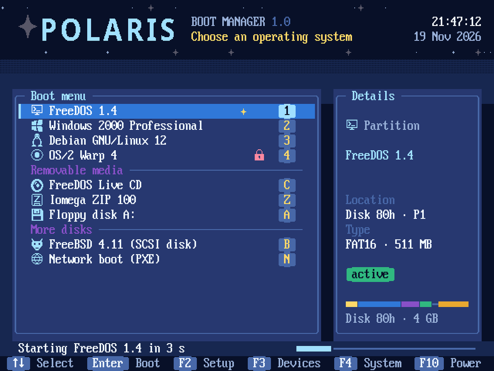
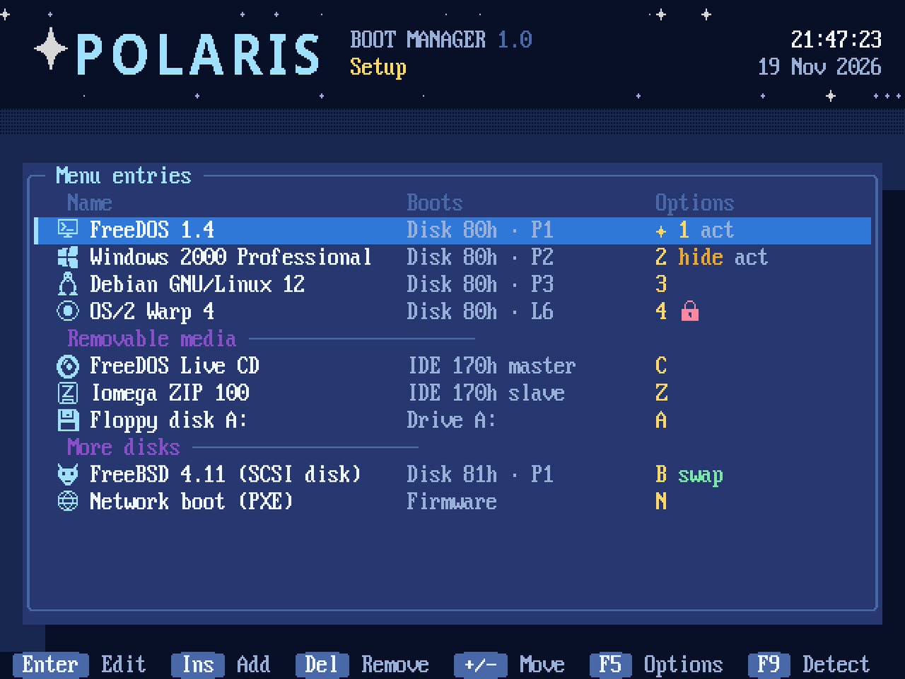
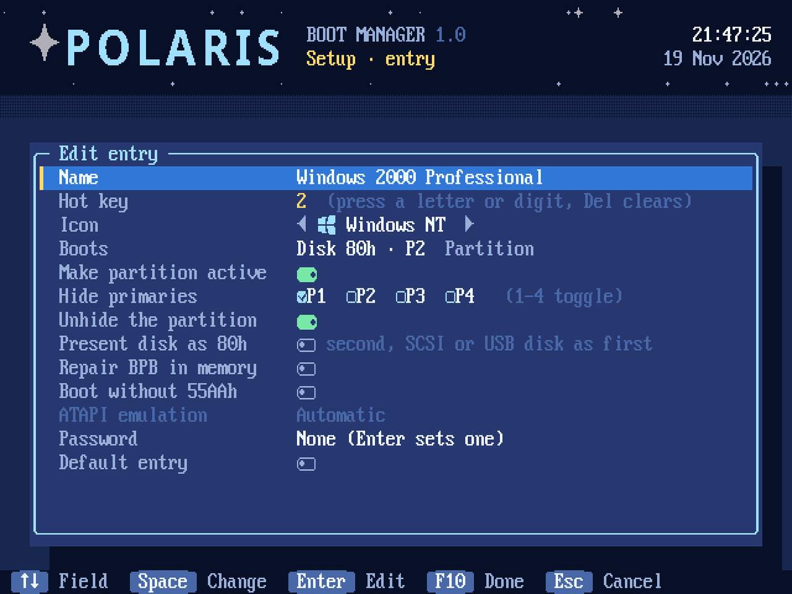
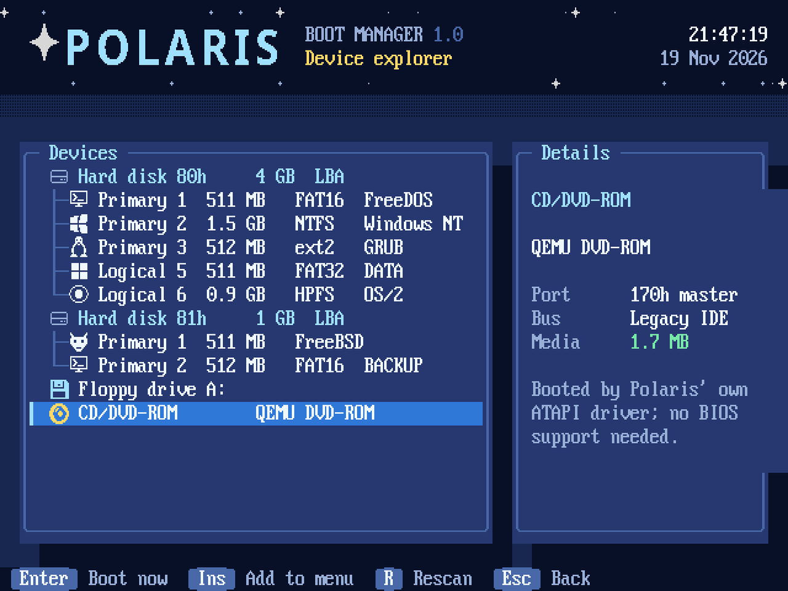
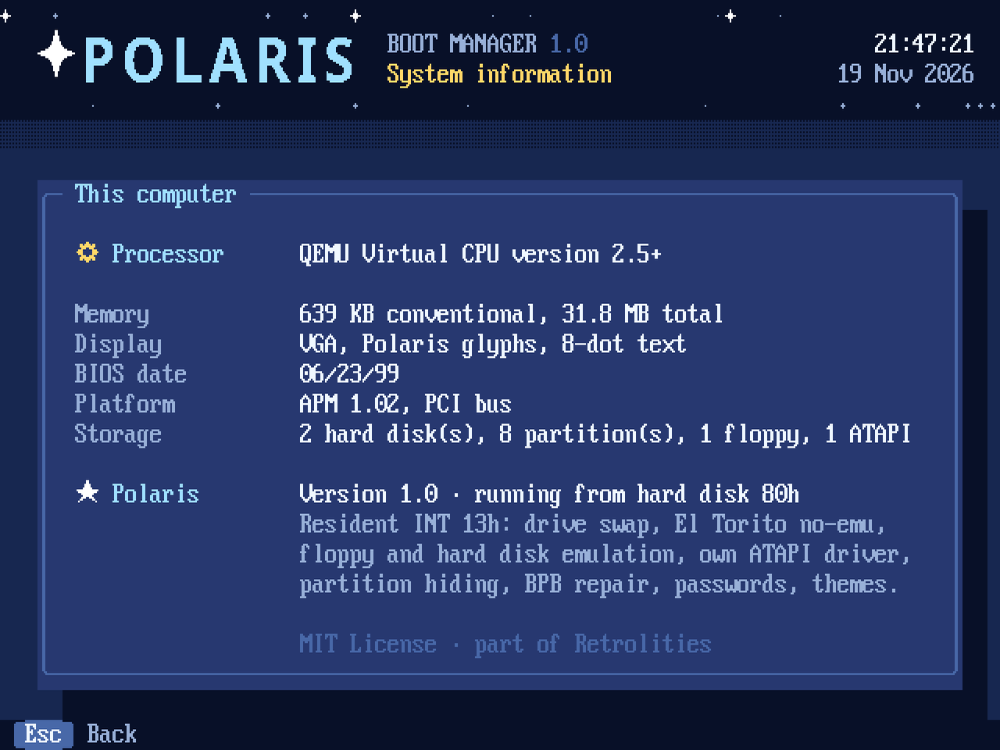
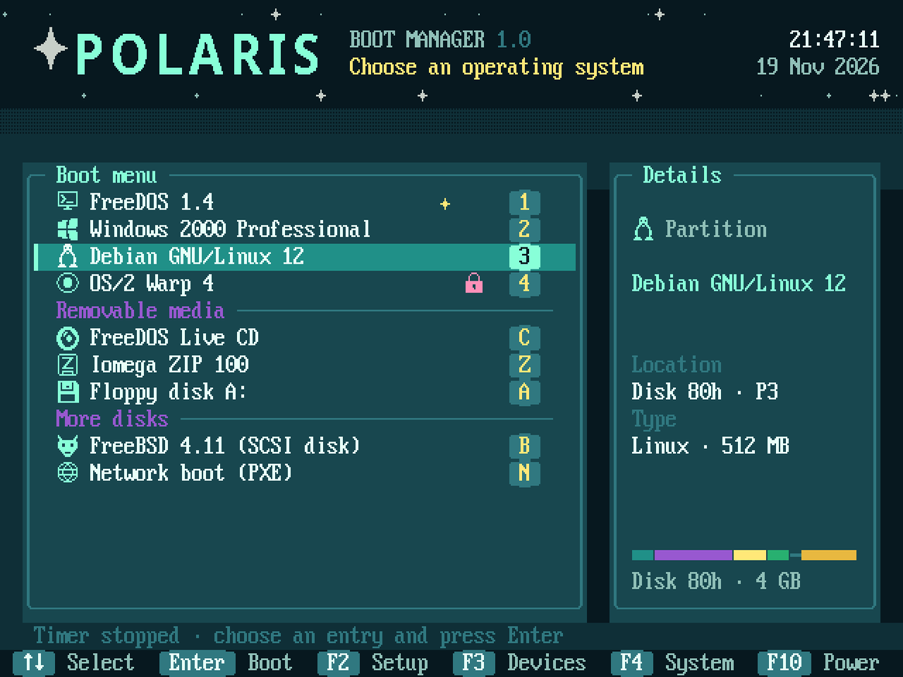
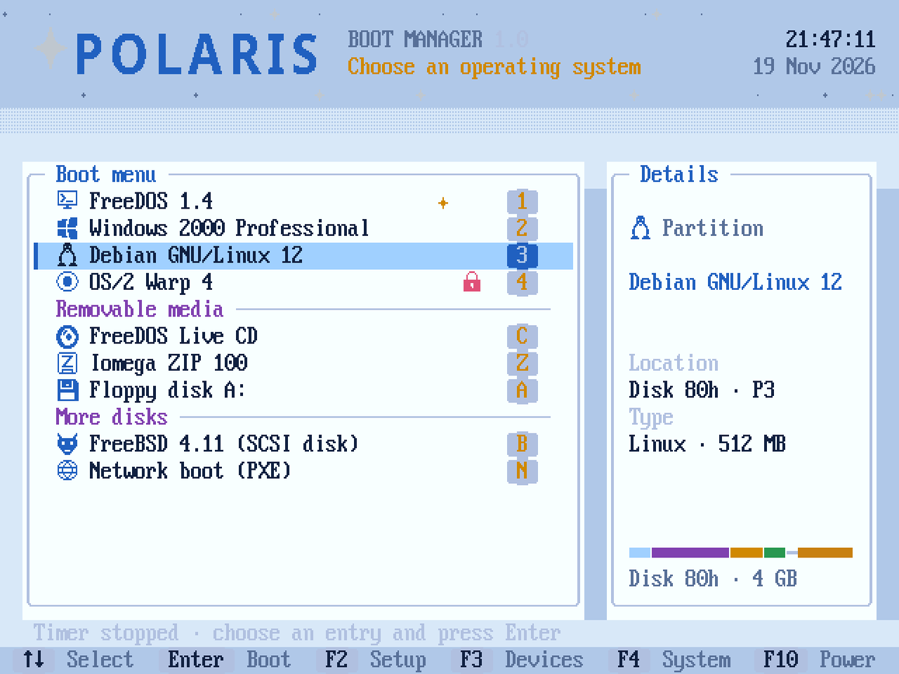
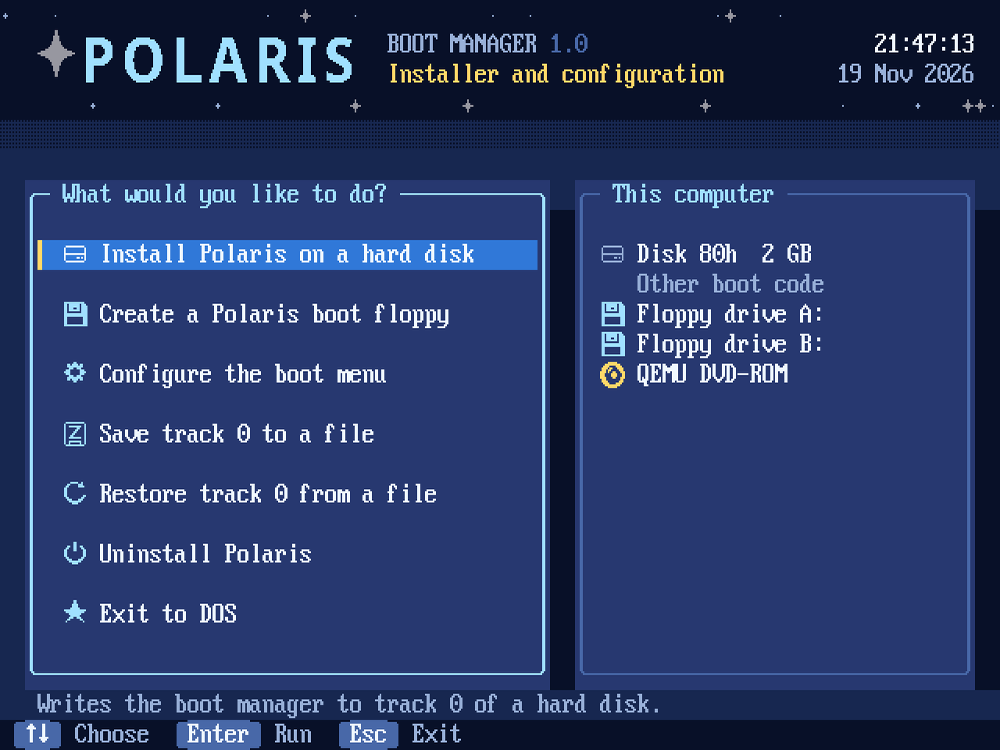
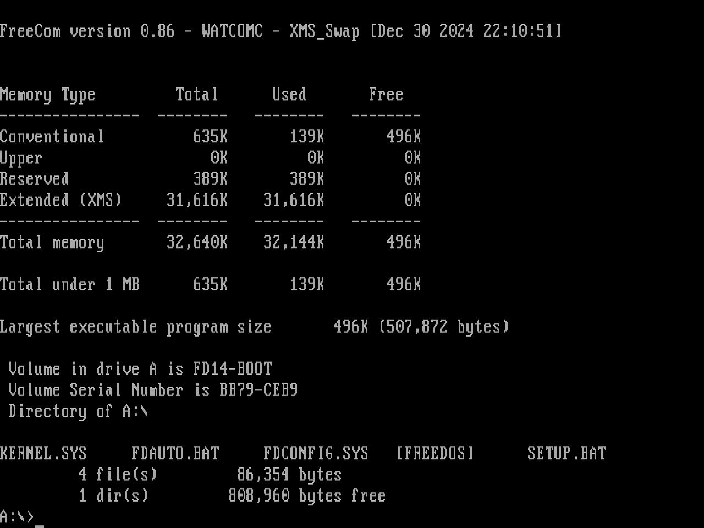

# Polaris boot manager

Polaris is a graphical-text boot manager for PCs with a BIOS (386 or later).
It installs in track 0 of a hard disk, without a partition of its own, or on
a floppy disk that DOS can still use for files. It starts DOS, Windows, OS/2,
Linux and BSD from any primary or logical partition on any BIOS disk. It can
also start CD/DVD-ROM, ZIP, LS-120, MO and PD drives through its own ATAPI
driver, so the BIOS does not need to support booting from these drives.



## Features

**Menu**
- 80x25 text mode with custom VGA glyphs: logo, 16x16 icons, rounded cards,
  toggles, smooth progress bars and an animated night sky with a live clock.
- Five colour themes: Polaris Night, Aurora, Ember, Glacier and Classic VGA.
  Adapters without VGA fall back to plain CP437, and monochrome adapters
  are supported.
- Hot keys, group headings, a default entry with a countdown, quiet boot,
  "default = last booted", and passwords per entry and for Setup.
- A details panel for each entry, with a disk map of the selected partition.
- Flicker-free drawing. Each screen is built in a back buffer, and only
  changed cells are copied to video memory during vertical retrace. Palette
  animation is written in the same retrace window.

**Starting operating systems**
- Primary and logical partitions (EBR chain), LBA through INT 13h
  extensions and CHS on older BIOSes.
- BootIt-style partition control when an entry starts:
  - make the partition active
  - unhide it
  - hide any of the four primaries
- Drive swapping: a second IDE, SCSI or USB disk can start as drive 80h. The
  resident INT 13h module remaps drive numbers, and the BPB's hidden-sector
  and drive fields can be corrected in memory.
- Whole-disk MBR chaining, floppy A:/B:, INT 18h (next BIOS device or PXE),
  restart and APM power-off.

**Drives the BIOS cannot boot from**
- An IDE/ATAPI PIO driver finds controllers on the legacy ports and on PCI
  native-mode IDE controllers.
- El Torito CD/DVD boot:
  - no emulation (2048-byte EDD reads, AH=4Bh status)
  - 1.2, 1.44 and 2.88 MB floppy emulation
  - hard-disk emulation
- ATAPI removable disks (ZIP, LS-120, MO, PD) with 512-byte sectors start
  as floppy drive 00h or as hard disk 80h.
- After boot, a resident 4 KB INT 13h module serves the emulated drive to the
  operating system.

**Setup, inside the boot menu (F2)**
- Entry editor, device explorer (F3), automatic detection (F9), options,
  themes with live preview, and system information (F4).
- The device explorer can start any partition or drive once, without adding
  it to the menu.

## Installing

`POLARIS.EXE` is the DOS installer. Run it without arguments to use the
interactive installer, or use command-line switches:

```text
POLARIS                       interactive installer
POLARIS /INSTALL 80 [/Y]      install on hard disk 80h
POLARIS /FLOPPY A [/Y]        make a Polaris boot floppy in A: or B:
POLARIS /UNINSTALL 80 [/Y]    put the previous boot code back
POLARIS /SAVE 80 FILE         save track 0 (63 sectors) to a file
POLARIS /RESTORE 80 FILE [/Y] write a saved track 0 back
POLARIS /STATUS               list disks, Polaris installations and ATAPI drives
```

When installing on a hard disk, the installer:
- checks that the first partition starts at or after sector 58
- warns if track 0 already holds another boot manager
- keeps the partition table and disk signature
- saves the original MBR for Uninstall
- builds a menu from the operating systems and drives it detects

A Polaris floppy:
- is an ordinary FAT12 disk with 64 reserved sectors
- detects the menu again on every computer it starts

From Linux, or to prepare disk images for emulators:

```sh
python3 src/polaris/tools/plimage.py hdd disk.img [--config menu.json]
python3 src/polaris/tools/plimage.py floppy polaris.img
python3 src/polaris/tools/plimage.py config disk.img
python3 src/polaris/tools/plimage.py uninstall disk.img
```

## On-disk layout

| Sectors | Contents |
|---|---|
| 0 | Stage 1: MBR or floppy boot sector. Keeps the partition table/BPB and holds an info block at 1A0h |
| 1-4 | Configuration (2048 bytes): 20 entries, options and the original MBR |
| 5-62 | Stage 2: a 132-byte unpacker, then the PLZ-packed menu |

At boot, stage 2 is loaded to 1000:0100 and unpacked to 2000:0100.

**Size budget**
- The menu is about 39 KB unpacked and about 26 KB packed, so it fits in a
  classic 63-sector track 0.
- PLZ (`tools/plz.py`) is an LZ77 format with Elias-gamma codes,
  repeat-offset matches and optimal parsing. It packs this code smaller than
  `zlib -9`.

## Building and testing

Build:

```sh
docker compose run --rm build make -C src/polaris dos   # or: make dos
```

The build writes:
- `build/dos/bin/POLARIS.EXE`
- `build/polaris/stage1.bin`
- `build/polaris/stage2.bin`

Stage 2 is built from C (Open Watcom, `-zl`, no C library) and NASM. The
build fails if it does not fit in sectors 5-62.

Tests:

```sh
python3 src/polaris/tests/test_units.py            # codec, layout, install/uninstall
python3 src/polaris/tests/mkdemo.py freedos14.img  # demo machine (needs a FreeDOS 1.4 floppy)
python3 src/polaris/tests/boot_test.py             # 9 real boots in QEMU, checked on screen
python3 src/polaris/tests/installer_test.py freedos14.img
python3 src/polaris/tests/shots.py freedos14.img   # regenerate docs/*.png
```

The demo machine is a 4 GB IDE disk with 63-sector alignment:

| Partition | Contents |
|---|---|
| P1 | FAT16 with a real FreeDOS 1.4 |
| P2 | NTFS-type decoy |
| P3 | ext2 |
| L5 | FAT32 |
| L6 | HPFS-type decoy |

It also has:
- a SCSI disk on an LSI 53C895A controller
- `freedos-cd.iso`: El Torito floppy emulation
- `noemu.iso`: a no-emulation loader that reads the CD only through INT 13h
  AH=42h and AH=4Bh

`tests/run.sh` runs the unit tests. Set `POLARIS_FREEDOS=<floppy image>` to
also run the QEMU boots.

`tools/mkglyphs.py` regenerates `glyphs.h`. `tools/logo.txt` holds the
wordmark bitmap.

## Screens

| | |
|---|---|
|  |  |
|  |  |
|  |  |
|  |  |

## Limitations

- Polaris has been tested in QEMU (SeaBIOS) only.
- The ZIP/LS-120 path follows the ATAPI specification, but no QEMU device
  could exercise it.
- ATAPI drives behind AHCI-mode SATA controllers are not supported. Set the
  controller to IDE/compatible mode.
- USB devices work only when the BIOS exposes them through INT 13h; use the
  drive swap for those.
- There is no partition editor or imaging. Use FDISK or similar tools for
  that.
- Polaris needs a 386 or later CPU and a BIOS.
