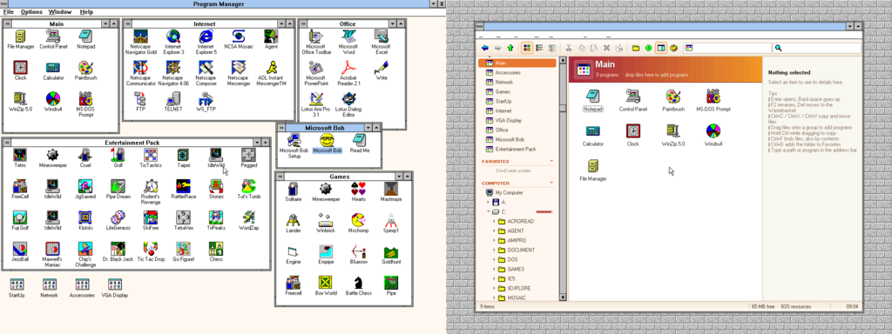
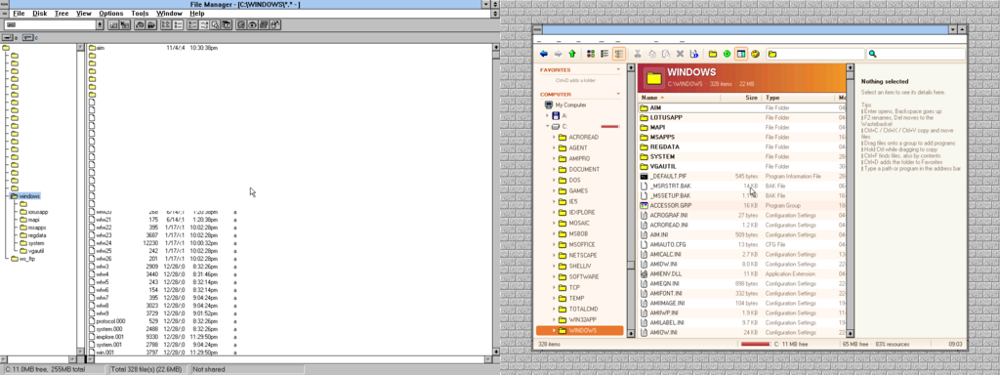

# ShellIV

ShellIV replaces both **Program Manager** and **File Manager** for Windows 3.x
with a single themed window. The Windows 3.x build is a native **32-bit
program**: it runs through the Open Watcom Windows 386 extender, so it needs
386 Enhanced mode but not Win32s. The same source also builds for Windows
95/98/ME and NT/2000.

| Executable | Platform | Notes |
|---|---|---|
| `build/win386/bin/SHELLIV.EXE` | Windows 3.1 / 3.11, 386 Enhanced mode | 32-bit flat code; uses the Win16 API |
| `build/win9x/bin/SHELLIV.EXE` | Windows 95 / 98 / ME | Long file names |
| `build/winnt/bin/SHELLIV.EXE` | Windows NT 4.0 / 2000 | Long file names |

```sh
docker compose run --rm build make PROJECTS=shelliv win386
docker compose run --rm build make PROJECTS=shelliv win9x winnt
```

## The window

```text
+--------------------------------------------------------------------------+
| File Edit View Go Programs Tools Help                                    |
| < > ^ | Icons Tiles Details | Cut Copy Paste Delete Props | ... [address] [find] |
+-------------------+--------------------------------------+---------------+
| PROGRAMS          |  [icon]  Location title              |  Preview      |
|   All Groups      |          path - 29 items - 3.8 MB    |  big icon     |
|   Recent Programs |--------------------------------------|  details      |
|   Main ...        |                                      |  text / hex / |
| FAVORITES         |   icons, tiles or sortable details   |  bitmap /     |
| COMPUTER          |                                      |  icons / pie  |
|   My Computer     |                                      |               |
|   C: [gauge] tree |                                      |               |
|   Wastebasket     |                                      |               |
| RUNNING TASKS     |                                      |               |
+-------------------+--------------------------------------+---------------+
| 3 of 29 selected - 12 KB   | C: [gauge] 120 MB free | 4 MB free - 71% resources | 12:41 |
+--------------------------------------------------------------------------+
```

* **Sidebar** with collapsible sections: program groups and the recently
  started programs; favorite folders; *My Computer* with every drive and a
  lazily expanded folder tree (fixed drives show a usage gauge); the
  Wastebasket; and the running programs (click to switch, right-click to
  close).
* **Item view** with a location banner (title, item count, total size and a
  free space gauge) and three layouts: large icons, tiles (icon, name, type,
  size and date, or a gauge for drives) and details (sortable columns,
  striped rows). Selection works with the mouse (click, Ctrl, Shift and a
  marquee rectangle) and the keyboard (arrows, Home/End, PgUp/PgDn,
  Shift-extension, Ctrl+Space and type-ahead by name).
* **Icons** come from the programs themselves: an `.EXE` shows its own icon,
  a document shows the icon of its associated program on a page, and
  everything else gets builtin artwork for its type.
* **Preview pane** (F3): a double-size icon and the details of the
  selection, plus a look inside: the start of a text file, a hex dump of a
  binary, a thumbnail of a `.BMP`, the icons inside a program, the
  description of a Windows program (read from its NE header) or a 3-D pie
  chart of a drive.
* **Status bar**: selection summary, free space of the current drive, free
  memory and system resources, and a clock.
* **Six themes**: Midnight, Sunrise, Forest, Graphite, Amethyst and Classic
  (Windows 3.1 colours). On 256-colour displays ShellIV realizes its own
  palette with every theme colour and gradient step, so fills stay solid and
  gradients smooth; on 16-colour displays colours map to the nearest pure
  colour.

## Compared with Program Manager and File Manager

Side by side on the same Windows for Workgroups 3.11 installation (QEMU,
256 colours; the originals were started from ShellIV running as the shell;
the missing captions in the originals are a display quirk of the emulator
right after boot):





Every function of the two Windows 3.1 programs, and where ShellIV has it.
"Tested" means covered by the automated tests (Wine, and/or the real
Windows for Workgroups 3.11 run of `tests/win311.sh`).

| Program Manager (3.1) | ShellIV | Tested |
|---|---|---|
| Program groups and items | Groups and items in the sidebar and view | Wine (3.x, 9x, NT builds), WfW 3.11 |
| Reads `.GRP` files / `PROGMAN.INI` | Imports them on first start and on demand | Wine, WfW 3.11 (10 groups, 104 items) |
| Item properties: description, command, working dir, icon | Same dialog, plus Browse and Change Icon | Wine, WfW 3.11 |
| Shortcut keys (Ctrl+Alt+key) | Same; system-wide on 9x/NT; kept on import | Wine, WfW 3.11 |
| Run minimized | Run dialog option | WfW 3.11 |
| File > Run | Run dialog with history; the address bar runs commands too | WfW 3.11 |
| Minimize on use, save settings on exit | Options | — |
| StartUp group | Started when ShellIV is the shell | WfW 3.11 |
| Exit Windows / shell= | Options toggles `shell=`; closing ends the session | WfW 3.11 (ran as the shell) |
| Move/copy items between groups | Drag (Ctrl copies), reorder by dropping | Wine |
| Cascade / tile / arrange group windows | Not applicable: groups open one at a time in the view | — |
| Task List (Ctrl+Esc, part of Windows) | Running Tasks in the sidebar (Ctrl+T): switch, close | Wine, WfW 3.11 |

| File Manager (3.1) | ShellIV | Tested |
|---|---|---|
| Drive bar, directory tree, contents | Drives and lazy folder tree in the sidebar, three view layouts | Wine, WfW 3.11 |
| Copy, move, delete, rename | Same, whole trees, progress and cancel, Yes to All | Wine, WfW 3.11 |
| Drag to copy/move (other drive copies) | Same rule, Ctrl copies | Wine |
| Create directory | New Folder (Ctrl+Shift+N) | Wine |
| Properties and attributes | Attributes for several files at once, folder sizes | WfW 3.11 |
| Search | By name patterns and by contents | Wine, WfW 3.11 |
| Select Files by pattern | Same; focus moves to the first match | Wine, WfW 3.11 |
| Associate | Edits `[Extensions]` in `WIN.INI` | WfW 3.11 |
| Print | Through the associated program | — |
| Sort by name/type/size/date, hidden files | Same, by clicking column headers | Wine |
| Accepts dropped files | Drop onto folders, drives and groups | — |
| Several directory windows at once | One view with Back/Forward history, Favorites | — |
| Label disk | Disk > Label Disk | WfW 3.11 |
| Format disk | Disk > Format Disk (runs DOS FORMAT in a window) | WfW 3.11 |
| Copy disk | Disk > Copy Disk (runs DISKCOPY in a window) | — |
| Connect / disconnect network drives | Disk menu (`WNetAddConnection` / `WNetCancelConnection`) | — |

Things neither program had: a **Wastebasket** with restore, a **preview
pane** (text, hex, bitmaps, program descriptions, drive pie chart), real
**program icons for files** and documents, **Favorites**, a **file
clipboard** (cut/copy/paste), **Recent Programs**, an **address bar**,
**tiles** view, **search by contents**, live **free memory/resources** in
the status bar, and six **themes** with 256-colour palettes.

## Program Manager features

* Program groups with program items (description, command line, working
  directory, icon file and index, shortcut key). Groups and items are created, renamed,
  deleted and edited from menus, context menus and in place (F2).
* *Change Icon* lists the icons of any `.EXE`, `.DLL` or `.ICO` file.
* **Shortcut keys** start program items, as in Program Manager: type
  `Ctrl+Alt+N`, `Ctrl+Shift+F5` or just `N` (Ctrl+Alt is added) in the
  program's properties; keys stored in imported `.GRP` files are kept. On
  Windows 9x/NT they work in every program (`RegisterHotKey`); on
  Windows 3.x while ShellIV is active.
* On first start ShellIV imports the groups listed in `PROGMAN.INI`
  (binary `.GRP` files, including working directories); without them it
  creates *Main*, *Accessories*, *Games* and *Retrolities* groups from the
  programs it finds. *Programs > Import Program Manager Groups* imports
  again at any time.
* Drag programs between groups (Ctrl copies), reorder them by dropping onto
  another item, or drop files from a folder onto a group to add them.
* *Recent Programs* lists the last 16 programs and documents started.
* *Run* (Ctrl+R) keeps a history of 12 command lines; the address bar also
  runs a command when what you typed is not a place.
* **Shell mode**: *Tools > Options > Use as the Windows shell* sets
  `shell=` in `SYSTEM.INI` (the previous shell is remembered and restored).
  As the shell, ShellIV starts the *StartUp* group and closing it ends the
  Windows session; *File > Exit Windows* is always available.

## File Manager features

* Browse every drive; folders open in the view and the tree follows.
  Floppy and CD-ROM drives are only read when you open them, and critical
  error boxes are suppressed (`SetErrorMode`).
* **Copy, move and delete** whole folder trees with a progress dialog that
  can be cancelled, and *Yes / Yes to All / No / Cancel* when replacing
  files. Dropping on another drive copies, on the same drive moves (as in
  File Manager); Ctrl always copies. Moves on one drive are renames, and
  folders that DOS cannot rename across directories are moved file by file.
* **File clipboard**: Cut, Copy and Paste files between folders (Ctrl+X, C,
  V); pasting into a group adds program items.
* **Wastebasket**: Del moves files on hard disks to a hidden
  `\SHELLIV.WST` folder on the same drive (instantly, by renaming). The
  Wastebasket view lists the deleted items with their original location and
  time; *Restore* puts them back (recreating missing folders) and *Empty
  Wastebasket* deletes them for good. Shift+Del, and deletes on floppy or
  network drives, delete permanently after confirmation.
* **Find** (Ctrl+F): several wildcard patterns, an optional text the files
  must contain (case insensitive), optionally in subfolders. Results arrive
  while searching; Esc stops. The search box in the toolbar finds names
  containing the text in the current folder tree.
* **Properties** (Alt+Enter): size of whole folder trees with file and folder
  counts, modification date, and the read-only, hidden, system and archive
  attributes, also for several items at once (three-state check boxes).
* **Select Files** by pattern, Select All, Invert Selection; show or hide
  hidden and system files.
* **Associate** a file type with a program (`[Extensions]` in `WIN.INI`) and
  **Print** documents through their programs, as in File Manager.
* Folders can be added to **Favorites** (Ctrl+D); *MS-DOS Prompt Here*
  opens a prompt in the current folder.
* Files dropped from other programs (File Manager, for example) are copied
  into the folder under the mouse or added to the group.

## Keyboard

| Keys | Action |
|---|---|
| Enter, double-click | Open folder, start program or document |
| Backspace / Alt+Left / Alt+Right | Up, back, forward |
| F2 | Rename |
| Del / Shift+Del | To the Wastebasket / delete permanently |
| Alt+Enter | Properties |
| Ctrl+X, Ctrl+C, Ctrl+V | Cut, copy, paste files |
| Ctrl+A | Select all |
| Ctrl+1, Ctrl+2, Ctrl+3 | Icons, tiles, details |
| Ctrl+L | Type an address: a folder, `My Computer`, `Programs\Accessories`, or a program to run |
| Ctrl+F | Find files |
| Ctrl+D | Add to Favorites |
| Ctrl+R | Run |
| Ctrl+T | Running tasks in the sidebar; Enter switches to one |
| Ctrl+Shift+N | New folder |
| F3 / F5 / F6 | Preview pane / refresh / next pane |
| F1 | List of shortcuts |

## Settings

Everything is kept in `SHELLIV.INI` in the Windows directory: the window
position, sidebar and preview widths, layout, sort order, theme, options,
collapsed sidebar sections, the groups (`[Groups]`, `[GroupN]`), recent
programs, favorites, the Run history and the last location. Each drive's
Wastebasket keeps its own index in `\SHELLIV.WST\INDEX.INF`.

## The 32-bit Windows 3.x build

`mk/platform/win386.mk` compiles with `wcc386 -bt=windows -zW`, links a
`.REX` image with `system win386` and joins it to the `WIN386.EXT`
supervisor and the resources with `wbind`. The result is an ordinary NE
executable that switches to 32-bit flat code when it starts. Memory comes
from one flat heap, so there is no 64 KB limit on folder listings or
buffers.

The extender converts pointers for USER, GDI and KERNEL calls; SHELL.DLL
calls (icons, associations, starting programs, drag and drop) go through
`_Call16` in `shell16.c`. Pointers in `lParam` of messages such as
`WM_DRAWITEM` are 16:16 and are mapped with `MK_FP32`.

## Source

| File | Contents |
|---|---|
| `main.c` | Frame window, toolbar, status bar, layout, menus, commands, drag and drop, settings |
| `sidebar.c` | Navigation sidebar and folder tree |
| `view.c` | Item view: layouts, painting, selection, sorting, renaming |
| `nav.c` | Locations, history, filling the view, search |
| `preview.c` | Preview pane |
| `ops.c` | Copy, move, delete, wastebasket, clipboard, dropping |
| `groups.c` | Program groups, PROGMAN import, recent programs, favorites, launching |
| `dialogs.c` | Dialog boxes |
| `icons.c` | Icon cache, file types |
| `files.c` | File system access (DOS calls on Windows 3.x, Win32 API otherwise) |
| `theme.c` | Themes, fonts, drawing primitives, flicker-free strip buffering |
| `shell16.c` | SHELL.DLL calls for the 386 extender |
| `res/mkart.py` | Generates all icons, glyphs and cursors (`python3 src/shelliv/res/mkart.py`) |

## Tests

`test.sh` (sourced by `tests/run.sh`) runs two scripts against the
Windows 3.x, Windows 9x and NT builds under Wine, driving ShellIV with the
keyboard and mouse and checking the results:

* `tests/ops.sh`: copy, paste, move, delete to and restore from the
  Wastebasket, rename, new folder and search by contents (checked on disk);
* `tests/tour2.sh`: importing a `.GRP` file made by `tests/mkgrp.py`
  through `PROGMAN.INI`, drag and drop of files onto folders and groups,
  closing a running program from the sidebar, a shortcut key imported from
  the group file and one set in the properties dialog.

`tests/win311.sh` runs ShellIV as the shell of a real Windows for
Workgroups 3.11 installation in QEMU (a copy of a disk image you provide)
and checks on the disk afterwards: the first-run import of the Program
Manager groups, the file clipboard, rename, Wastebasket delete and restore,
shortcut keys, Associate, attributes of several files, Run minimized with
switching through Running Tasks, Label Disk, Format Disk (a blank floppy is
attached) and the StartUp group after a reboot:

```sh
docker compose run --rm -v ~/Shared/win311:/img:ro test \
    src/shelliv/tests/win311.sh /img/hda.img
```

`tests/tour.sh` takes screenshots of the main views and themes:

```sh
docker compose run --rm test sh -c 'GUI_DESKTOP=none GUI_SCREEN=1024x768x24 \
    tests/gui.sh build/win386/bin/SHELLIV.EXE src/shelliv/tests/tour.sh'
```
